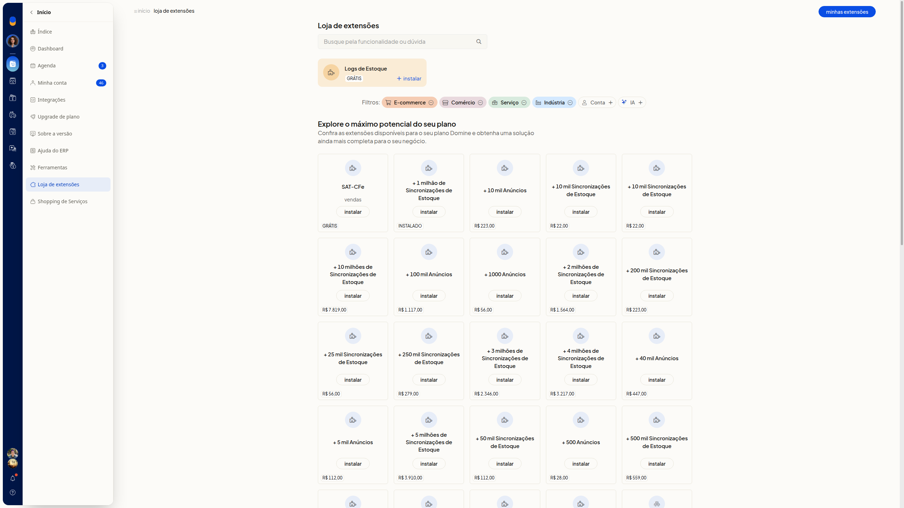
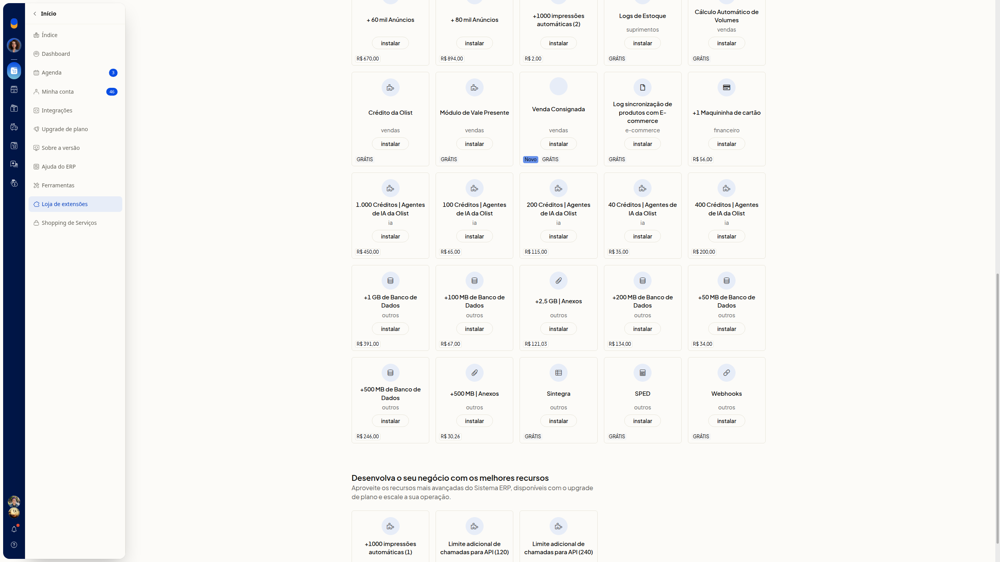
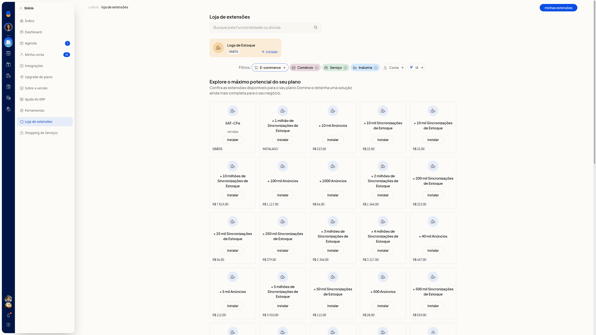
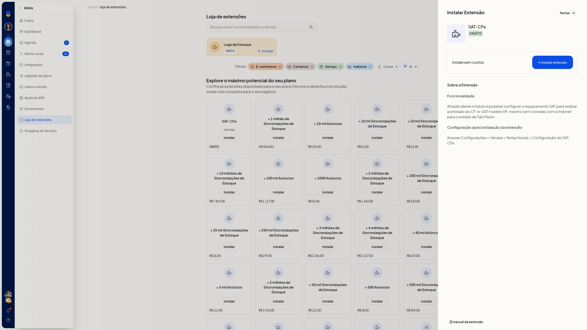
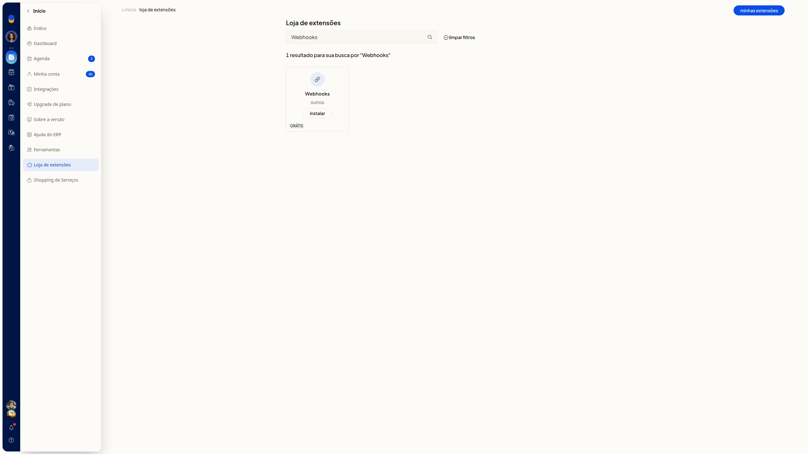
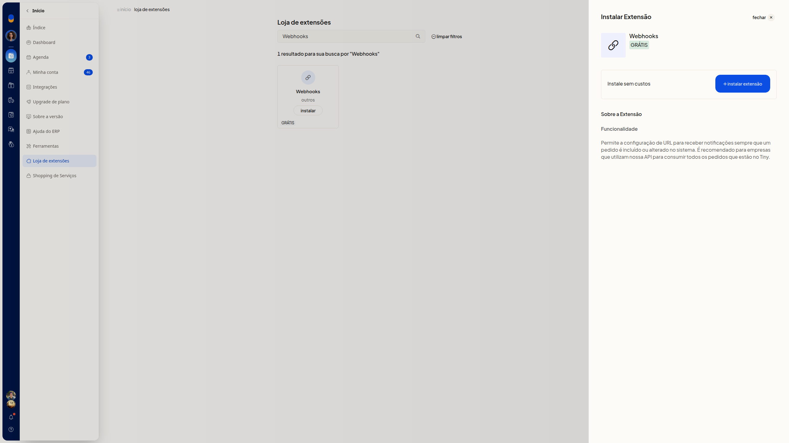
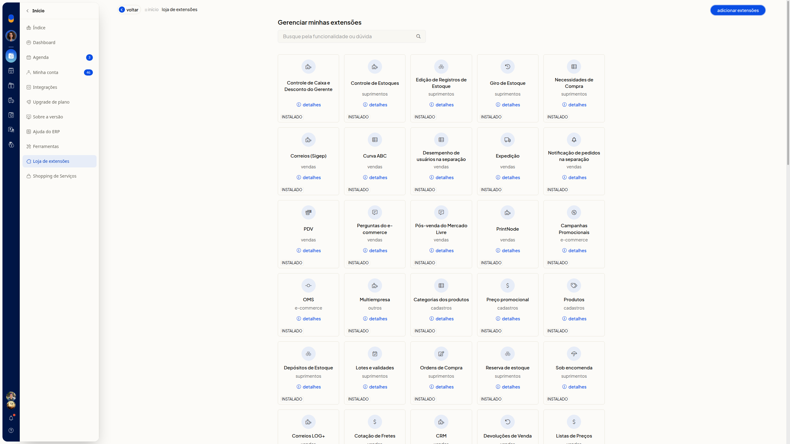
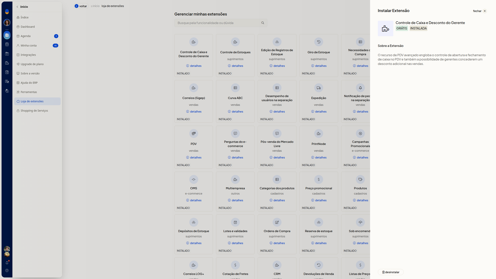

# Loja de extensões: instalar e gerenciar

A Loja de extensões do ERP da Olist reúne as extensões disponíveis para a sua conta. Você consulta o catálogo, instala as extensões gratuitas e acompanha as que já estão instaladas.

Em **Início > Loja de extensões** você busca por funcionalidade, revisa a descrição no painel **Instalar Extensão** antes de confirmar e abre **Minhas extensões** para ver o que já está instalado.

## Importante
- A instalação gratuita só é concluída no botão **instalar extensão**, dentro do painel **Instalar Extensão**.
- O botão **Instalar** do card abre esse painel e não conclui a instalação.
- Para instalar sem custo, escolha uma extensão com o selo **GRÁTIS**.
- O botão **Desinstalar** remove a extensão instalada. Não use esse botão se quiser apenas consultar o detalhe.

## Instruções
### Instalar uma extensão gratuita

1. Acesse **Início > Loja de extensões**.
2. Localize uma extensão com o selo **GRÁTIS**.

   

   

3. Clique em um filtro ao lado de **Filtros** se quiser restringir a lista: **E-commerce**, **Comércio**, **Serviço**, **Indústria**, **Conta** ou **IA**.

   

4. Clique em **Instalar** no card. No card em destaque de **Logs de Estoque**, o botão aparece como **+ instalar**.
5. Confira no painel **Instalar Extensão** o nome, o selo **GRÁTIS**, o texto **Instale sem custos** e a seção **Sobre a Extensão**.

   

6. Clique em **instalar extensão** para concluir a instalação.

### Buscar uma extensão

1. Em **Loja de extensões**, digite o termo no campo **Busque pela funcionalidade ou dúvida**. O preenchimento não é obrigatório. Por exemplo, Webhooks.
2. Confira a quantidade de resultados e o link **limpar filtros**.

   

3. Clique em **Instalar** no card encontrado.
4. Confira o painel **Instalar Extensão**, com o selo **GRÁTIS** e o texto **Instale sem custos**. Em **Webhooks**, a seção **Funcionalidade** descreve a configuração de URL para receber notificações quando um pedido é incluído ou alterado. O texto recomenda o uso por empresas que utilizam a API para consumir os pedidos.

   

5. Clique em **instalar extensão** para concluir a instalação.

### Gerenciar extensões instaladas

1. Em **Loja de extensões**, clique em **Minhas extensões**.
2. Localize o card com o estado **Instalado**. A tela **Gerenciar minhas extensões** também mostra a busca e o botão **adicionar extensões**.

   

3. Clique em **detalhes** no card desejado.
4. Confira o nome, os selos **GRÁTIS** e **INSTALADA** e a seção **Sobre a Extensão**.

   

5. Clique em **Desinstalar** somente se quiser remover a extensão. Esse botão remove a extensão instalada.

## Resultado
Em **Gerenciar minhas extensões**, as extensões já instaladas aparecem com o estado **Instalado** e o link **detalhes**. No detalhe, **Desinstalar** fica disponível.

## Informações adicionais
### O catálogo também lista adicionais pagos

O catálogo também lista adicionais pagos, com preço e o botão **Instalar**, como pacotes de anúncios, sincronizações de estoque, impressões automáticas, maquininha e créditos de IA.

### Extensão já instalada no catálogo

Uma extensão já instalada pode aparecer no catálogo com o estado **Instalado**, e não como uma instalação nova. O card **+ 1 milhão de Sincronizações de Estoque** fica assim.
