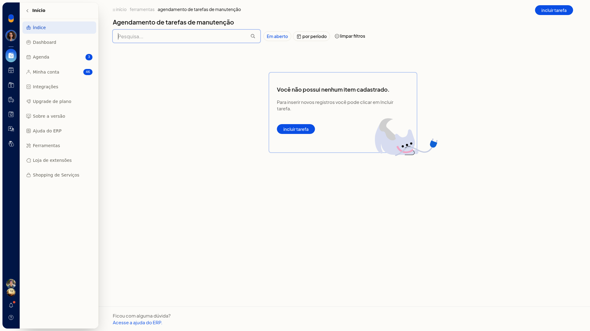

# Agendamento de tarefas de manutenção

## Importante
- Ao informar **Quando**, a tela exibe um aviso de execução noturna.

## Instruções
1. Acesse **Início > Ferramentas > Agendamento de tarefas de manutenção**.
2. Clique em **Incluir tarefa**.
3. Em **Tipo**, escolha a tarefa, como **Importação de estoque do correios LOG+**. O campo não é obrigatório.

   

4. Informe **Quando**. O campo não é obrigatório.
5. Clique em **Salvar** para agendar a tarefa. Para descartar, clique em **Cancelar**. Para retornar à lista, clique em **Voltar**.
