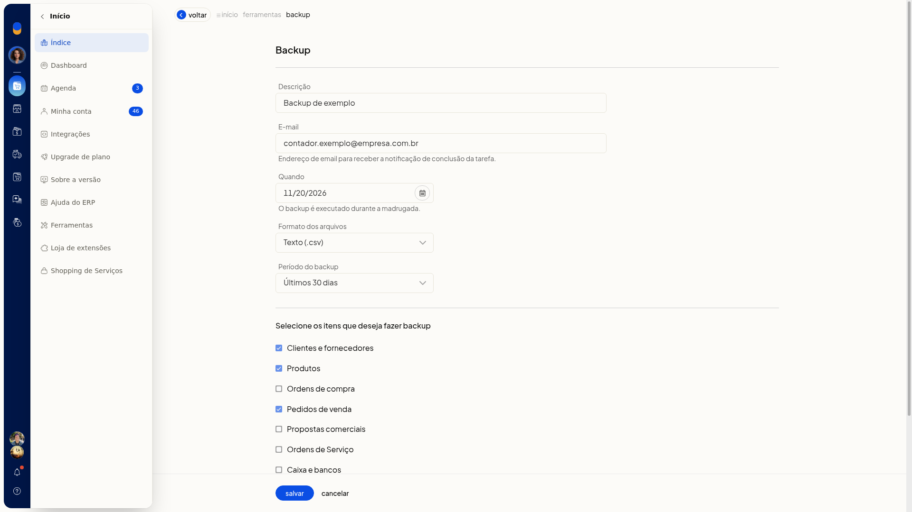

# Backup dos dados

## Instruções
1. Acesse **Início > Ferramentas > Backup**.
2. Use os filtros **Em aberto** e por período, ou **limpar filtros**.
3. Clique em **Incluir Backup**.
4. Informe o **E-mail**, a **Descrição** e a data em **Quando**. Esses campos não são obrigatórios. O **E-mail** recebe o aviso de conclusão da tarefa.
5. Escolha **Texto (.csv)** ou **Excel (.xls)** em **Formato** e o **Período** abaixo. **Formato** e **Período** não são obrigatórios.
 - **Últimos 30 dias**
 - **3 meses**
 - **6 meses**
 - **1 ano**

   

6. Marque o que incluir, por exemplo **Clientes e fornecedores**, **Produtos** e **Pedidos de venda**. Também há **Ordens de compra** e **Propostas comerciais**.
7. Clique em **Salvar** para agendar o backup. Para descartar, clique em **Cancelar**.
