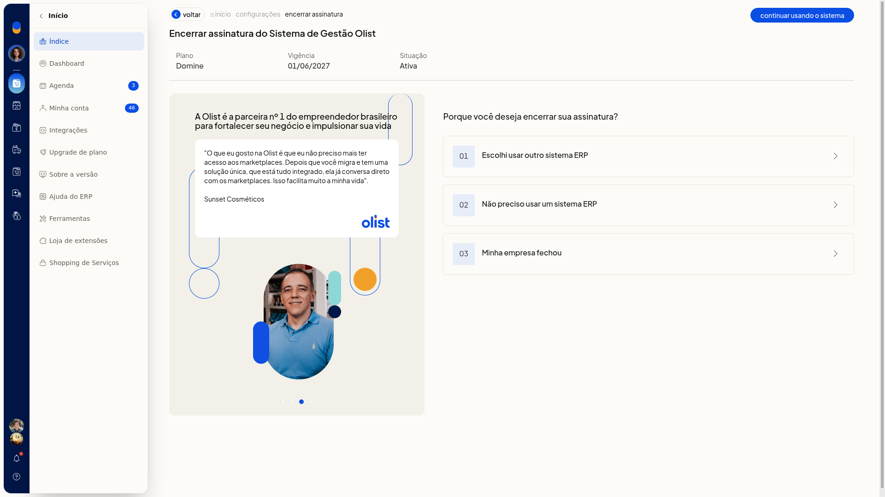
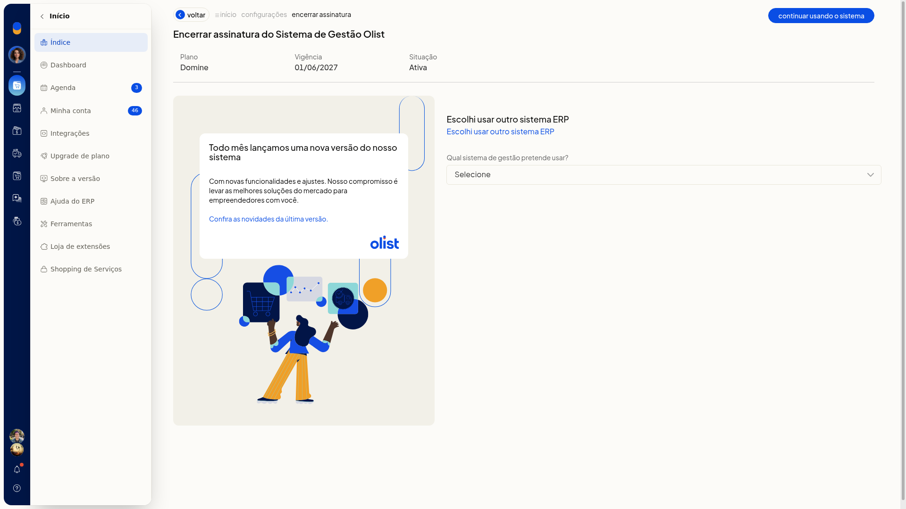
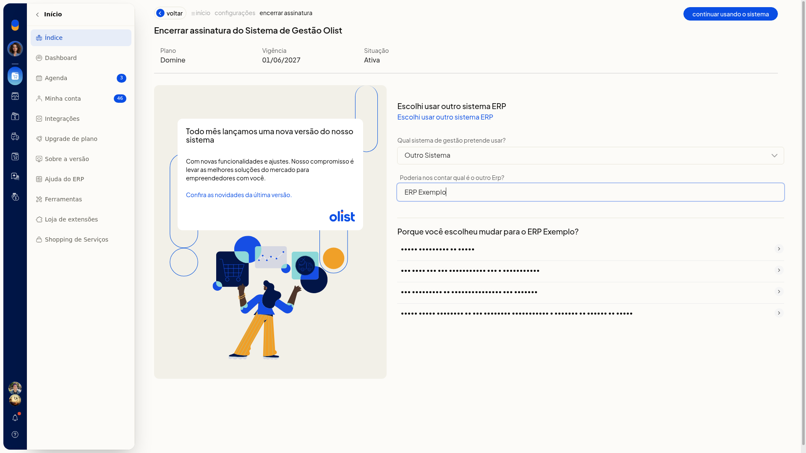
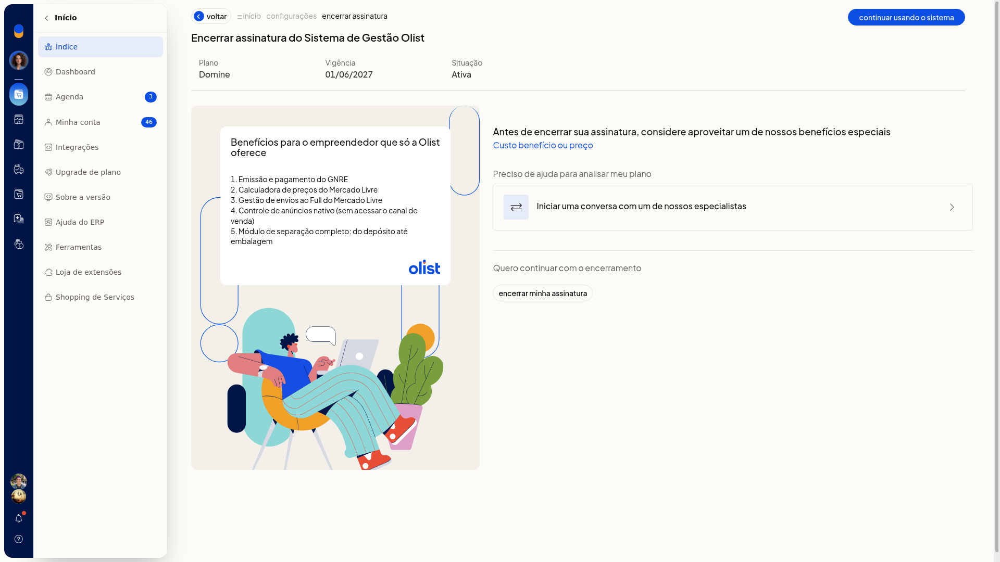
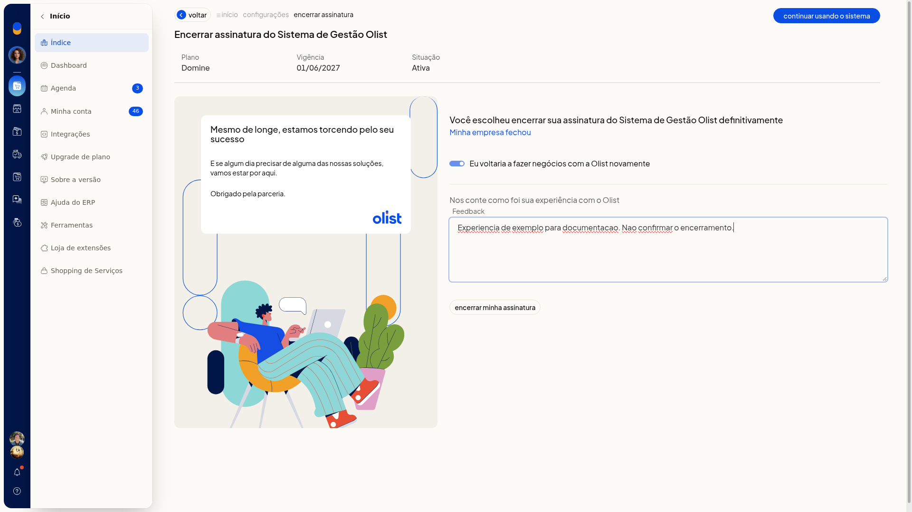

# Cancelar a conta do ERP

Para cancelar a conta, você encerra a assinatura do ERP da Olist em **Configurações**. Informe o motivo e confirme o encerramento, ou desista e continue usando o sistema.

## Importante
- A tela descreve o encerramento da assinatura como definitivo.
- Antes de confirmar, você pode desistir em **continuar usando o sistema** ou em **Voltar**.

## Instruções
1. Acesse **Configurações > Configurações ERP > Geral > Encerrar assinatura**.
2. Confira **Plano**, **Vigência** e **Situação**.

   

3. Escolha um motivo:
 - **01 Escolhi usar outro sistema ERP**
 - **02 Não preciso usar um sistema ERP**
 - **03 Minha empresa fechou**

### Motivo de usar outro sistema

1. Escolha uma opção em **Qual sistema de gestão pretende usar?**. O campo não é obrigatório.
 - **Bling**
 - **Conta Azul**
 - **Vhsys**
 - **Anymarket**
 - **UpSeller**
 - **Plugg.to**
 - **Omie**
 - **Outro Sistema**

   

2. Preencha **Poderia nos contar qual é o outro Erp?** ao selecionar **Outro Sistema** e confira os detalhes do motivo. O campo não é obrigatório.

   

3. Escolha o detalhe **Custo benefício ou preço**. A tela oferece conversa com especialista e uma lista de benefícios.

   

4. Clique em **Encerrar minha assinatura** para concluir o encerramento.

### Motivo de não precisar do sistema ou de empresa fechada

1. Escolha **02 Não preciso usar um sistema ERP** ou **03 Minha empresa fechou**. A tela informa que o encerramento é definitivo e mostra uma mensagem de parceria.
2. Ajuste **Eu voltaria a fazer negócios com a Olist novamente**, se quiser. Não é obrigatório.
3. Preencha **Feedback**, se quiser. Não é obrigatório.

   

   

4. Clique em **Encerrar minha assinatura** para concluir o encerramento.

## Informações adicionais
### Voltar retorna à lista de configurações

**Voltar**, depois que você escolhe o motivo, leva à lista de **Configurações**, e não à lista de motivos. Abra **Encerrar assinatura** de novo para ver os motivos.
