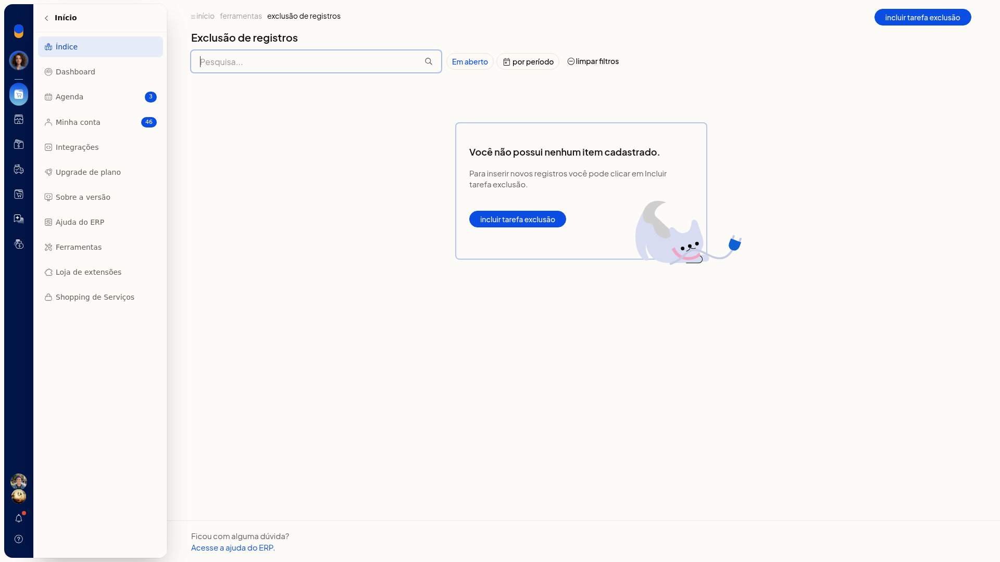

# Exclusão de registros

Em **Início > Ferramentas > Exclusão de registros**, você agenda a exclusão definitiva de registros antigos no ERP da Olist. Você escolhe o conjunto e a data limite. O email informado recebe o aviso de conclusão da tarefa.

## Importante
- A exclusão é definitiva.
- Faça um backup antes. A tela avisa isso e mostra um link para fazer backup.

## Instruções
1. Acesse **Início > Ferramentas > Exclusão de registros**.
2. Na lista, use **Pesquisa**, **Em aberto**, por período ou **limpar filtros** quando precisar localizar uma tarefa.
3. Clique em **Incluir tarefa de exclusão**.
4. Preencha **Descrição**, **E-mail** e **Quando**. Esses campos não são obrigatórios. Em **E-mail**, informe o endereço que recebe o aviso de conclusão da tarefa.
5. Escolha o conjunto de registros:
 - **Notas fiscais**, com a opção **NF-e de terceiros**
 - **Recebimentos e Contas a Receber vinculadas ao recebimento**
 - **Todos os registros de contas a receber**
 - **Pagamentos e Contas a Pagar vinculadas ao pagamento**
 - **Todos os registros de contas a pagar**
 - **Pedidos de vendas**
 - **Reservas de estoque**
6. Informe **Excluir registros anteriores à data**. Esse campo não é obrigatório. Leia o aviso de exclusão definitiva e o link para fazer backup.

   

7. Clique em **Salvar** para agendar a exclusão. Para descartar, clique em **Cancelar**.
