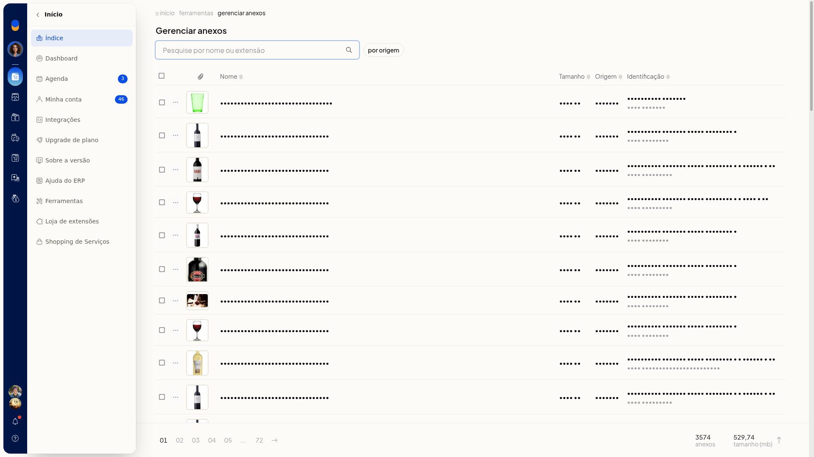

# Gerenciar anexos

No ERP da Olist, **Gerenciar Anexos** localiza anexos pelo nome ou pela extensão e filtra por origem. Você confere a quantidade de anexos e o total em MB e, em cada linha, pode usar **Visualizar produto** ou **Excluir anexo**.

## Instruções
1. Acesse **Início > Ferramentas > Gerenciar Anexos**.
2. Pesquise pelo nome ou pela extensão do arquivo, ou abra o filtro por origem e escolha uma origem:
 - **Sem filtro**
 - **Clientes e Fornecedores**
 - **Conta a pagar**
 - **Conta a receber**
 - **Contrato**
 - **Lançamento de caixa**
 - **Ordem de Servico**
 - **Pedidos de Venda**
 - **Produto**
 - **Proposta comercial**

 Para fechar o filtro sem aplicar, clique em **Cancelar**.

   

3. Na lista, confira **Nome**, **Tamanho**, **Origem** e **Identificação**. No rodapé, confira a quantidade de anexos e o total em MB.
4. Abra o menu da linha e clique em **Visualizar produto** ou em **Excluir anexo**.

## Resultado
A lista mostra os anexos localizados, com nome, tamanho, origem, identificação, o total em MB e as ações **Visualizar produto** e **Excluir anexo** em cada linha.
