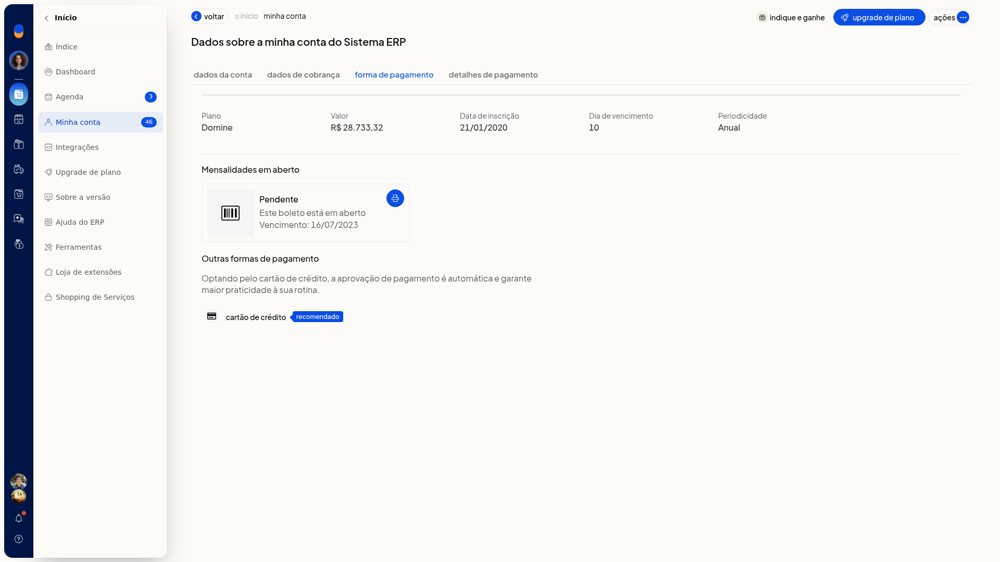
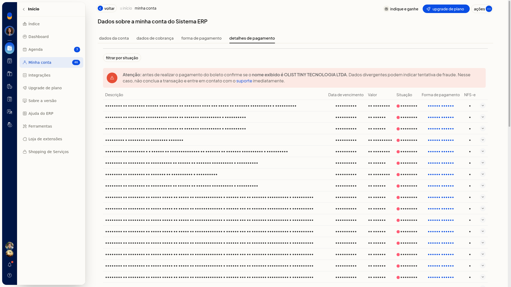

# Mensalidade: forma de pagamento, boleto e nota fiscal

Na aba **Forma de pagamento**, em **Início > Minha conta**, você consulta como a mensalidade do ERP da Olist é cobrada. A tela mostra o plano, o valor, a data de inscrição, o dia de vencimento, a periodicidade e a forma de pagamento atual.

Você também vê a opção de outra forma de pagamento, filtra as cobranças, baixa o boleto quando o botão existe e confere a nota fiscal de serviço na coluna **NFS-e**.

## Pré-requisitos
- No plano Conta Digital da Olist, as abas de pagamento não ficam disponíveis.
- Se a aba **Forma de pagamento** não aparecer, peça acesso ao administrador da conta.

## Importante
- Para trocar para **Cartão de Crédito**, a opção só aparece quando a forma de pagamento atual não é cartão de crédito.
- Para trocar para **Boleto**, a opção só aparece quando a forma atual não é boleto.
- No plano Mastercard, a opção **Boleto** não aparece para troca da forma de pagamento.
- A opção **PayPal** só aparece quando a forma de pagamento atual já é PayPal.

## Instruções
1. Acesse **Início > Minha conta**.
2. Abra a aba **Forma de pagamento**.
3. Confira o plano, o valor, a data de inscrição, o dia de vencimento, a periodicidade e a forma de pagamento atual.

   

4. Use a outra opção exibida na tela para trocar a forma de pagamento.
5. Abra **Detalhes de pagamento**.
6. Filtre por **situação**, como **pagas** ou **pendentes**. Para remover o filtro, clique em **Limpar filtros**.

   

7. Clique em **baixar boleto** ou **imprimir** na cobrança, quando o botão existir, e confira a coluna **NFS-e**.

## Resultado
Você entende como a mensalidade é cobrada, localiza o boleto quando o botão está disponível e vê se há NFS-e na cobrança.

## Informações adicionais
### A tela de upgrade também mostra a forma de pagamento

Em **Início > Upgrade de plano**, você confere o plano atual, o valor, a periodicidade, a forma de pagamento e a opção **Alterar pagamento**.
