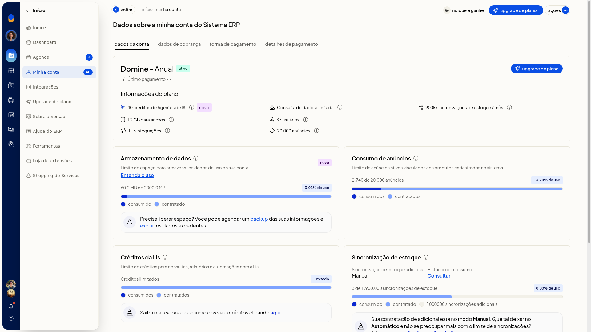

# Minha conta: plano, limites e armazenamento

## Instruções
1. Acesse **Início > Minha conta**.
2. Confira o plano contratado e a situação da conta.

   

3. Leia os limites exibidos: **usuários**, **armazenamento/anexos**, **integrações**, **anúncios** e **sincronizações**.
4. Confira o consumo em relação ao limite, inclusive armazenamento e anúncios.
5. Se precisar de mais recursos, use as ofertas de expansão da própria tela (upgrade para **Protagonize**, **mais anúncios** ou **mais emissões**) ou acesse **Início > Upgrade de plano**. Você vê o plano contratado, os limites, o consumo já utilizado e os atalhos para ampliar o plano.
