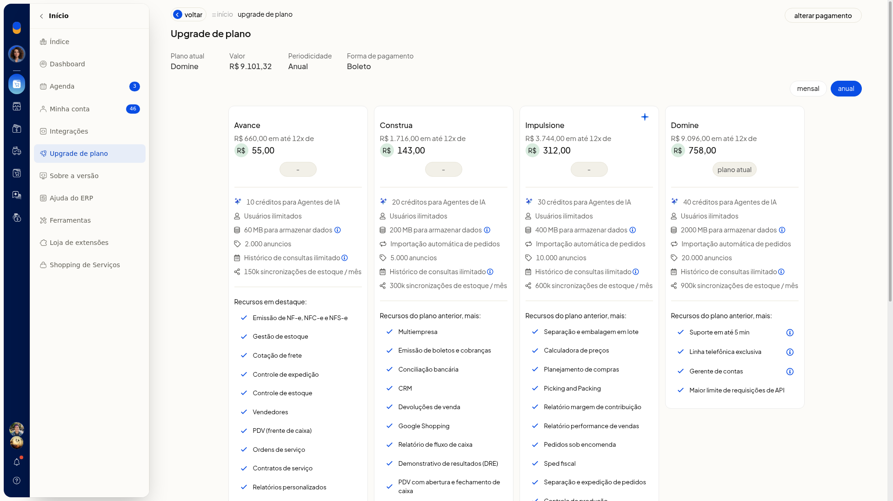

# Upgrade de plano e calculadora de planos

## Instruções
1. Acesse **Início > Upgrade de plano** ou use o atalho de expansão em **Minha conta**.
2. Confira o plano atual, o valor, a periodicidade e a forma de pagamento. Para alterar o pagamento, clique em **Alterar pagamento**.
3. Compare a visão anual e a visão mensal.

Na visão anual, confira o valor em 12 vezes e o total:

- **Avance**: 12x R$ 55, total R$ 660
- **Construa**: 12x R$ 143, total R$ 1.716
- **Impulsione**: 12x R$ 312, total R$ 3.744
- **Domine**: 12x R$ 758, total R$ 9.096

Na visão mensal, confira o valor de cada plano:

- **Avance**: R$ 66
- **Construa**: R$ 177
- **Impulsione**: R$ 389
- **Domine**: R$ 949

O plano atual aparece identificado na tela.

4. Clique, na parte inferior da tela, em **Compare os planos**, **Ainda tem dúvidas?**, **Plano Protagonize** ou **agendar com especialista**. A comparação fica disponível antes de qualquer contratação.

## Resultado
Você identifica o plano atual e os preços nas visões anual e mensal, antes de contratar outro plano.

## Informações adicionais
### As ofertas de expansão ficam em Minha conta

Em **Minha conta**, as ofertas de expansão incluem upgrade para **Protagonize**, mais anúncios e mais emissões.
