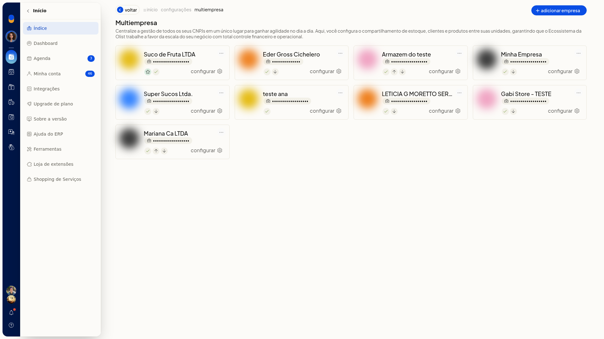
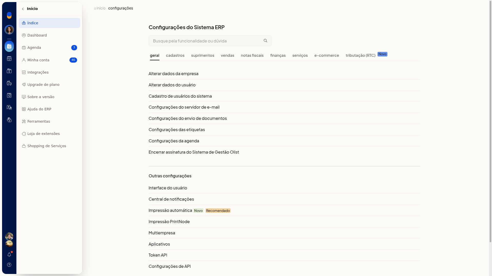
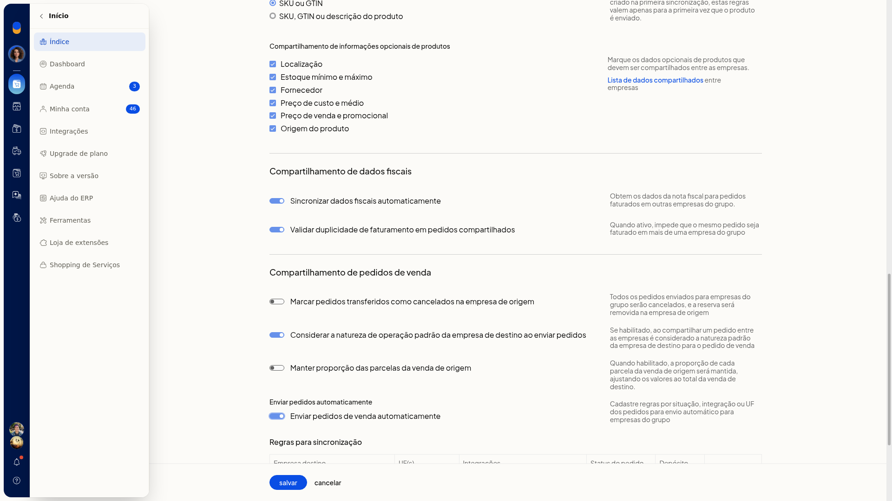
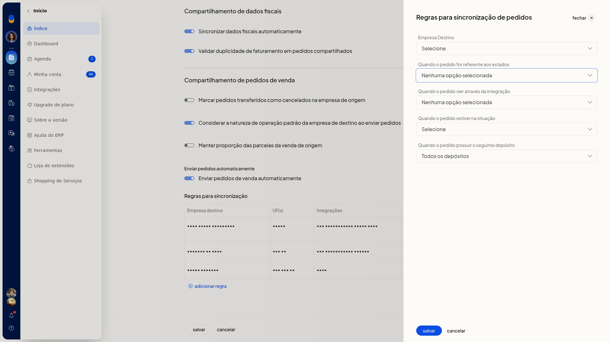
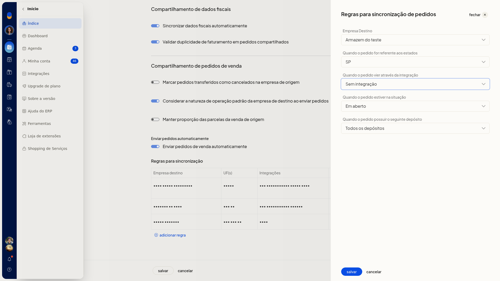

# Criar regras de envio automático de pedidos no Multiempresa

No ERP da Olist, o envio automático de pedidos define para qual empresa do grupo um pedido de venda segue, conforme destino, estado, integração, situação e depósito. Você cria essas regras no card da empresa, em **configurar**.

## Pré-requisitos
- A empresa destino já precisa estar vinculada e marcada para receber dados.
- Se **Multiempresa** não aparecer para você, peça acesso ao administrador da conta.

## Importante
- Com **Enviar pedidos de venda automaticamente** ligado, só é possível salvar se houver ao menos uma regra de sincronização.
- O local logístico externo só pode ser informado em regra com uma única integração Shopify.

## Instruções
Você também pode abrir a lista pelo avatar da empresa, em **Minha conta > Gerenciar Multiempresa**.

1. Acesse **Configurações > Configurações ERP**.
2. Com **Geral** ativo, em **Outras configurações**, clique em **Multiempresa**.

   

3. Na lista, clique em **configurar** no card da empresa.

   

4. Ative **Enviar pedidos de venda automaticamente**.

   

5. Na seção **Regras para sincronização**, clique em **Adicionar regra**.

   

6. Preencha a regra. Nenhum destes campos é obrigatório.
 - **Empresa Destino**: selecione uma empresa já marcada para receber dados.
 - **Quando o pedido for referente aos estados**: escolha as UFs, de AC a TO, ou **Selecionar todas**.
 - **Quando o pedido vier através da integração**: escolha **Sem integração** ou um canal já conectado à empresa.
 - **Quando o pedido estiver na situação**: escolha **Selecione**, **Em aberto**, **Faturado**, **Cancelado**, **Aprovado**, **Preparando envio**, **Enviado**, **Entregue**, **Pronto para envio**, **Dados incompletos**, **Não entregue** ou **Em devolução**.
 - **Quando o pedido possuir o seguinte depósito**: escolha **Todos os depósitos** ou um depósito já cadastrado.

   

7. Clique em **salvar** para gravar a regra. **cancelar** fecha o painel sem gravar.

## Informações adicionais
Na lista de regras, use **editar**, **Clonar regra** ou **Remover regra**.
