# Multiempresa: configurar várias empresas (CNPJs)

A Multiempresa do ERP da Olist reúne os CNPJs vinculados. Você conecta outras empresas, define o que cada unidade compartilha e passa a operar em outra empresa do grupo pelo seletor em **Minha conta**.

O compartilhamento pode incluir estoque, clientes, produtos, pedidos e dados fiscais. A lista **Multiempresa** explica a centralização dos CNPJs e mostra um card por empresa vinculada.

## Pré-requisitos
- Para conectar outra empresa, tenha o email ou login e a senha da conta dessa empresa.
- Se **Multiempresa** não aparecer, peça acesso ao administrador da conta.

## Importante
- O painel **De quais unidades esta empresa recebe?** apenas lista quem envia. A mudança é feita na configuração de envio da empresa de origem.
- A opção de como os produtos são ligados só aparece para empresas liberadas nessa funcionalidade. Ela deixa de aparecer se a empresa já usa o vínculo permanente.
- Ao ativar o vínculo permanente, a configuração é replicada às empresas conectadas e não pode ser desfeita.
- Para salvar com **Enviar pedidos de venda automaticamente** ligado, é preciso ter ao menos uma regra de sincronização.
- O local logístico externo só pode ser informado em regra com uma única integração Shopify.
- No card da empresa principal, o menu de ações mostra **empresa principal**. **remover empresa** aparece no menu de um card que não é a principal.

## Instruções
### Abrir a lista pelo menu

1. No menu lateral, clique em **Configurações**.
2. Clique em **Configurações ERP**.
3. Na tela **Configurações do Sistema ERP**, com **Geral** ativo, clique em **Multiempresa**, em **Outras configurações**.

   

A lista abre com **Voltar**, **Adicionar empresa** e um card por empresa vinculada.

### Abrir a lista por Minha conta

1. Clique no avatar da empresa no menu lateral para abrir **Minha conta**.
2. Clique em **Gerenciar Multiempresa**.

   

### Conectar outra empresa

1. Na lista **Multiempresa**, clique em **Adicionar empresa**.

   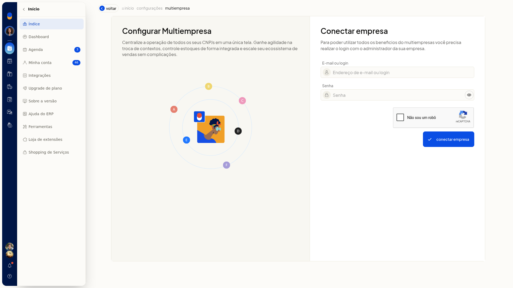

2. Preencha **E-mail ou login** e **Senha** da conta a conectar. **Mostrar senha** revela o que foi digitado.

   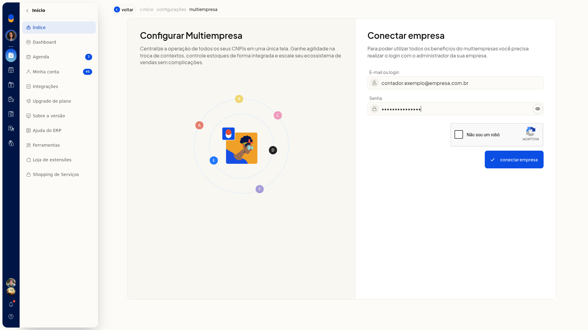

3. Conclua a verificação exibida no formulário.
4. Clique em **conectar empresa** para concluir o vínculo.

### Configurar o compartilhamento

1. Na lista, clique em **configurar** no card da empresa.

   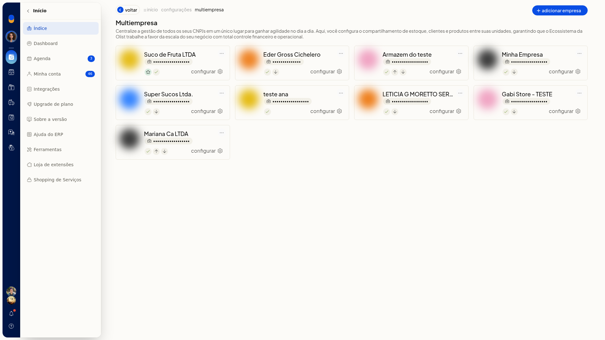

2. Marque as unidades em **Enviar dados para**. Há uma caixa por unidade já vinculada.
3. Ajuste estoque, catálogo, regra de vínculo de produtos e as opções fiscais e de pedidos. A tela mostra o que já estava salvo.

   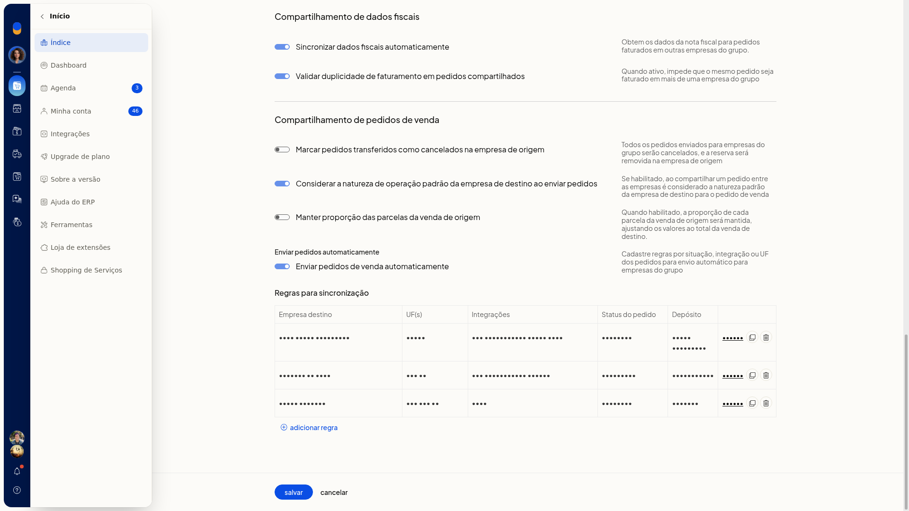

#### Estoque

- Marque **Considerar estoque desta empresa** se o estoque desta unidade entra no compartilhamento.
- Em **Estoque considerado na API**, escolha **De todas as empresas do grupo** ou **Apenas desta empresa**.
- Em **Saldo do kit**, escolha **Saldo final do kit** ou **Saldo dos itens do kit**. O saldo dos itens confere o estoque dos componentes entre as empresas e calcula o kit pelo saldo unificado.

#### Catálogo

Marque o que esta empresa deve compartilhar: **Dados do cliente**, **Dados do produto**, **Dados de contatos** e **Dados de produtos**.

#### Vínculo e campos do produto

Em **Regra de vínculo de produtos**, escolha **SKU (recomendado)**, **SKU ou GTIN** ou **SKU, GTIN ou descrição do produto**.

Os campos opcionais de produto no compartilhamento são **Localização**, **Estoque mínimo e máximo**, **Fornecedor**, **Preço de custo e médio**, **Preço de venda e promocional** e **Origem do produto**.

#### Fiscal e pedidos

Ajuste estas opções:

- **Sincronizar dados fiscais automaticamente**
- **Validar duplicidade de faturamento em pedidos compartilhados**
- **Marcar pedidos transferidos como cancelados na empresa de origem**
- **Considerar a natureza de operação padrão da empresa de destino ao enviar pedidos**
- **Manter proporção das parcelas da venda de origem**
- **Enviar pedidos de venda automaticamente**

4. Clique em **salvar** para gravar. **cancelar** volta à lista sem gravar.

### Criar regra de sincronização de pedidos

1. Em **configurar**, marque **Enviar pedidos de venda automaticamente**. A seção **Regras para sincronização** aparece.

   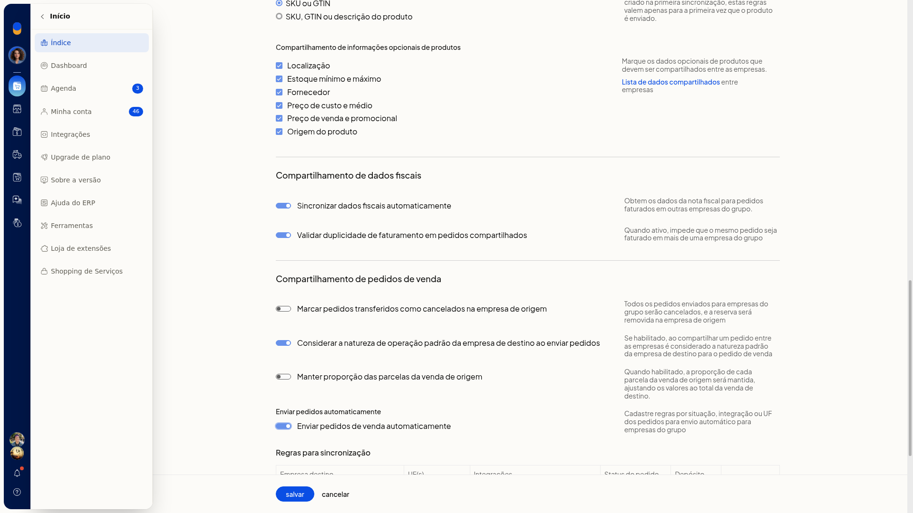

2. Na seção **Regras para sincronização**, clique em **Adicionar regra**.

   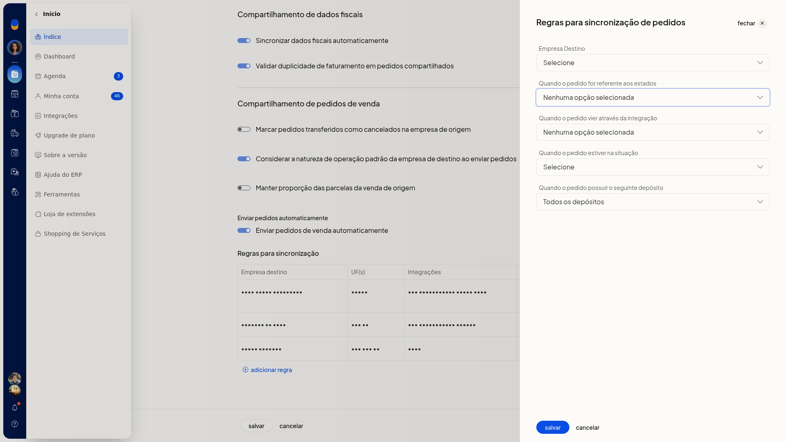

3. Preencha a regra:
   - **Empresa Destino**: uma empresa já marcada para receber dados
   - **Quando o pedido for referente aos estados**: as UFs de AC a TO ou **Selecionar todas**
   - **Quando o pedido vier através da integração**: **Sem integração** ou um canal já conectado à empresa
   - **Quando o pedido estiver na situação**: **Em aberto**, **Faturado**, **Cancelado**, **Aprovado**, **Preparando envio**, **Enviado**, **Entregue**, **Pronto para envio**, **Dados incompletos**, **Não entregue** ou **Em devolução**
   - **Quando o pedido possuir o seguinte depósito**: **Todos os depósitos** ou um depósito já cadastrado

   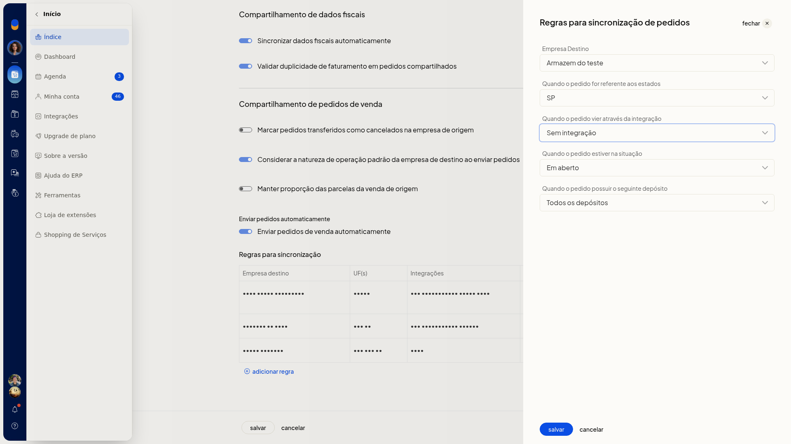

4. Clique em **salvar** para gravar a regra. **cancelar** fecha o painel sem gravar. Na lista de regras, use **editar**, **Clonar regra** ou **Remover regra**.

### Consultar as unidades que enviam dados

1. Em **configurar**, clique em **De quais unidades esta empresa recebe?**.
2. Leia a lista de unidades que enviam dados para a empresa aberta. Para alterar quem envia, mude o envio na configuração da empresa de origem.

   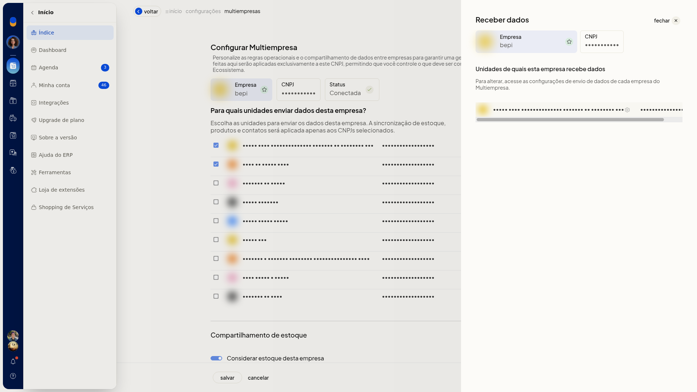

### Operar em outra empresa do grupo

1. Clique no avatar da empresa no menu lateral para abrir **Minha conta**.

   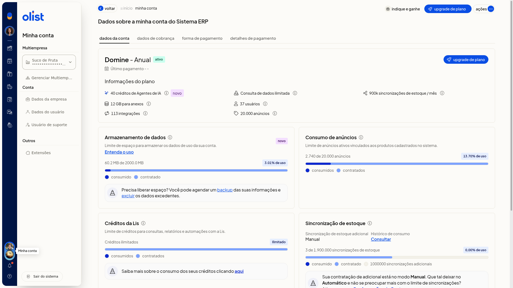

2. Expanda o seletor de empresa. As empresas listadas já estão vinculadas ao grupo, e a empresa atual permanece marcada.

   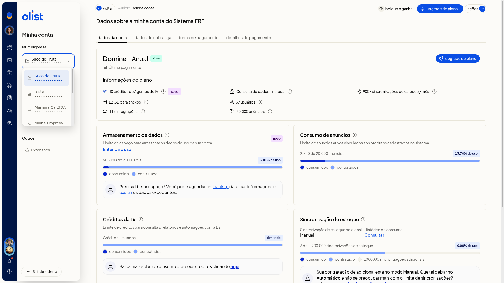

3. Selecione a empresa vinculada em que deseja operar.

### Ajustar a empresa principal ou remover a empresa

1. Na lista **Multiempresa**, clique no botão de mais ações do card.
2. Escolha **empresa principal**.

   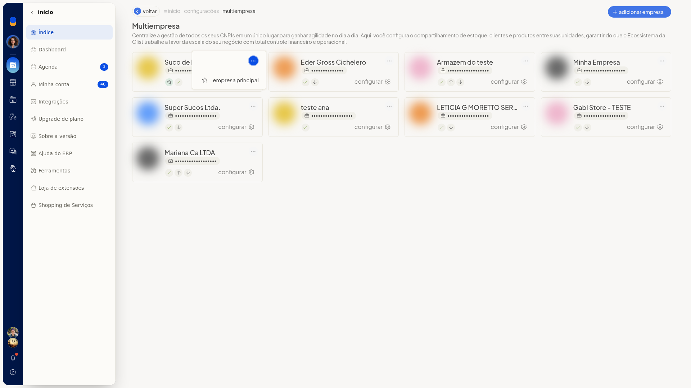

3. Em um card que não é a empresa principal, o mesmo menu também oferece **remover empresa**.

   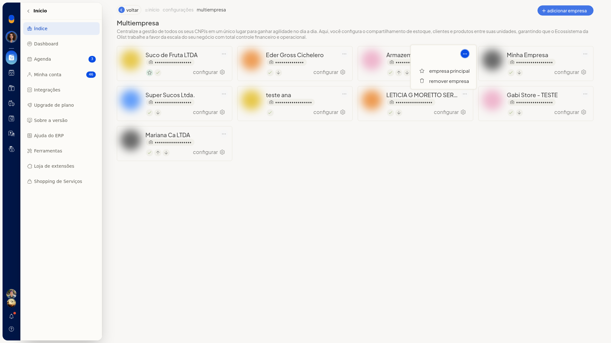

4. Confirme somente se quiser alterar o grupo.

## Resultado
A lista **Multiempresa** mostra um card por empresa vinculada, com documento, ícones de status e o link **configurar**. O seletor em **Minha conta** lista as empresas vinculadas e mantém a empresa atual marcada. A tela **configurar** mostra as opções de compartilhamento já gravadas da empresa aberta.

## Informações adicionais
- Os ícones do card indicam **Empresa principal**, **Conectada**, **Enviando dados para esta empresa** e **Recebendo dados desta empresa**.
- O status de cada empresa na lista pode ser principal, conectada, enviando dados ou recebendo dados.
- **Lista de dados compartilhados** abre, em outra aba, o artigo de ajuda Multiempresa - Configurações.
