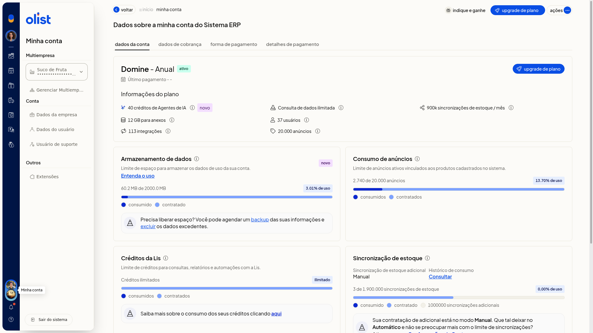
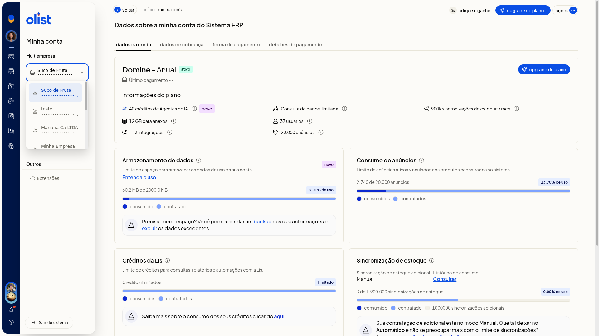

# Multiempresa: operar entre empresas

Multiempresa reúne os CNPJs vinculados do grupo. No ERP da Olist, você usa o seletor em **Minha conta** para operar em outra empresa já vinculada.

## Instruções
1. Clique no **avatar da empresa** no menu lateral para abrir **Minha conta**.

   

2. Expanda o **seletor de empresa** para ver as empresas vinculadas, com a empresa atual marcada.

   

3. Selecione a empresa vinculada em que deseja operar.
