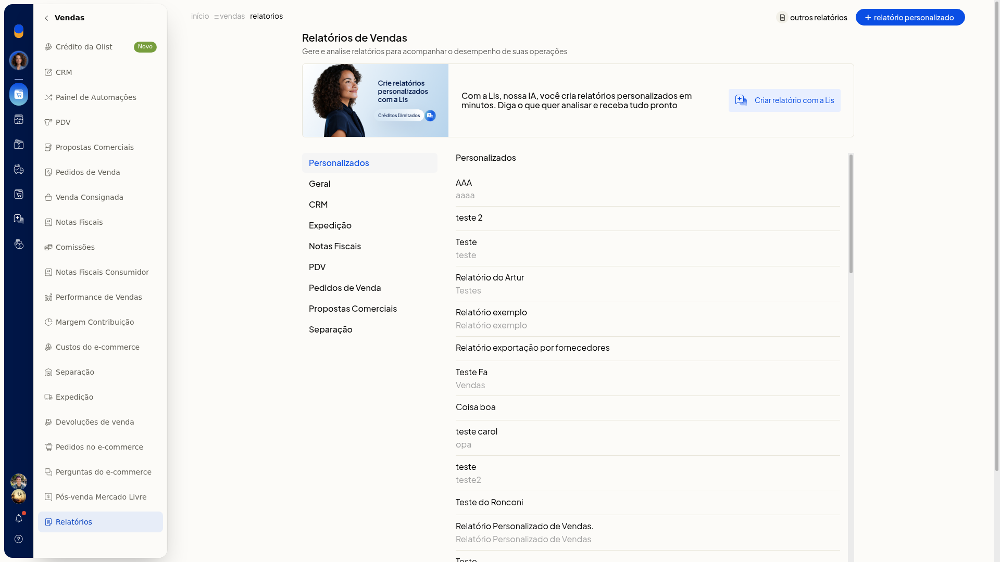
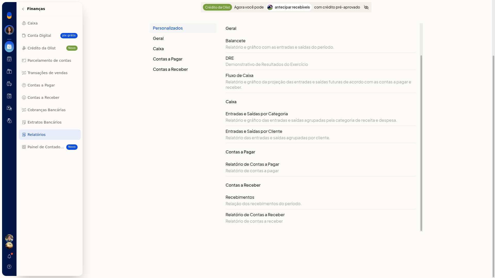
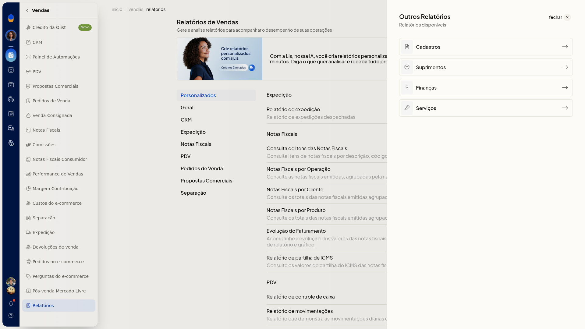

# Consultar os relatórios prontos de vendas e de finanças

No ERP da Olist, os relatórios prontos de vendas e de finanças ficam agrupados por seção. Você localiza o relatório pelo grupo, em **Vendas > Relatórios** ou em **Finanças > Relatórios**.

A tela **Relatórios de Finanças** explica: Gere e analise relatórios para acompanhar o desempenho de suas operações.

## Importante
- Não siga a trilha do topo da página. Ela não corresponde ao caminho do menu.

## Instruções
1. Acesse **Vendas > Relatórios** ou **Finanças > Relatórios**.
2. Use as seções laterais para chegar a cada grupo.
3. Em Vendas, consulte os grupos **Personalizados**, **Geral** (**Vendas**, **Relatório Financeiro de Vendas** e **Curva ABC**), **CRM**, **Expedição**, **Notas Fiscais** (itens, por operação, por cliente, por produto, evolução do faturamento e partilha de ICMS), **PDV** (controle de caixa e movimentações), **Pedidos de Venda**, **Propostas Comerciais** e **Separação**.

   

4. Em Finanças, consulte os grupos **Personalizados** (**Relatório Personalizado de Contas Pagar** e **Relatório Personalizado de Contas Receber**), **Geral** (**Balancete**, **DRE** e **Fluxo de Caixa**), **Caixa** (**Entradas e Saídas por Categoria** e **Entradas e Saídas por Cliente**), **Contas a Pagar** (**Relatório de Contas a Pagar**) e **Contas a Receber** (**Recebimentos** e **Relatório de Contas a Receber**).

   

5. Clique em **outros relatórios** para abrir **Cadastros**, **Suprimentos**, **Finanças** e **Serviços**. **Finanças** leva à mesma tela **Relatórios de Finanças**, com **Relatórios** destacado no menu **Finanças**. Você encontra o relatório pronto pelo grupo, em Vendas ou em Finanças, ou chega ao catálogo de Finanças por **outros relatórios**.

   

## Resultado
Os catálogos de Vendas e de Finanças listam os relatórios por seção. Em Finanças, vários itens trazem descrição.
