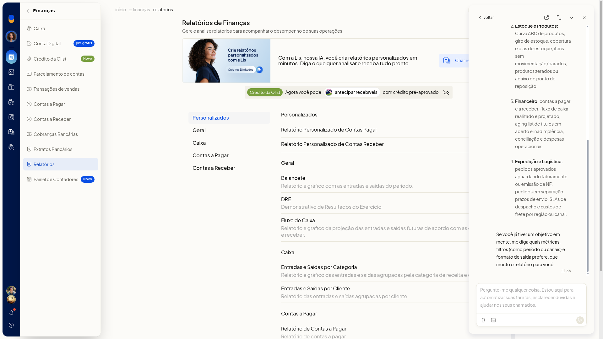
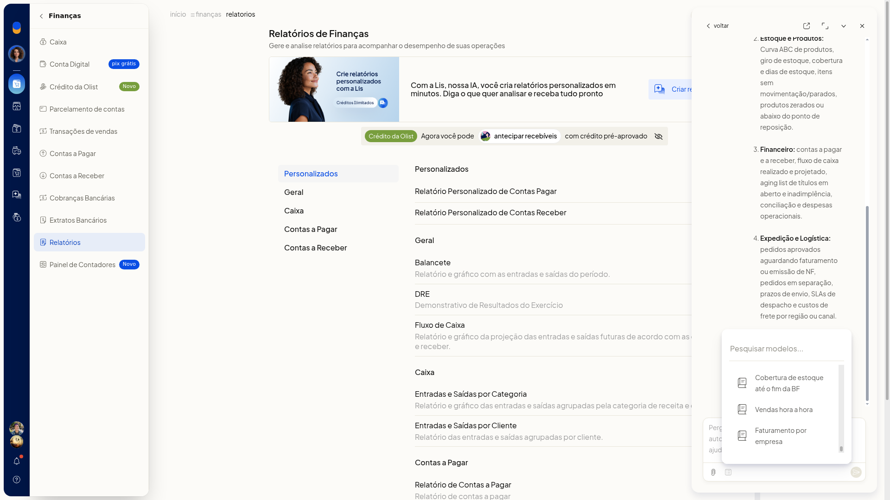

# Criar um relatório personalizado com a Lis

Você pede um relatório personalizado à Lis da Olist a partir dos relatórios de Vendas ou de Finanças, sem sair desses menus. Dá para descrever a análise no chat ou partir de um modelo pronto.

A Lis informa que consolida análises sob medida, gera gráficos, exporta em CSV, PDF ou Google Sheets e agenda automações periódicas. As áreas citadas são Vendas e Comercial, Estoque e Produtos, Financeiro e Expedição e Logística.

## Instruções
### Pelo chat

1. Acesse **Vendas > Relatórios** ou **Finanças > Relatórios**.
2. Clique em **Criar relatório com a Lis**.
3. Leia a resposta no painel.

   

4. Use o campo **Pergunte-me qualquer coisa** para dizer o que quer analisar. Para anexar um arquivo, clique em **Fazer upload de arquivo**. O upload aceita imagem, PDF e CSV. O painel mostra o que a Lis informa que consegue analisar e exportar.

### Por um modelo

1. Acesse **Vendas > Relatórios** ou **Finanças > Relatórios**.
2. Clique em **Criar relatório com a Lis**.
3. Abra **Modelos**.
4. Pesquise em **Pesquisar modelos...** ou percorra a lista até o fim. Você localiza um modelo pronto para iniciar o relatório sem digitar o pedido.

   

## Resultado
O painel da Lis mostra a resposta com áreas, métricas e formatos de exportação. Em **Modelos**, a lista pesquisável fica disponível até o último modelo.

## Informações adicionais
### O que a Lis informa que entrega

- análises sob medida e gráficos
- exportação em CSV, PDF ou Google Sheets
- automações periódicas

O banner de **Criar relatório com a Lis** informa: Com a Lis, nossa IA, você cria relatórios personalizados em minutos. Diga o que quer analisar e receba tudo pronto.
