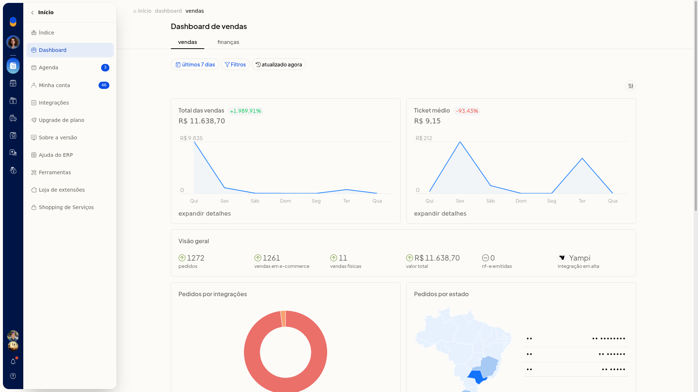
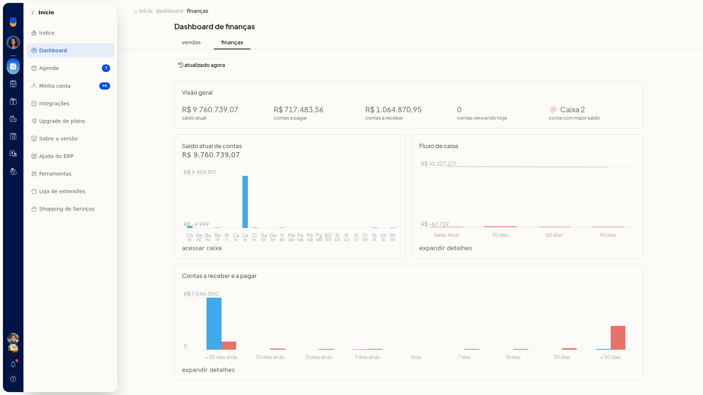

# Dashboard

No Dashboard do ERP da Olist, você acompanha indicadores de vendas e de finanças do período em exibição. Você consulta esses números sem gerar um relatório.

## Importante
- Para ver os números no Dashboard, a conta precisa ter movimentação.

## Instruções
1. Acesse **Início > Dashboard**.
2. Confira, na aba **Vendas**, o período em exibição e os indicadores:
 - total de vendas, com variação
 - ticket médio, com variação
 - quantidade de pedidos por origem: **e-commerce**, vendas físicas e **NF-e**
 - integração em alta
 - pedidos por integração e por estado
 - funil de CRM
 - produtos
 - horários
 - vendas versus devoluções

   

3. Abra a aba **Finanças** e confira saldo, contas a pagar e a receber, vencimentos do dia, maior saldo e fluxo de caixa. Use os atalhos para acessar o caixa e expandir os detalhes.

   

## Resultado
O Dashboard exibe os indicadores e gráficos da aba escolhida, **Vendas** ou **Finanças**.
