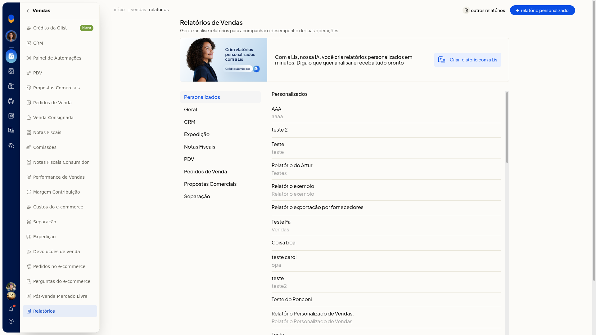
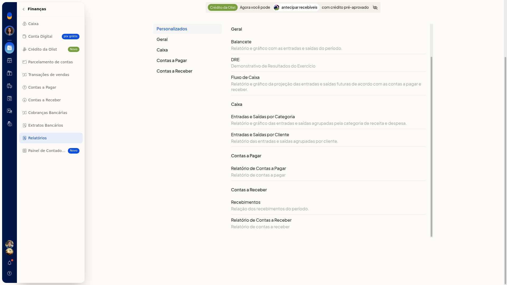
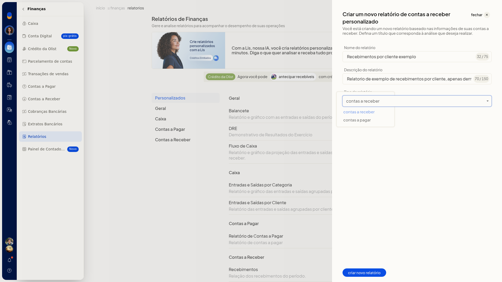
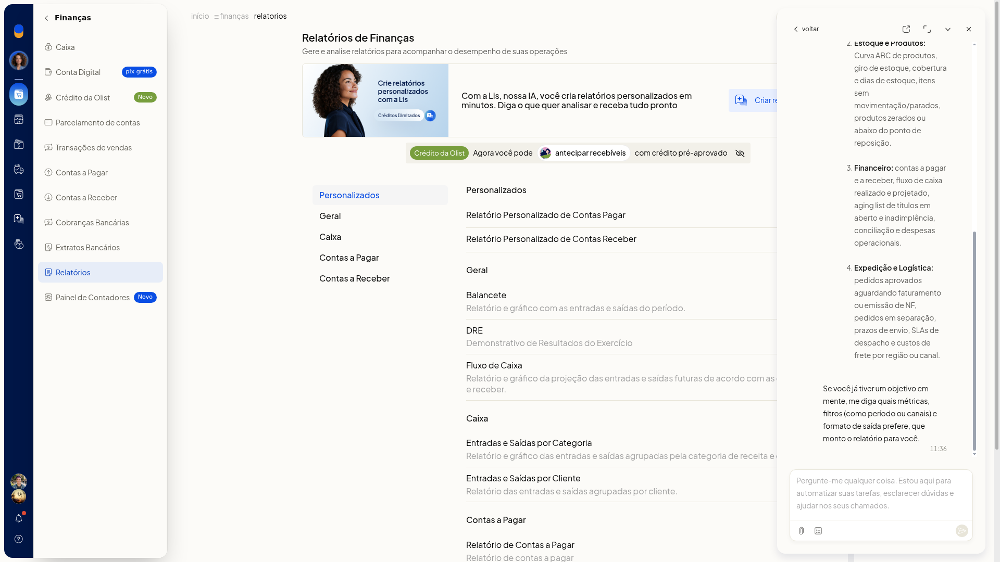
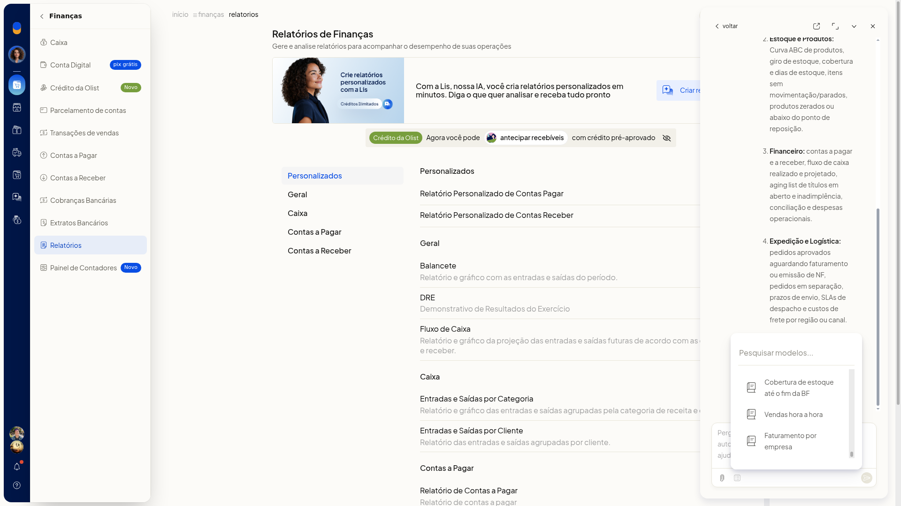

# Relatórios personalizados

No ERP da Olist, você cria um relatório personalizado em **Vendas > Relatórios** ou em **Finanças > Relatórios**, sem sair desses menus. Pela tela, você informa nome e descrição. Em Finanças, também escolhe se o relatório é de contas a receber ou de contas a pagar.

Com a Lis, você pede o relatório por texto, envia um arquivo ou parte de um modelo pronto. O painel informa as áreas, as métricas e os formatos de exportação.

## Importante
- Use o caminho do menu. Não siga a trilha do topo da página.
- Fechar o painel do relatório personalizado pelo botão do cabeçalho descarta o preenchimento e volta ao catálogo.

## Instruções
### Pela tela

1. Acesse **Vendas > Relatórios**.

   

2. Para um relatório de finanças, acesse **Finanças > Relatórios**.

   

3. Clique em **relatório personalizado**.
4. Preencha **Nome**. O campo não é obrigatório.
5. Preencha **Descrição**. O campo não é obrigatório.

   

6. Em Finanças, confira **Tipo**. O valor inicial é **contas a receber**. A outra opção é **contas a pagar**. O campo não é obrigatório.

   

7. Revise o painel. O relatório fica descrito e pronto para criação, sem ser gravado. Para descartar, feche pelo botão do cabeçalho: o preenchimento é descartado e você volta ao catálogo.

### Com a Lis

1. Em **Vendas > Relatórios** ou **Finanças > Relatórios**, clique em **Criar relatório com a Lis**. O banner informa: Com a Lis, nossa IA, você cria relatórios personalizados em minutos. Diga o que quer analisar e receba tudo pronto.
2. Leia a resposta no painel. A Lis informa que consolida análises sob medida, gera gráficos, exporta em CSV, PDF ou Google Sheets e agenda automações periódicas. As áreas citadas são Vendas e Comercial, Estoque e Produtos, Financeiro e Expedição e Logística.

   

3. No campo **Pergunte-me qualquer coisa**, descreva o que quer analisar. Se quiser anexar um arquivo, clique em **Fazer upload de arquivo**. O upload aceita imagem, PDF e CSV.

### Por um modelo da Lis

1. Com o painel da Lis aberto em Relatórios, abra **Modelos**.
2. Pesquise em **Pesquisar modelos...** ou percorra a lista até o fim. Você localiza um modelo pronto para iniciar o relatório, sem disparar a geração.

   

## Resultado
O painel da tela mostra o relatório personalizado descrito, enquanto a gravação não é confirmada. No painel da Lis, você vê a resposta com áreas, métricas e formatos de exportação. Em **Modelos**, a lista fica pesquisável até o último modelo.

## Informações adicionais
### O que a Lis informa que analisa

- A Lis informa análises sob medida, gráficos, exportação em CSV, PDF ou Google Sheets e automações periódicas.
- As áreas citadas são Vendas e Comercial, Estoque e Produtos, Financeiro e Expedição e Logística.

### Modelos que a lista exibe

A lista de **Modelos** exibe: Estoque parado, Faturamento semanal, Possíveis kits, Custo de frete, Clientes valiosos, Clientes para reativar, Performance de vendas, Análise regional, Relatório Kardex, Perfil de clientes do mês, Comparativo mensal de vendas, Produtos campeões por estado, Top clientes do período, Projeção de faturamento dia, Projeção de compra itens kit, Status de vendas por canal, Análise clientes detalhada, Cálculo de Economia de Envios, Comparativo de vendas, Análise 360º de vendas, Performance de vendedores, Segmentação RFM, Monitoramento canais de venda, Clientes VIP inativos, Oportunidades de venda, Clientes por região, Produtos com margem negativa, Top 10 lucrativos, Raio-X financeiro, Projeção de fluxo de caixa, Contas vencidas e a vencer, Margem por categoria, SLA de expedição, Frete médio por região, Curva ABC de produtos, Tempo de vida do cliente, Recorrência de compra, Motivos de devolução, Raio-X logístico, Conhecer a Lis da Olist, Recompra de itens para kits, Relatório de produtos sem estoque, Criação de conteúdo sazonal, Relatório de planejamento tributário, Conhecer o agente de primeiros passos, Relatório personalizado do PDV, Criar Relatório Personalizado, Simulador de desconto BF, Cobertura de estoque até o fim da BF, Vendas hora a hora e Faturamento por empresa.
