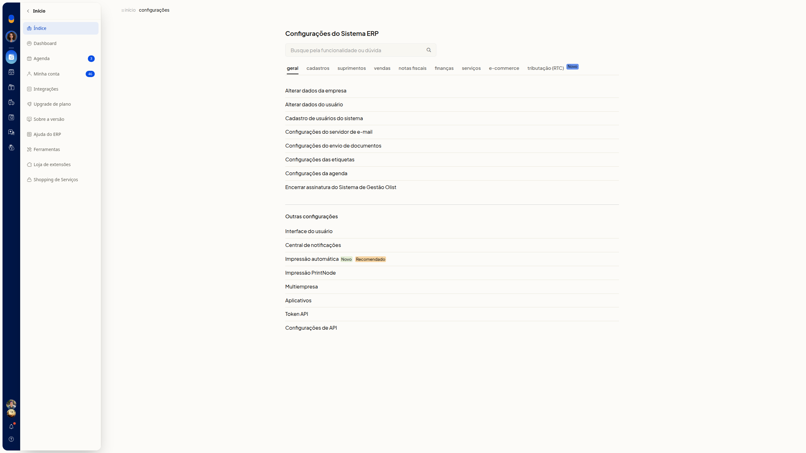
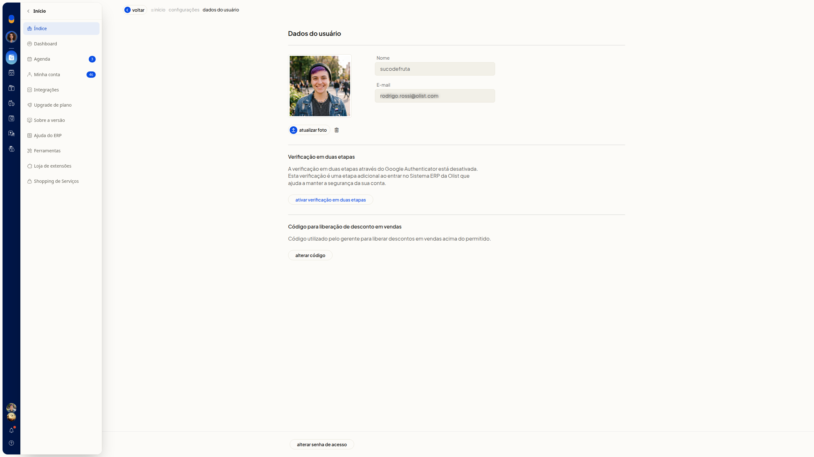
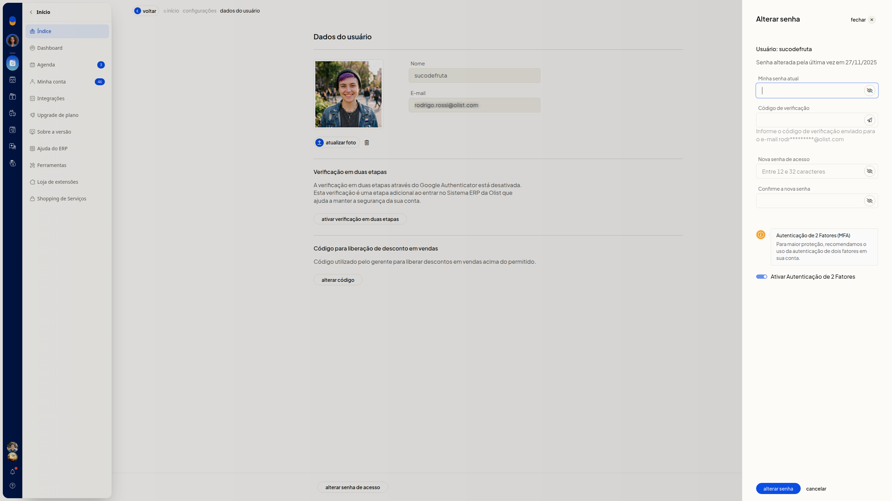
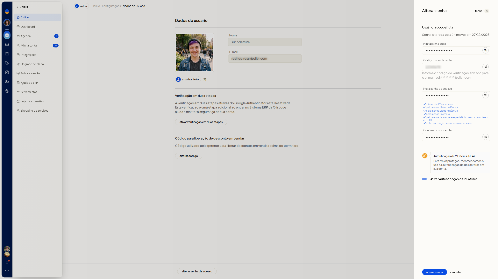
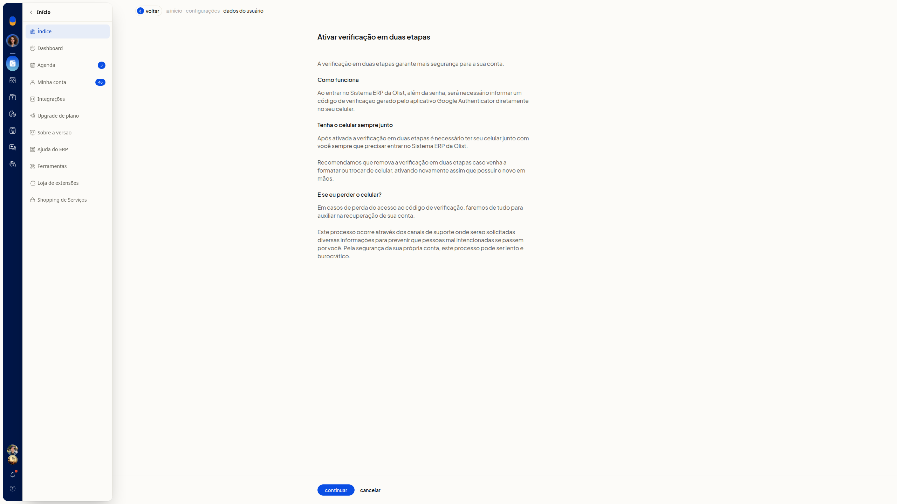
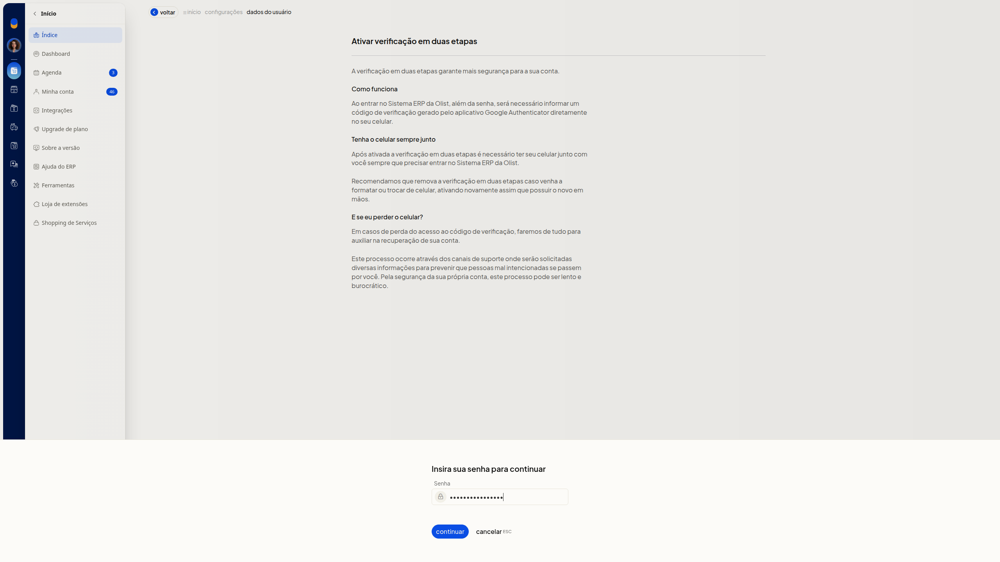

# Validação por token e autenticação multifator (MFA)

A validação por token autoriza a troca da senha de acesso com um código de verificação enviado ao email da conta. A autenticação multifator (MFA) é a verificação em duas etapas do ERP da Olist: uma etapa a mais ao entrar, com um código do Google Authenticator.

Em **Dados do usuário**, você informa esse código, pode reenviá-lo e inicia a verificação em duas etapas. No formulário da troca de senha, também pode marcar **Ativar Autenticação de 2 Fatores**.

## Importante
- Tenha a senha atual da conta e acesso ao email da conta. A troca de senha pede a senha atual e o código de verificação enviado a esse email.
- Na troca de senha, a nova senha precisa ter entre 12 e 32 caracteres, com letra maiúscula, minúscula, número e caractere especial. Não use =, aspas, apóstrofo nem dois-pontos, e não use a senha de login da empresa.
- A ativação da verificação em duas etapas pede a senha atual antes de continuar.
- A verificação em duas etapas usa o código do Google Authenticator ao entrar no ERP. Mantenha o celular usado na ativação.
- Remova a verificação em duas etapas antes de trocar de celular. Se o celular for perdido, recupere a conta pelo suporte.

## Instruções
### Informar o código de verificação

1. Acesse **Configurações > Configurações ERP > Geral > Alterar dados do usuário**. Pelo avatar no topo, acesse **Minha conta > Dados do usuário**.

   

   

2. Clique em **Alterar senha de acesso**.

   

3. Informe a senha atual em **Minha senha atual**.
4. Informe em **Código de verificação** o código enviado ao email da conta. O email aparece mascarado no formulário. Para receber outro código, clique em **Re-enviar código**.
5. Informe **Nova senha de acesso** e repita em **Confirme a nova senha**.

   

6. Clique em **Alterar senha** para concluir a troca com o código de verificação.

### Ativar a verificação em duas etapas

1. Acesse **Dados do usuário** em **Configurações > Configurações ERP > Geral > Alterar dados do usuário**.
2. Na seção **Verificação em duas etapas**, clique em **Ativar verificação em duas etapas**. A seção informa que a verificação pelo Google Authenticator está desativada e que ela é uma etapa adicional ao entrar no ERP.

   

3. Clique em **Continuar**.
4. Na etapa **Insira sua senha para continuar**, informe a senha atual em **Senha**.

   

   

5. Clique em **Continuar** para seguir na ativação.

### Marcar a autenticação de 2 fatores na troca de senha

1. Acesse **Dados do usuário** em **Configurações > Configurações ERP > Geral > Alterar dados do usuário**.
2. Clique em **Alterar senha de acesso**.
3. Marque **Ativar Autenticação de 2 Fatores**.
4. Preencha **Minha senha atual**, **Código de verificação**, **Nova senha de acesso** e **Confirme a nova senha**.
5. Clique em **Alterar senha** para enviar a opção junto com a troca de senha.

## Informações adicionais
### Cancelar volta sem concluir a ação

- **Cancelar** no formulário de troca de senha fecha o formulário e volta a **Dados do usuário**.
- Na etapa **Insira sua senha para continuar**, **Cancelar** volta ao aviso. A tela indica ESC para esse **Cancelar**.
- **Cancelar** no aviso de ativação volta a **Dados do usuário**, com a verificação pelo Google Authenticator ainda informada como desativada.

### O formulário mostra a data da última alteração

O formulário de troca de senha exibe a data da última alteração de senha.
