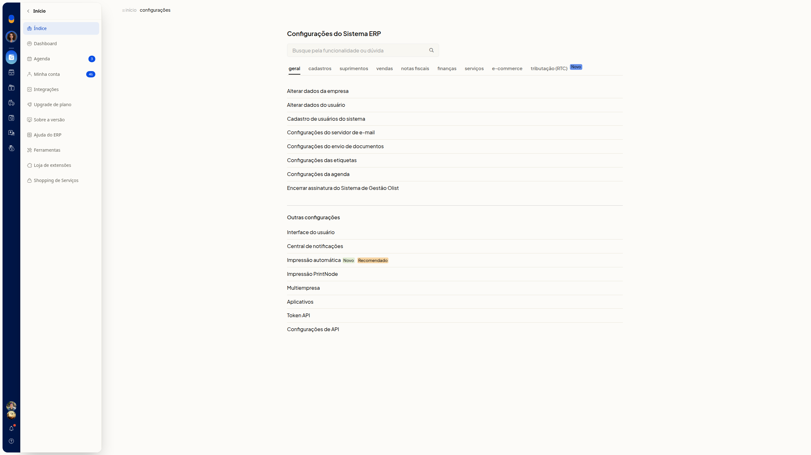
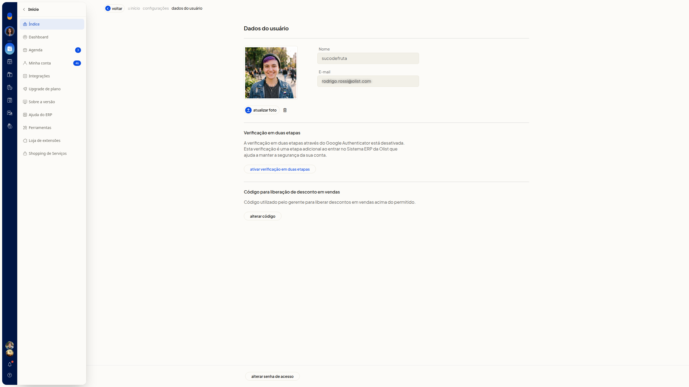
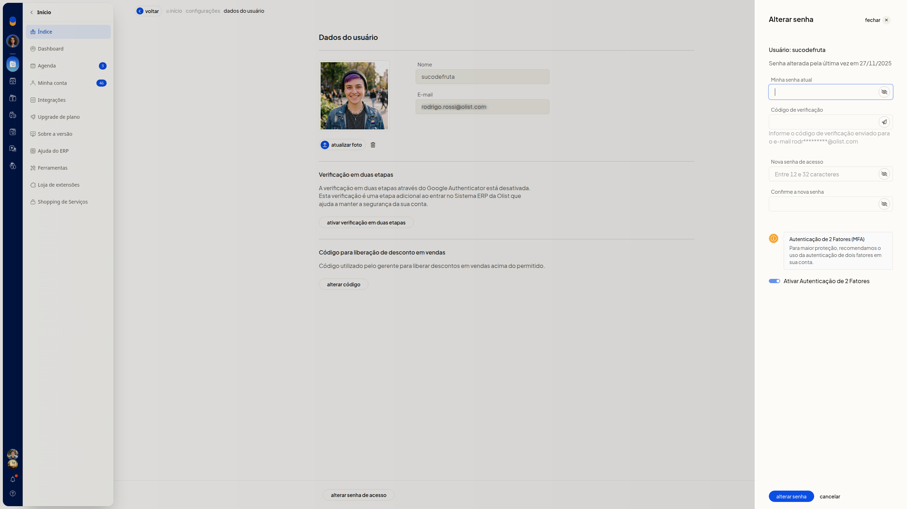
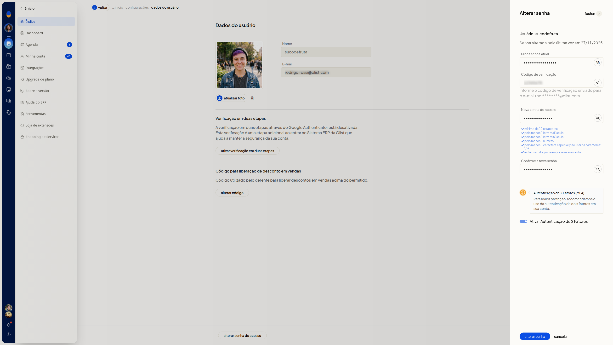
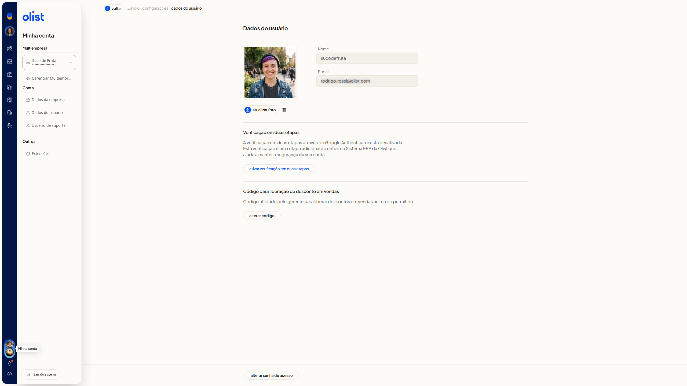

# Alterar senha e sair do sistema

No ERP da Olist, você altera a senha de acesso da sua conta e confirma a troca com o código enviado ao email. Pelo painel **Minha conta**, você também sai do sistema.

A tela **Dados do usuário** reúne a troca de senha. Você a abre em **Configurações > Configurações ERP > Geral > Alterar dados do usuário** ou pelo avatar, em **Minha conta > Dados do usuário**.

## Importante
- Tenha a senha atual da conta. A troca pede essa senha e o código de verificação enviado ao email da conta.
- A nova senha precisa ter entre 12 e 32 caracteres, com letra maiúscula, minúscula, número e caractere especial.
- Não use os caracteres = " ': e não use a senha de login da empresa.

## Instruções
### Alterar a senha de acesso

1. Acesse **Configurações > Configurações ERP**.
2. Na área **Geral**, clique em **Alterar dados do usuário**.

   

   

3. Clique em **Alterar senha de acesso**.

   

4. Digite a senha atual em **Minha senha atual**.
5. Digite o código em **Código de verificação**. O código é enviado ao email da conta. Para reenviar, clique em **Re-enviar código**.
6. Digite a nova senha em **Nova senha de acesso** e repita em **Confirme a nova senha**.
7. Revise **Ativar Autenticação de 2 Fatores**. A opção só é enviada com **Alterar senha**.

   

8. Clique em **Alterar senha** para concluir a troca.

### Sair do sistema

1. Clique no avatar no topo da tela.

   

2. Clique em **Sair do sistema**.

## Informações adicionais
- O formulário de troca de senha exibe a data da última alteração de senha.
- **Cancelar** fecha o formulário e volta para **Dados do usuário**.
