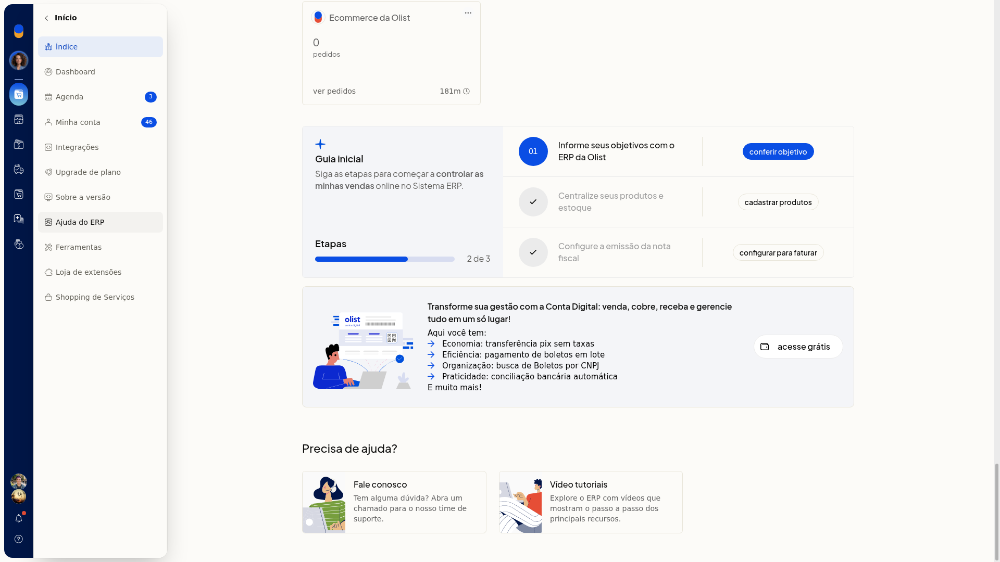
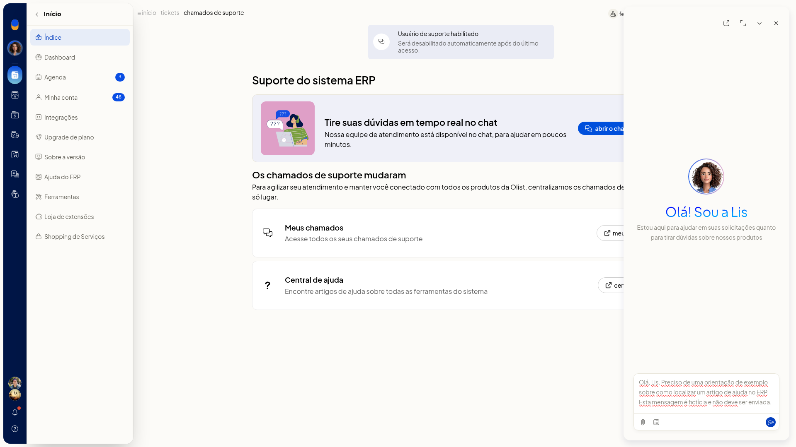
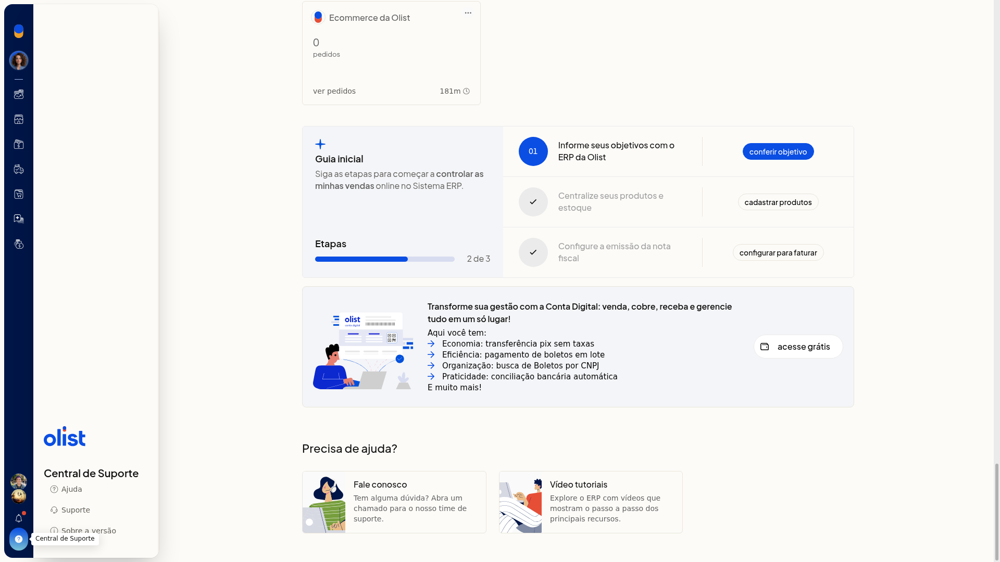
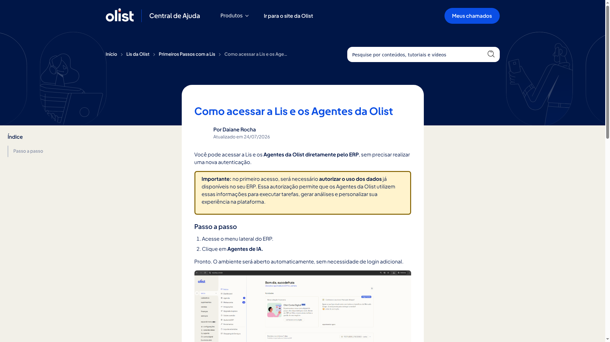

# Assistente da Olist no ERP

No ERP da Olist, o Assistente da Olist (Lis) atende pelo chat em tempo real. Com a Lis, você esclarece dúvidas, automatiza tarefas e recebe ajuda nos chamados, usando modelos de pergunta e anexo de arquivo.

O chat fica na tela **Suporte do sistema ERP**. Você chega lá pelo card **Fale conosco** em **Início > Índice** ou por **Ajuda > Suporte**.

## Importante
- O horário de atendimento informado na tela é de segunda a sexta, das 8h30 às 17h30.
- Para abrir um chamado, preencha a mensagem com pelo menos 10 palavras.
- Não há formulário de novo chamado com assunto ou categoria: o atendimento começa no chat.

## Instruções
1. Acesse **Início > Índice**.
2. Abra o card **Fale conosco**.

   

3. Na tela **Suporte do sistema ERP**, clique em **abrir o chat de suporte**.

   

4. Digite a pergunta no campo **Pergunte-me qualquer coisa. Estou aqui para automatizar suas tarefas, esclarecer dúvidas e ajudar nos seus chamados.** O campo é de texto livre e não é obrigatório na tela.
5. Se quiser partir de um modelo, clique em **Modelos** e escolha um. Os modelos são:

   - Estoque parado
   - Faturamento semanal
   - Possíveis kits
   - Custo de frete
   - Clientes valiosos
   - Clientes para reativar
   - Performance de vendas
   - Análise regional
   - Relatório Kardex
   - Perfil de clientes do mês
   - Comparativo mensal de vendas
   - Produtos campeões por estado
   - Top clientes do período

   

6. Se precisar, anexe uma imagem em JPEG, PNG, GIF ou WEBP, um PDF ou um CSV.
7. Envie a mensagem. O painel da Lis fica pronto para o atendimento da dúvida, da tarefa ou do chamado.

## Resultado
O painel da Lis exibe o campo de pergunta, **Modelos** e o anexo de arquivo.

## Informações adicionais
### Você também abre o chat pelo cabeçalho

Clique em **Ajuda** e, no painel **Central de Suporte**, clique em **Suporte**. Em seguida, clique em **abrir o chat de suporte**.

### O acesso pela Central de Ajuda indica o menu Agentes de IA

Em **Início > Ajuda do ERP**, abra o artigo **Como acessar a Lis e os Agentes da Olist**. O artigo descreve o acesso pelo menu lateral **Agentes de IA**.

