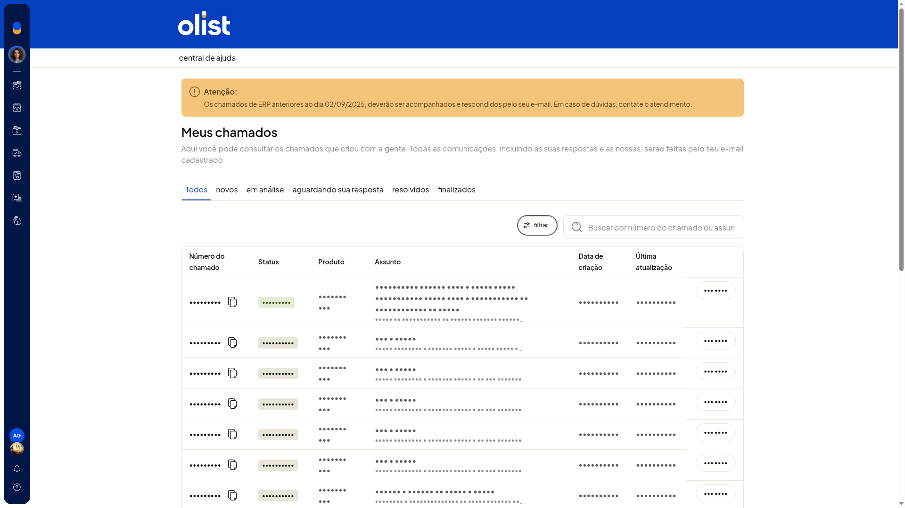

# Consultar chamados de suporte

No ERP da Olist, você consulta os chamados de suporte já abertos na tela **Suporte do sistema ERP**. Dá para ver a situação de cada solicitação, buscar um chamado e filtrar por produto.

Você também chega a essa tela por **Ajuda > Suporte**.

## Importante
- A lista **Meus chamados** serve só para consulta. Não há botão de novo chamado nessa lista.
- O link **abra um chamado**, em artigo da Central de ajuda, abre essa mesma lista, e não um formulário.

## Instruções
1. Acesse **Início > Índice**.
2. Abra o card **Fale conosco**.
3. Na tela **Suporte do sistema ERP**, clique em **meus chamados**.
4. Consulte a lista pelas abas **Todos**, **novos**, **em análise**, **aguardando sua resposta**, **resolvidos** e **finalizados**, ou use a busca.

   

5. Clique em **Filtrar**.
6. Escolha **Loja**, **Envios** ou **Sistema ERP**.
7. Clique em **filtrar** para aplicar. Para sair sem aplicar, clique em **cancelar**. A lista mostra as solicitações já abertas e não cria um chamado novo.

## Resultado
Você consulta as solicitações de suporte já abertas, conforme a aba, a busca ou o filtro de produto.
