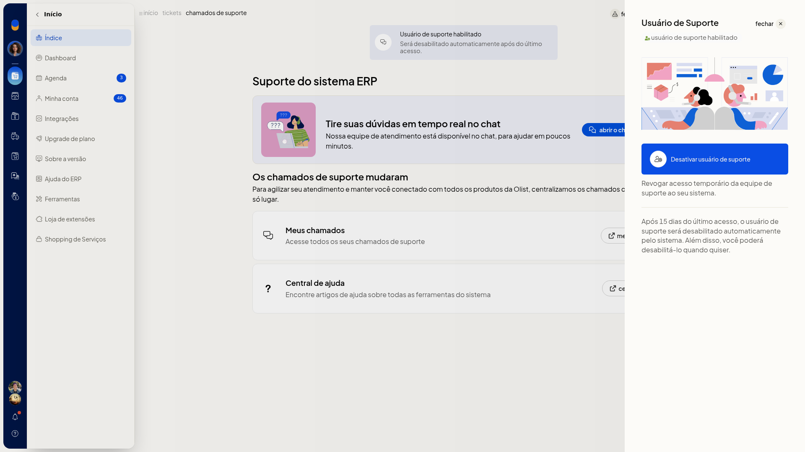

# Desativar o usuário de suporte

O **usuário de suporte** é um acesso temporário da equipe de suporte à sua conta no ERP da Olist. Com ele habilitado, você revoga esse acesso na tela **Suporte do sistema ERP**, sem esperar o prazo automático.

Você abre essa tela por **Ajuda > Suporte** ou por **Início > Índice**, no card **Fale conosco**.

## Pré-requisitos
- O acesso precisa já estar habilitado. O status exibido é **usuário de suporte habilitado**.

## Importante
- Após 15 dias do último acesso, o sistema desabilita o acesso automaticamente. Você também pode desativá-lo antes desse prazo.
- Com o acesso habilitado, a ação visível é **Desativar usuário de suporte**.

## Instruções
1. Clique em **Ajuda**.
2. Clique em **Suporte**.
3. Na tela **Suporte do sistema ERP**, clique em **usuário de suporte**.
4. Leia o status **usuário de suporte habilitado** e o texto **Revogar acesso temporário da equipe de suporte ao seu sistema.**

   

5. Clique em **Desativar usuário de suporte**. Para sair sem alterar o acesso, clique em **fechar**.

## Informações adicionais
### O prazo de 15 dias aparece no painel

No banner da tela, o texto é **Usuário de suporte habilitado** e **Será desabilitado automaticamente após do último acesso.** O número de 15 dias aparece no painel **Usuário de Suporte**.
