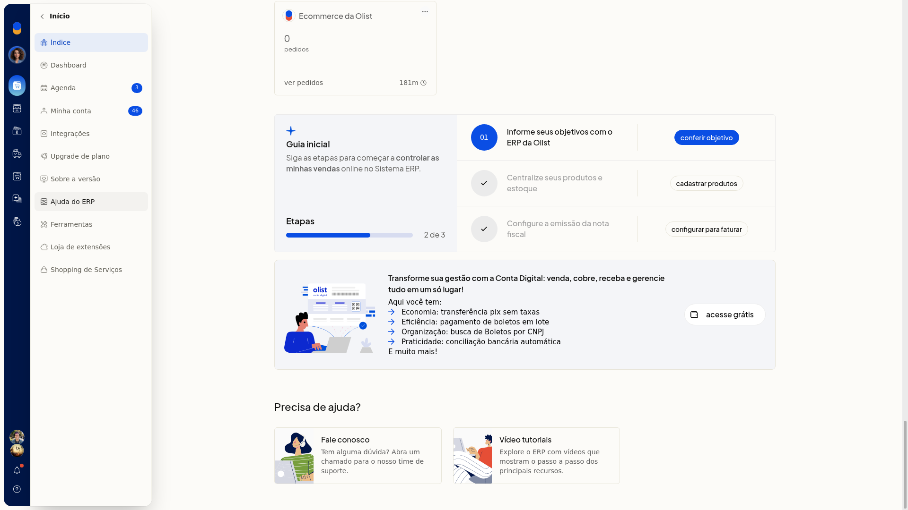
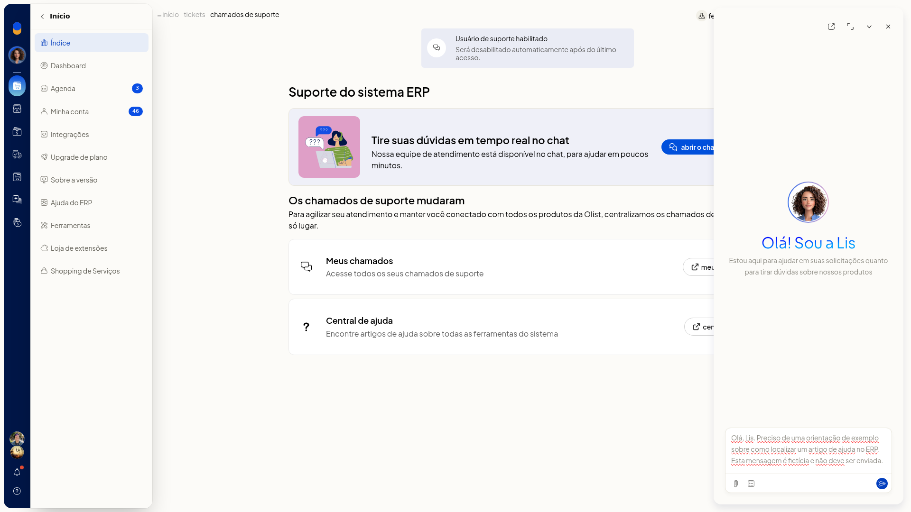
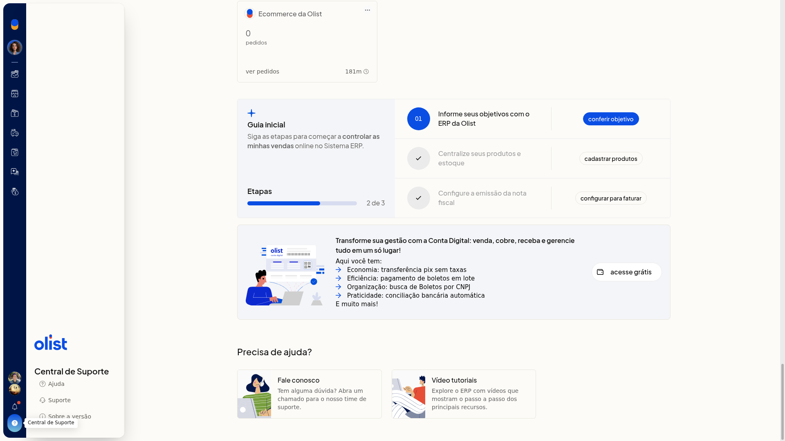
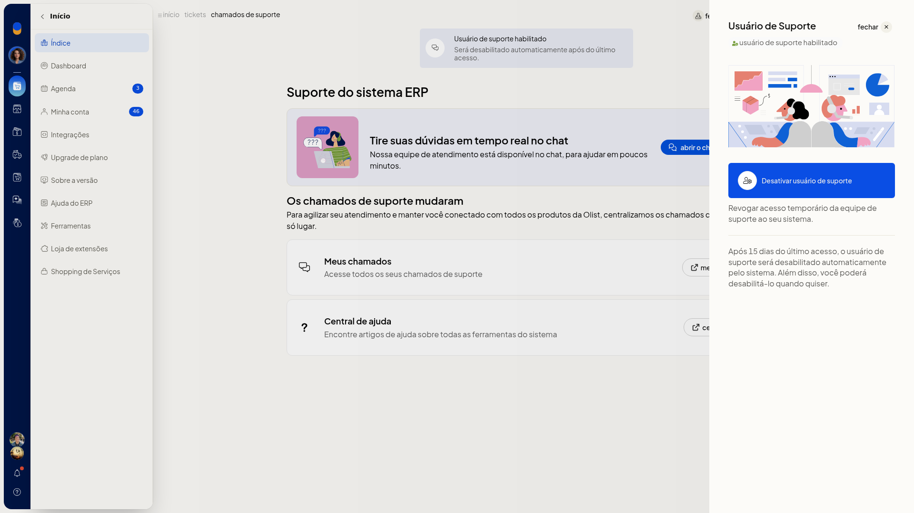

# Suporte: abrir chamado e habilitar usuário de suporte

O atendimento de suporte do ERP da Olist começa no chat em tempo real com o Assistente da Olist (Lis). Na tela **Suporte do sistema ERP**, você descreve a dúvida para o time, consulta o que já foi aberto e libera um acesso temporário da equipe à conta.

Esse acesso pode ser desativado por você e é desabilitado automaticamente 15 dias após o último acesso.

## Importante
- O atendimento começa no chat. Não há formulário de novo chamado com assunto ou categoria.
- A lista **Meus chamados** não cria chamado. Ela serve para consulta.
- O horário de atendimento informado na tela é de segunda a sexta, das 8h30 às 17h30.
- Para abrir o chamado, a mensagem precisa ter pelo menos 10 palavras.
- O **usuário de suporte** é desabilitado automaticamente após 15 dias do último acesso. Você também pode desativá-lo quando quiser.
- Com o acesso já habilitado, a ação visível é **Desativar usuário de suporte**.

## Instruções
### Pelo card Fale conosco

1. Acesse **Início > Índice**.
2. No card **Fale conosco**, leia **Tem alguma dúvida? Abra um chamado para o nosso time de suporte.** e abra o card.

   

3. Na tela **Suporte do sistema ERP**, leia o aviso **Os chamados de suporte mudaram** e o card **Tire suas dúvidas em tempo real no chat**.
4. Clique em **abrir o chat de suporte**.

   

5. Escreva a dúvida, com pelo menos 10 palavras, no campo **Pergunte-me qualquer coisa. Estou aqui para automatizar suas tarefas, esclarecer dúvidas e ajudar nos seus chamados.** Se quiser, escolha um modelo em **Modelos** ou anexe uma imagem (JPEG, PNG, GIF ou WEBP), PDF ou CSV, e envie a mensagem. O painel da Lis fica pronto para o atendimento.

### Pelo botão Ajuda

1. Clique em **Ajuda** no cabeçalho.
2. No painel **Central de Suporte**, clique em **Suporte**.

   

3. Na tela **Suporte do sistema ERP**, clique em **abrir o chat de suporte**.
4. Escreva a dúvida, com pelo menos 10 palavras, envie a mensagem e, se quiser, use **Modelos** ou anexe uma imagem (JPEG, PNG, GIF ou WEBP), PDF ou CSV. O painel da Lis fica pronto para o atendimento.

### Habilitar o usuário de suporte

1. Na tela **Suporte do sistema ERP**, clique em **usuário de suporte**.
2. Quando o acesso ainda não está ativo, leia **Ativando o usuário de suporte, nossa equipe passa a ter acesso temporário à sua conta para auxiliar na solução de eventuais problemas.**
3. Clique em **Habilitar usuário de suporte** para conceder o acesso temporário.

### Desativar o acesso já habilitado

1. Na tela **Suporte do sistema ERP**, clique em **usuário de suporte** no cabeçalho.
2. Leia o status **usuário de suporte habilitado**, a frase **Revogar acesso temporário da equipe de suporte ao seu sistema** e o aviso de desabilitação automática após 15 dias do último acesso.

   

3. Para encerrar o acesso antes disso, clique em **Desativar usuário de suporte**. Para sair sem alterar, clique em **fechar**. O painel mostra o acesso temporário habilitado e a ação para revogá-lo.

## Resultado
A tela **Suporte do sistema ERP** exibe o card de chat, **Meus chamados**, a Central de ajuda e o banner **Usuário de suporte habilitado**. O painel da Lis mostra o campo de pergunta, **Modelos** e o anexo de arquivo.

## Informações adicionais
- O banner da tela informa **Usuário de suporte habilitado** e que o acesso será desabilitado automaticamente após o último acesso, sem o número de dias. O prazo de 15 dias aparece no painel lateral.
- Em **Meus chamados**, a consulta usa as abas **Todos**, **novos**, **em análise**, **aguardando sua resposta**, **resolvidos** e **finalizados**, além da busca e de **Filtrar**. Em **Filtrar**, os produtos exibidos são **Loja**, **Envios** e **Sistema ERP**. Use **cancelar** para sair sem aplicar ou **filtrar** para aplicar.
