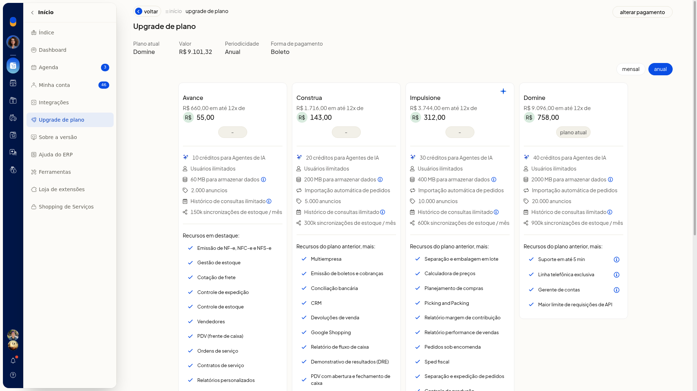
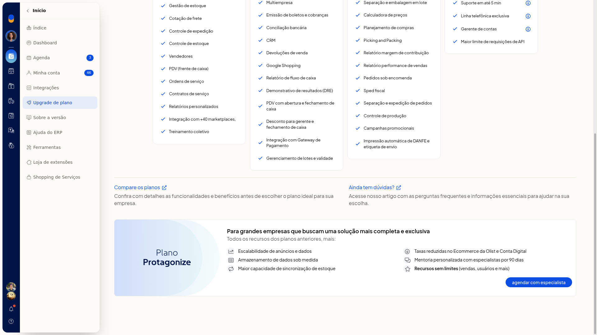

# Usuários e perfis de acesso

No ERP da Olist, esta tela cadastra quem acessa o sistema, define perfil e permissões, restringe horário e IP, inclui vendedor com acesso e altera os dados do seu próprio acesso.

Em **Configurações > Configurações ERP > Geral > Cadastro de usuários do sistema**, a lista mostra os totais e as ações de inclusão. O limite não aparece nessa lista. Em **Início > Upgrade de plano**, o plano atual e os planos exibidos informam **Usuários ilimitados**.

## Importante
- A restrição por IP vale para IPs fixos.
- **adicionar permissões adicionais** e **editar permissões da conta digital** só seguem depois que o cadastro foi salvo. Antes disso, a tela abre confirmação com **Confirmar** e **Cancelar** e não continua.
- A empresa administradora não acessa **Upgrade de plano**.
- Em **Upgrade de plano**, não use **Alterar pagamento**, os botões de contratação nem **agendar com especialista**. Essas ações são comerciais e não fazem parte deste cadastro.

## Instruções
### Incluir pelo cadastro

1. Acesse **Configurações > Configurações ERP > Geral > Cadastro de usuários do sistema**.
2. Na lista, busque por nome ou login se precisar localizar alguém. Os cartões mostram login, email, um indicativo de perfil (**admin**, **gerente**, **vendedor** ou **definir perfil**) e a ação **gerenciar**. Os totalizadores são **Usuários cadastrados** e **Vendedores**.
3. Clique em **incluir usuário**.
4. Na aba **acesso do usuário**, preencha os dados. Nenhum campo está marcado como obrigatório.
 - **Nome do usuário**
 - **Login de acesso**
 - **Email de acesso**, no formato de email
 - **Email para comunicação**, no formato de email
5. Se quiser limitar dias e períodos, marque **Acesso restrito por horário**. Use as abreviações **S T Q Q S**, **Sábado** e **Domingo**, os períodos **Manhã**, **Tarde** e **Noite** e os horários **Início** e **Final**.
6. Se quiser limitar a rede, informe IPs em **Acesso restrito por IP**, no formato IPv4, e use **Adicionar IP**.
7. Abra a aba **permissões e ações**. Marque ou não **Este usuário é um gerente** e escolha **Pode acessar contatos com o perfil**.
8. Se o cadastro ainda não foi salvo, você pode abrir **criar perfil baseado no usuário** nessa aba. **adicionar permissões adicionais** e **editar permissões da conta digital** pedem confirmação e não seguem antes do salvamento.
9. Clique em **salvar usuário**. O cadastro fica com login, emails, restrições e permissões.

### Criar um perfil

1. Em **Cadastro de usuários do sistema**, clique em **perfil de usuários** ou em **Mais ações > perfil de usuários**.
2. Se não houver perfil, a lista mostra **Nenhum perfil cadastrado** e o botão **criar perfil**. **Voltar** retorna à lista.
3. Clique em **criar perfil**.
4. Preencha **Nome do perfil** e **Descrição do perfil**. Nenhum dos dois está marcado como obrigatório.
5. Marque as permissões nas abas **Cadastros**, **Suprimentos**, **Vendas**, **Finanças**, **Serviços** e **Ferramentas e mais**, ou use **Marcar todos**.
6. Na aba **Cadastros**, as permissões são: **Embalagens**; **Clientes e Fornecedores**; **editar limite de crédito**; **exportação de dados de contatos**; **Produtos**; **Preço promocional**; **Relatório de Preços dos Produtos**; **Categorias dos Produtos**; **edição de preços na lista**; **Serviços**; **Vendedores**; **Campanhas Promocionais**; **Listas de preço**; **Variações (grade)**; **Nova Precificação Inteligente**; **Preços competitivos Mercado Livre e Amazon**; **Logs de atualização de produto**; **Pode aprovar vendas com desconto de gerente**.
7. Clique em **salvar**. O perfil fica com nome, descrição e permissões por módulo.

### Criar perfil a partir do formulário

1. No formulário, aba **permissões e ações**, clique em **criar perfil baseado no usuário**.
2. No diálogo **Novo perfil**, preencha **Nome** e **Descrição**.
3. Confirme o perfil. O perfil novo se baseia no cadastro em edição. Cancelar o diálogo não grava esse cadastro.

### Incluir um vendedor

1. Em **Cadastro de usuários do sistema**, clique em **gerenciar vendedores**, em **Mais ações > gerenciar vendedores** ou no totalizador **Vendedores**. O totalizador abre a lista em nova aba.
2. Na lista, use o filtro de situação, a busca, o botão **incluir vendedor** e as abas **todos**, **ativos**, **inativos** e **excluídos**.
3. Clique em **incluir vendedor**.
4. Preencha a identificação. Nenhum campo está marcado como obrigatório.
 - **Nome**, **Fantasia** e **Código**
 - **Tipo de Pessoa**
 - **CNPJ**, exibido quando **Tipo de Pessoa** é **Jurídica**
 - **Contribuinte** e **IE**
5. Preencha endereço e contatos: **CEP**, **Cidade**, **UF**, **Endereço**, **Bairro**, **Número**, **Complemento**, **Telefone**, **Celular** e **Email** (formato de email). Em **UF**, há **Selecione**, as UFs e **EX**.
6. Defina **Situação**, **Depósito**, **E-mail para comunicações** (formato de email) e **Usuário do Sistema**.
7. Se precisar, marque **Acesso restrito por horário** e **Acesso restrito por IP**.
8. Escolha **Pode acessar contatos com o perfil** e os módulos de acesso do vendedor.
9. Defina **Regras para liberação de comissões**, **Comissionamento**, **Alíquota de comissão** e **Observações**. Marque ou não **Desconsiderar comissionamento por linhas de produto**, **incluir produtos não cadastrados** e **Pode emitir cobranças**.
10. Clique em **salvar**. O vendedor fica com dados cadastrais, vínculo de acesso e regra de comissão.

### Alterar senha ou código

1. Acesse **Configurações > Configurações ERP > Geral > Alterar dados do usuário**.
2. Use **Alterar senha** ou **Alterar código**, conforme a alteração.
3. Na verificação em duas etapas, preencha a senha pedida para chegar à confirmação. Senha, código ou etapa de verificação do seu acesso ficam prontos para confirmação.

### Consultar o limite no upgrade de plano

1. Com **Início** aberto, clique em **Upgrade de plano**.
2. Localize **Plano atual**. No plano **Domine**, e também nos cartões **Avance**, **Construa** e **Impulsione**, o item **Usuários ilimitados** aparece na lista de recursos.

   

3. Role até **Para grandes empresas que buscam uma solução mais completa e exclusiva (Plano Protagonize)** e leia **Recursos sem limites (vendas, usuários e mais)**. Os planos listados não exibem um teto numérico de acessos.

   

## Informações adicionais
### Perfis de contato no acesso

**Pode acessar contatos com o perfil** oferece **Qualquer perfil de contato**, **Outro**, **Cliente**, **Fornecedor**, **Vendedor**, **Transportador** e **Funcionário**.

### Opções do vendedor

- **Tipo de Pessoa** oferece **Jurídica**, **Física**, **Estrangeiro** e **Estrangeiro no Brasil**. **Jurídica** vem selecionada.
- **Situação** oferece **Ativo com acesso ao sistema**, **Ativo**, **Inativo**, **Sem Movimento** e **Excluído**.
- Perfis de contato: **Qualquer perfil de contato**, **Cliente**, **Fornecedor**, **Vendedor**, **Transportador**, **Funcionário** e **Outro**.
- Módulos: **Clientes**, **Comissões**, **CRM**, **Pedidos de Venda**, **PDV**, **Propostas comerciais**, **Relatório de Preços de Produtos**, **Performance de Vendas** e **Cotação de fretes**.
- **Comissionamento** oferece **alíquota fixa** e **conforme descontos**. No formulário vazio, **alíquota fixa** vem selecionada.
- **Regras para liberação de comissões** oferece **parcial por parcelas**, **integral no faturamento**, **integral após a 1ª parcela** e **50% no faturamento mais o restante nas parcelas**. **parcial por parcelas** vem selecionada.

### O que Mais ações reúne

**Mais ações** repete **perfil de usuários** e **gerenciar vendedores**. Essas telas não trazem importação por planilha nem ativação de integração.
