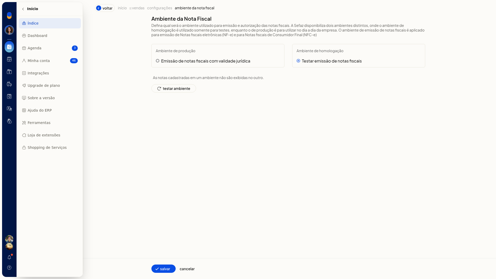
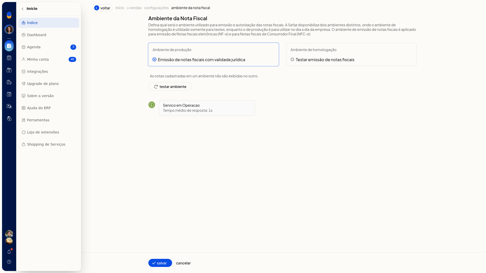
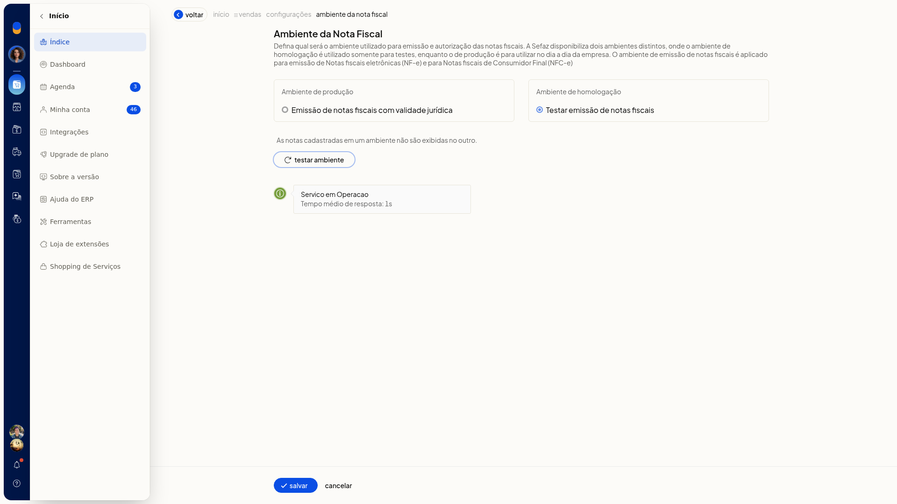

# Ambiente das notas fiscais: homologação e produção

O ambiente das notas fiscais define qual ambiente da Sefaz o ERP da Olist usa para emitir e autorizar NF-e e NFC-e. Em homologação, você testa a emissão. Em produção, as notas do dia a dia saem com validade jurídica.

Na mesma tela, você pode testar se o serviço está em operação antes de gravar a escolha. O caminho é **Configurações > Configurações ERP > Notas Fiscais > Ambiente das notas fiscais**.

## Importante
- O ambiente de homologação serve somente para testes. O ambiente de produção é para o dia a dia e descreve emissão de notas fiscais com validade jurídica.
- A escolha vale para Notas fiscais eletrônicas (NF-e) e Notas fiscais de Consumidor Final (NFC-e).
- As notas cadastradas em um ambiente não são exibidas no outro.
- Marcar um ambiente não grava a escolha. Sem **Salvar**, a seleção é descartada e permanece o ambiente já gravado.

## Instruções
1. Acesse **Configurações > Configurações ERP**.
2. Abra a aba **Notas Fiscais**.
3. Clique em **Ambiente das notas fiscais**. O item da lista exibe o selo do ambiente já gravado.

   

4. Selecione **Ambiente de produção** — Emissão de notas fiscais com validade jurídica ou **Ambiente de homologação** — Testar emissão de notas fiscais.

   

   

5. Para conferir o serviço antes de gravar, clique em **Testar ambiente**. A tela mostra o status do serviço e o tempo médio de resposta.

   

6. Clique em **Salvar** para gravar o ambiente escolhido. A emissão e a autorização de NF-e e NFC-e passam a usar esse ambiente. Para descartar a seleção, saia por **Cancelar** sem **Salvar**.

## Resultado
Com a homologação gravada, o item **Ambiente das notas fiscais** na aba **Notas Fiscais** mostra o selo **Ambiente de testes**.
