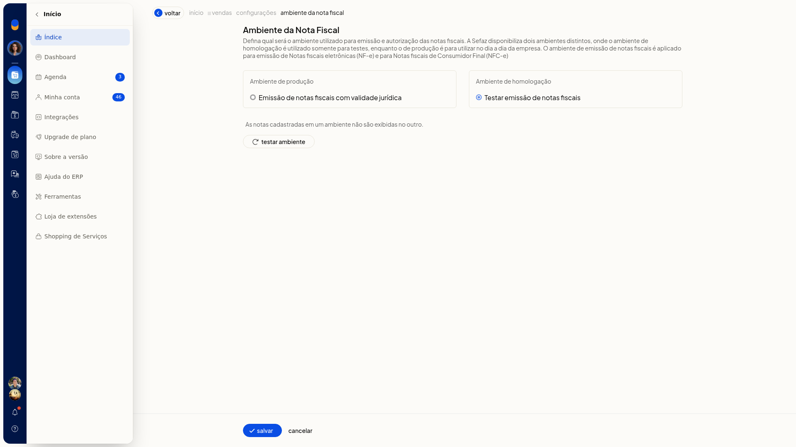
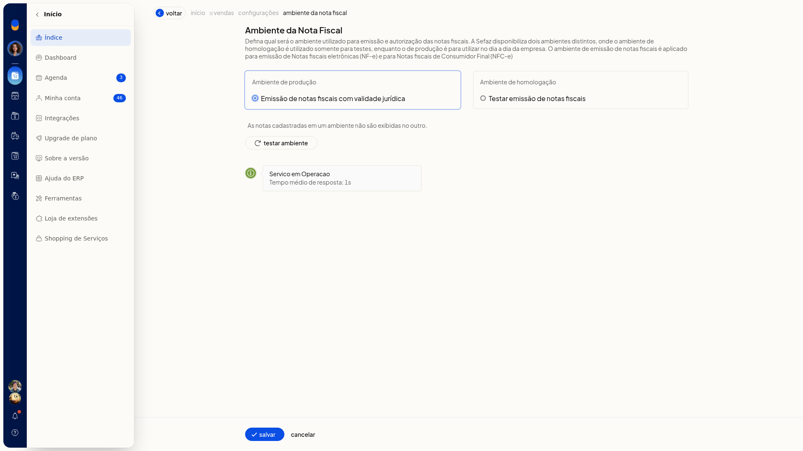
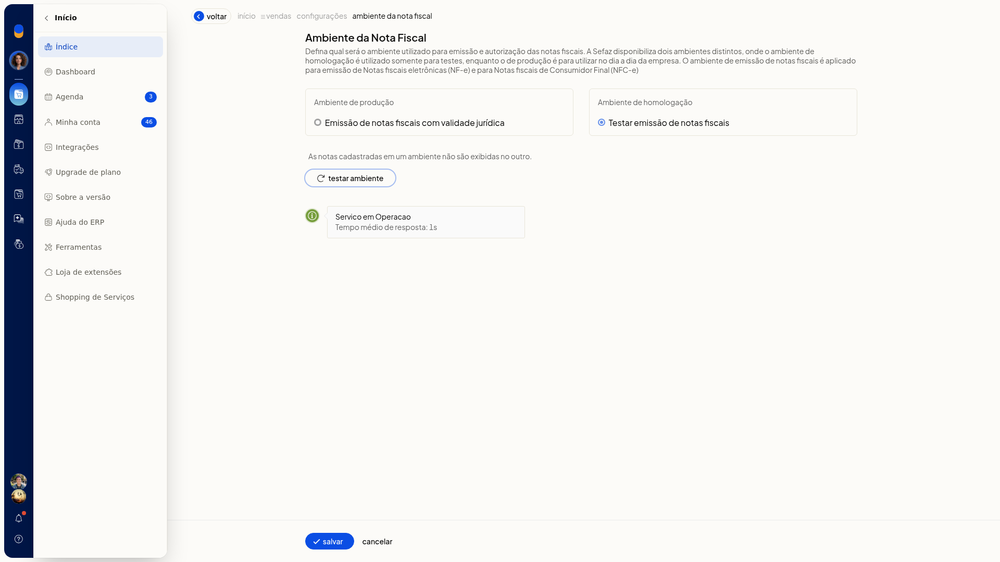

# Testar o ambiente das notas fiscais

## Importante
- O ambiente de homologação serve somente para testes.
- O ambiente de produção é para o dia a dia e descreve emissão de notas fiscais com validade jurídica.
- As notas cadastradas em um ambiente não são exibidas no outro.
- Marcar um ambiente não grava a escolha. Para gravar, clique em **Salvar**. Sair da tela sem **Salvar** descarta a seleção.

## Instruções
1. Acesse **Configurações > Configurações ERP**.
2. Abra a aba **Notas Fiscais**.
3. Clique em **Ambiente das notas fiscais**. O item exibe o selo do ambiente já gravado.

   

4. Selecione **Ambiente de produção (Emissão de notas fiscais com validade jurídica)** ou **Ambiente de homologação (Testar emissão de notas fiscais)**.

   

   

5. Clique em **Testar ambiente**. A tela mostra o carregamento e, em seguida, o status do serviço e o tempo médio de resposta.

   
