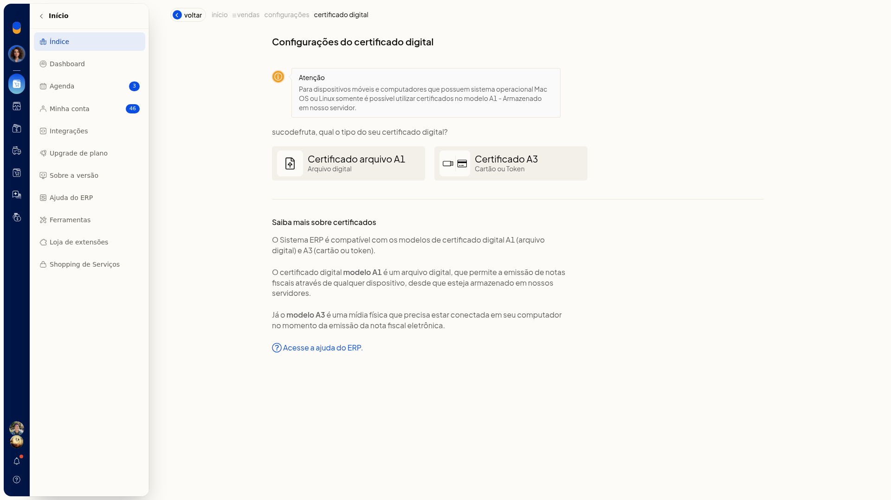
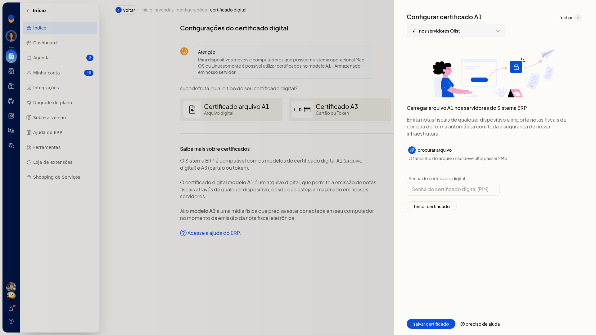
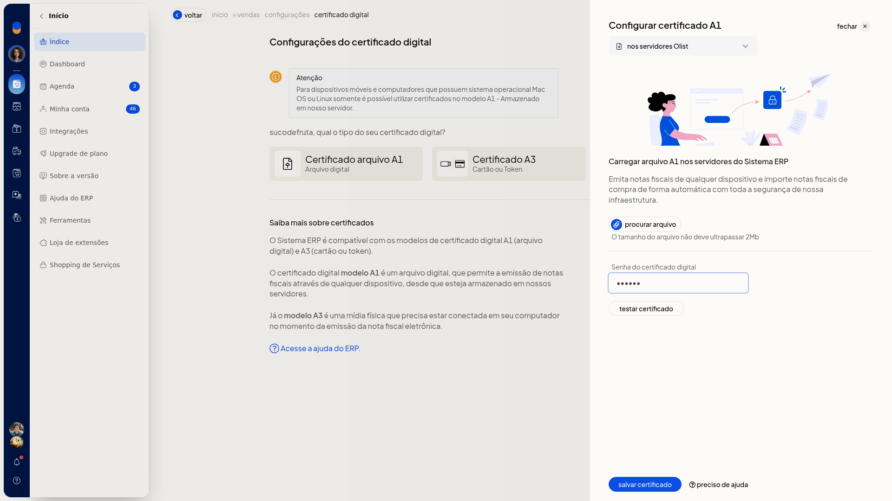
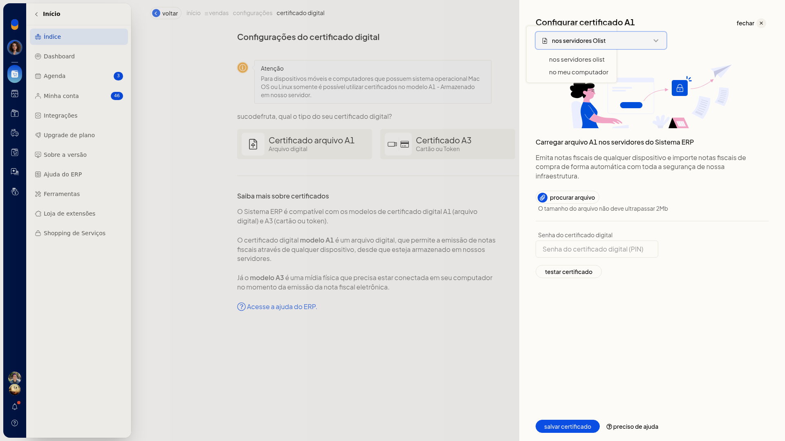
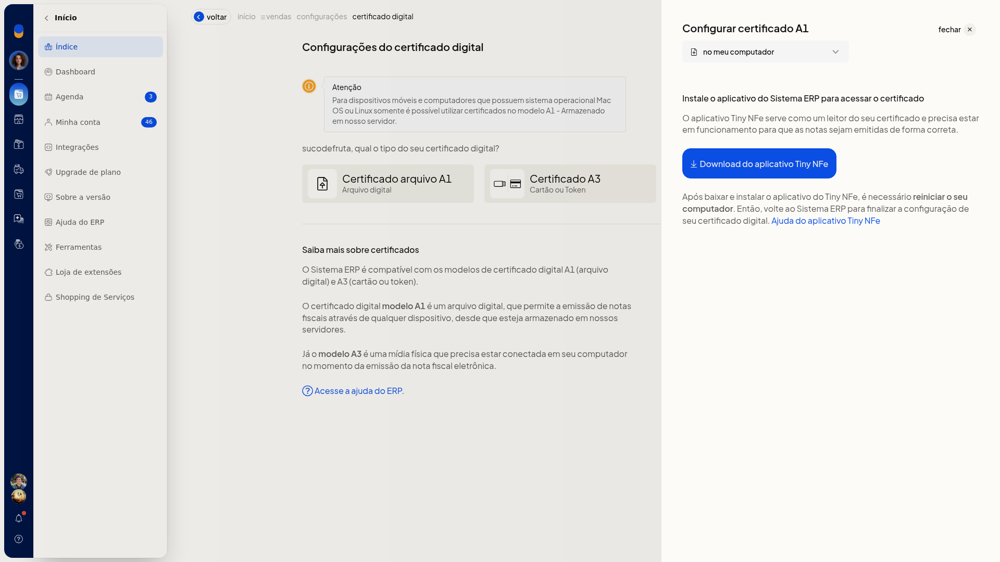
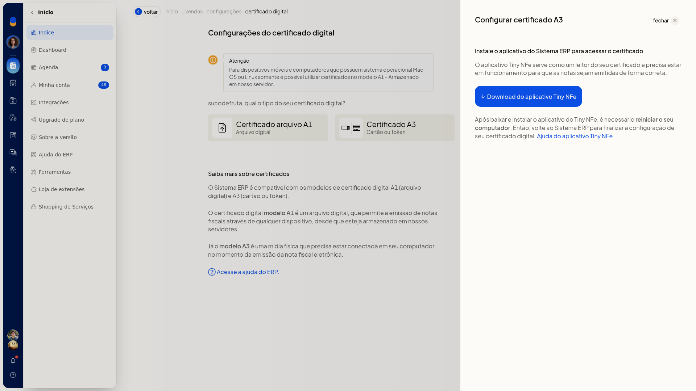

# Configurar o certificado digital (A1 e A3)

A configuração do certificado digital no ERP da Olist prepara o certificado usado para emitir notas fiscais eletrônicas. Você escolhe o modelo A1 (arquivo digital), guardado nos servidores ou no próprio computador, ou o modelo A3 (cartão ou token), lido pelo aplicativo **Tiny NFe**.

Enquanto nada é salvo, o item **Configuração do certificado digital**, na aba **Notas Fiscais**, continua com o distintivo **Configuração pendente**.

## Pré-requisitos
- Ter um certificado digital modelo A1 (arquivo) ou A3 (cartão ou token).
- A empresa precisa ter NF-e ou NFS-e.
- Se a opção não aparecer para você, peça acesso ao administrador da conta.

## Importante
- Em celular e em computadores com Mac OS ou Linux, só é possível usar certificado A1 armazenado no servidor.
- O arquivo A1 enviado aos servidores tem tamanho máximo de 2 Mb. O campo aceita um único arquivo.
- Para manter o A1 no computador ou usar o A3, instale o aplicativo **Tiny NFe**, reinicie o computador e mantenha o aplicativo em funcionamento na emissão.
- O A3 precisa estar conectado ao computador no momento da emissão.

## Instruções
### Guardar o A1 nos servidores

1. Acesse **Configurações > Configurações ERP > Notas Fiscais**.
2. Clique em **Configuração do certificado digital**.

   

3. Escolha **Certificado arquivo A1 (Arquivo digital)**.

   

4. Mantenha o armazenamento em **nos servidores Olist**.

   

5. Clique em **procurar arquivo** e selecione o arquivo do certificado.
6. Se o certificado tiver senha, preencha **Senha do certificado digital**.

   

7. Clique em **testar certificado** para validar o arquivo e a senha.
8. Clique em **salvar certificado**. O arquivo fica armazenado nos servidores e pode ser usado para emitir notas fiscais de qualquer dispositivo compatível, desde que o armazenamento seja nos servidores.

### Guardar o A1 no computador

1. Acesse **Configurações > Configurações ERP > Notas Fiscais** e clique em **Configuração do certificado digital**.
2. Escolha **Certificado arquivo A1 (Arquivo digital)**.
3. No seletor de armazenamento, troque **nos servidores Olist** por **no meu computador**.

   

4. Clique em **Download do aplicativo Tiny NFe** para obter o instalador.

   

5. Se precisar do passo a passo do aplicativo, clique em **Ajuda do aplicativo Tiny NFe**.
6. Instale o aplicativo, reinicie o computador e volte ao ERP para finalizar a configuração. O certificado permanece no computador, e o **Tiny NFe** precisa estar em funcionamento para a emissão das notas.

### Usar o certificado A3

1. Acesse **Configurações > Configurações ERP > Notas Fiscais** e clique em **Configuração do certificado digital**.
2. Escolha **Certificado A3 (Cartão ou Token)**.

   

3. Clique em **Download do aplicativo Tiny NFe**.
4. Se precisar do passo a passo do aplicativo, clique em **Ajuda do aplicativo Tiny NFe**.
5. Instale o aplicativo, reinicie o computador e volte ao ERP para finalizar a configuração. Mantenha o cartão ou token conectado no momento da emissão. O certificado é lido localmente pelo **Tiny NFe** enquanto o cartão ou token está conectado.

## Resultado
Com o A1 salvo nos servidores, o certificado pode ser usado para emitir notas fiscais em qualquer dispositivo compatível. Com o A1 no computador ou com o A3, a emissão depende do **Tiny NFe** em funcionamento. No A3, o cartão ou token precisa estar conectado.

Enquanto o certificado não é salvo, **Configuração do certificado digital** segue com o distintivo **Configuração pendente**.

## Informações adicionais
- A tela de tipo confirma a compatibilidade com A1 (arquivo digital) e A3 (cartão ou token) e explica o uso de cada modelo.
- Nesta tela não há opção de configurar o certificado por planilha nem por integração.
- A data de vencimento do certificado é exibida quando a empresa tem NF-e ou NFS-e.
- **Acesse a ajuda do ERP** abre o artigo de como configurar o certificado digital no ERP.
- **Voltar** retorna à lista da aba **Notas Fiscais**.
