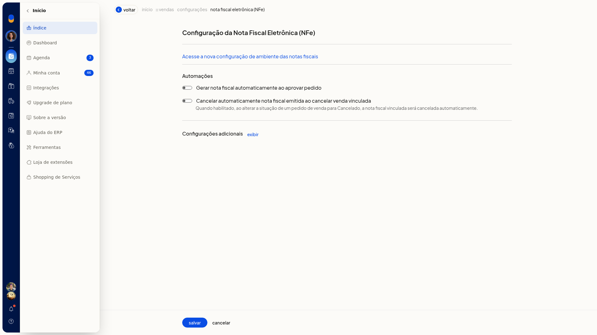
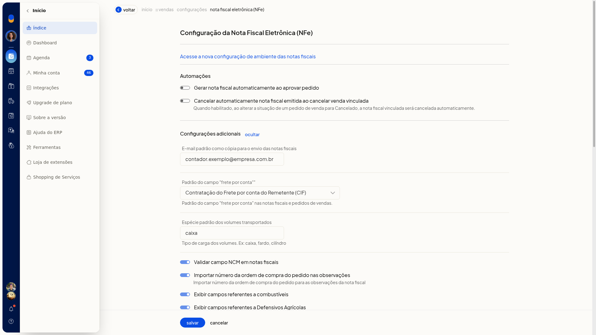
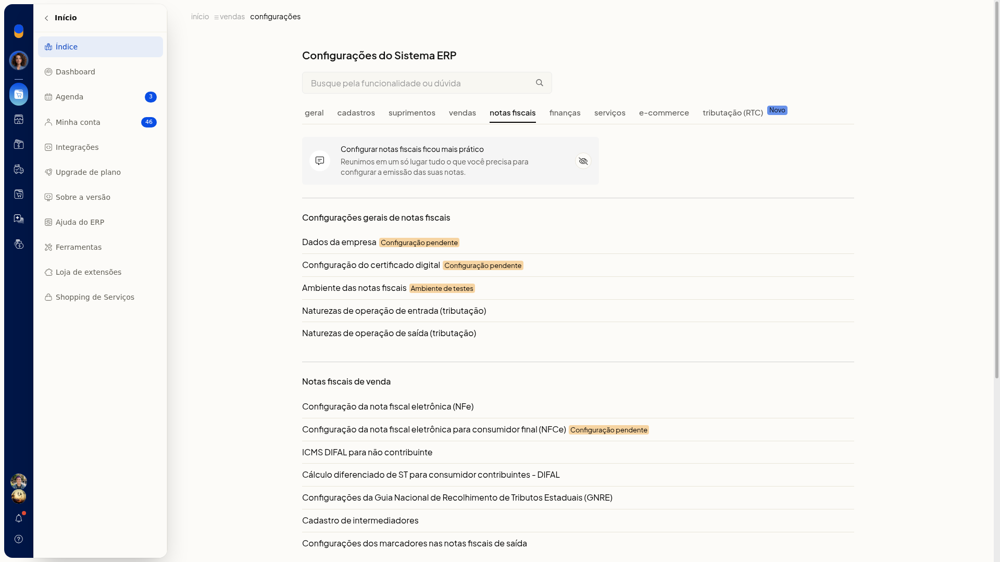
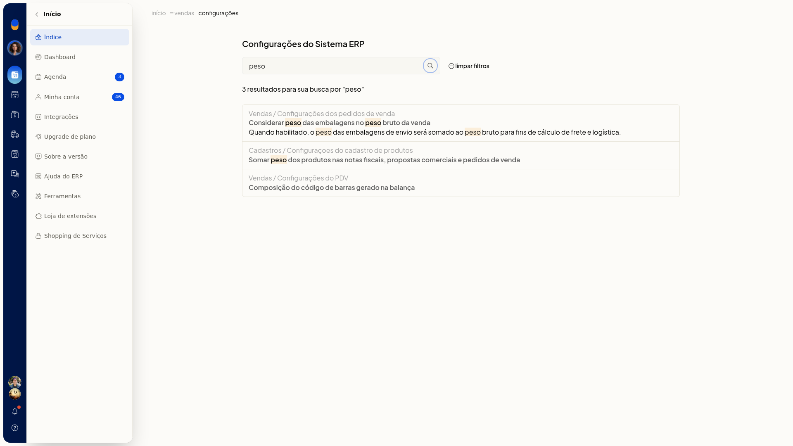
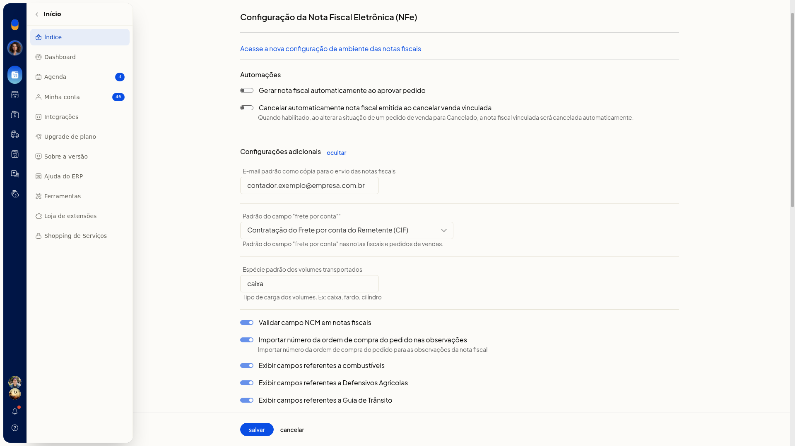
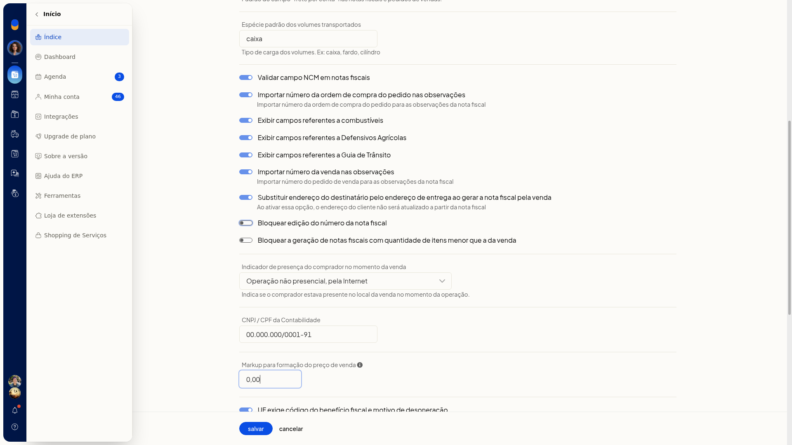
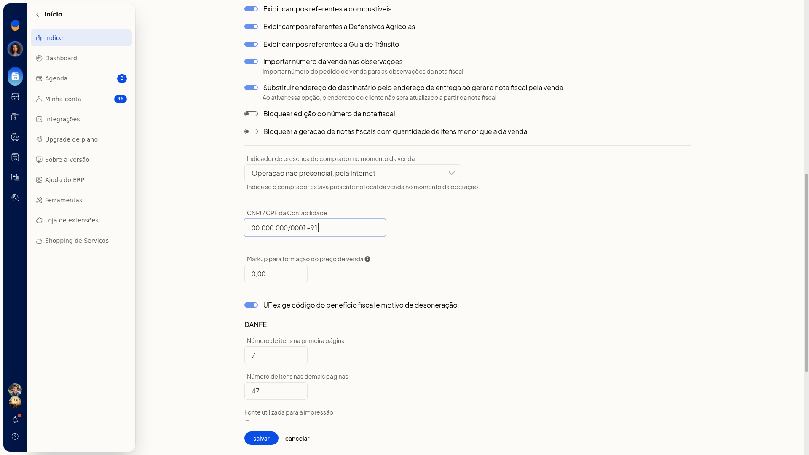
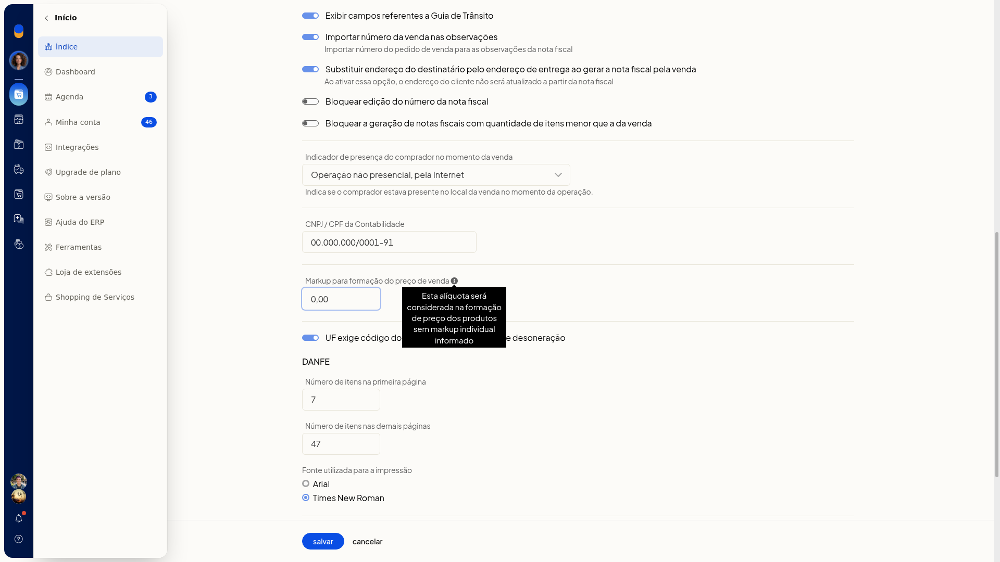

# Configuração da NF-e: automações e configurações adicionais

Na tela **Configuração da nota fiscal eletrônica (NFe)** do ERP da Olist, você define as automações ligadas ao pedido e os dados complementares da NF-e: frete, volumes, observações, presença do comprador e contabilidade.

Com isso, você escolhe se a nota é gerada ao aprovar o pedido, se a nota emitida é cancelada junto com a venda e quais desses dados entram na nota.

## Pré-requisitos
- A empresa precisa ter o módulo de nota fiscal eletrônica.
- Se a opção não aparecer para você, peça acesso ao administrador da conta.

## Importante
- Nenhum campo desta tela é obrigatório.
- O cancelamento automático só ocorre quando a situação do pedido de venda passa para **Cancelado** e existe nota vinculada.
- Com a substituição pelo endereço de entrega, o endereço do cliente não é atualizado a partir da nota.
- O padrão de frete por conta vale para as notas fiscais e para os pedidos de venda.
- **Bloquear a geração de notas fiscais com quantidade de itens menor que a da venda** só aparece se a empresa não tiver o módulo de faturar pedidos agrupadamente.

## Instruções
1. Acesse **Configurações > Configurações ERP > Notas Fiscais > Configuração da nota fiscal eletrônica (NFe)**.
2. Em **Automações**, ligue ou desligue **Gerar nota fiscal automaticamente ao aprovar pedido** e **Cancelar automaticamente nota fiscal emitida ao cancelar venda vinculada**.

   

3. Em **Configurações adicionais**, clique em **exibir**. O link passa a **ocultar** e os campos ficam visíveis.

   

   

4. Ajuste os campos que você quer usar.

   

#### Envio, frete e volumes

- **E-mail padrão como cópia para o envio das notas fiscais**: digite um email.
- **Padrão do campo "frete por conta"**: selecione uma opção:
 - Contratação do Frete por conta do Remetente (CIF)
 - Contratação do Frete por conta do Destinatário (FOB)
 - Contratação do Frete por conta de Terceiros
 - Transporte Próprio por conta do Remetente
 - Transporte Próprio por conta do Destinatário
 - Sem Ocorrência de Transporte
- **Espécie padrão dos volumes transportados**: digite o tipo de carga, como caixa ou fardo.

#### Observações e campos da nota

- **Validar campo NCM em notas fiscais**
- **Importar número da ordem de compra do pedido nas observações**: importa o número da ordem de compra do pedido para as observações da nota fiscal.
- **Importar número da venda nas observações**: importa o número do pedido de venda para as observações da nota fiscal.
- **Exibir campos referentes a combustíveis**
- **Exibir campos referentes a Defensivos Agrícolas**
- **Exibir campos referentes a Guia de Trânsito**
- **Substituir endereço do destinatário pelo endereço de entrega ao gerar a nota fiscal pela venda**

#### Bloqueios, presença e contabilidade

- **Bloquear edição do número da nota fiscal**
- **Bloquear a geração de notas fiscais com quantidade de itens menor que a da venda**
- **Indicador de presença do comprador no momento da venda**: indica se o comprador estava presente no local da venda. Selecione uma opção:
 - Não se aplica (por exemplo, Nota Fiscal complementar ou de ajuste)
 - Operação presencial
 - Operação não presencial, pela Internet
 - Operação não presencial, Teleatendimento
 - Operação presencial, fora do estabelecimento
 - Operação não presencial, outros

- **CNPJ / CPF da Contabilidade**: digite o CNPJ ou o CPF.

- **Markup para formação do preço de venda**: digite o valor com vírgula. O ícone ao lado informa que a alíquota é usada quando o produto não tem markup individual.

- **UF exige código do benefício fiscal e motivo de desoneração**

5. Clique em **Salvar**, no fim da tela, para gravar as automações e as configurações adicionais.
