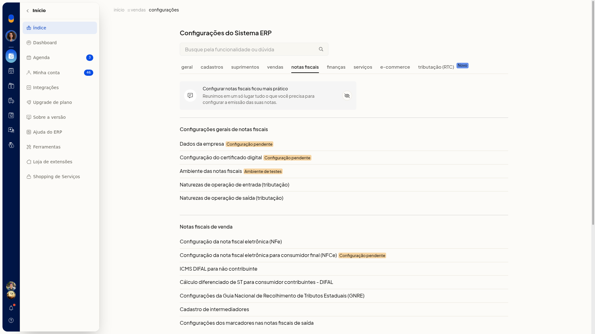
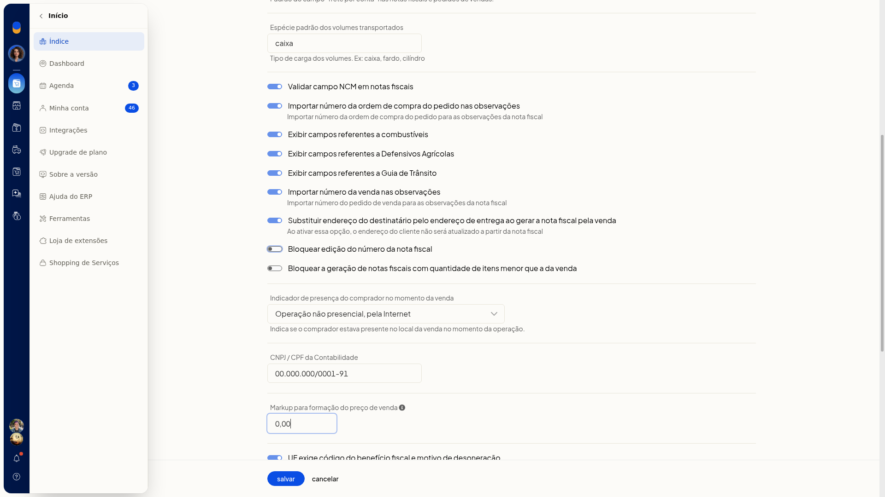

# Número e série da nota fiscal

## Importante
- Nesta tela não há controle de número da primeira nota nem de série.
- Nenhum campo desta tela é obrigatório.

## Instruções
1. Acesse **Configurações > Configurações ERP > Notas Fiscais**.

   

2. Abra **Configuração da nota fiscal eletrônica (NFe)**.
3. Em **Configurações adicionais**, clique em **exibir**. O link passa a **ocultar** e os campos complementares ficam visíveis.
4. Ajuste **Bloquear edição do número da nota fiscal**. A opção não é obrigatória.

   

5. Clique em **Salvar** para gravar o parâmetro.

## Informações adicionais
### Não há item separado de número e série

Em **Notas Fiscais**, não há um item só de número e série. **Configurações gerais de notas fiscais** é título de seção, não um link.
