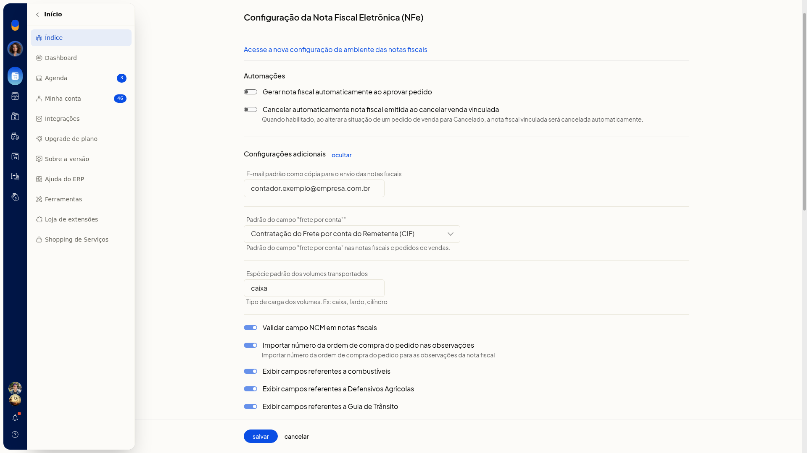
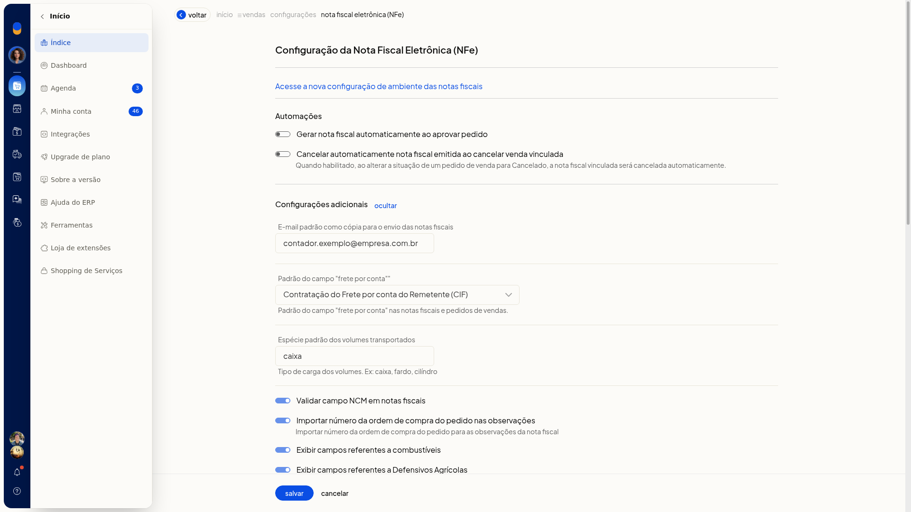

# Peso e volumes na nota fiscal

Na **Configuração da nota fiscal eletrônica (NFe)** do ERP da Olist, você define a espécie padrão dos volumes transportados. Essa espécie é o tipo de carga usado nas notas, como caixa ou fardo.

Nesta tela não há campos de peso nem de quantidade de volumes.

## Pré-requisitos
- A empresa precisa ter o módulo de nota fiscal eletrônica.
- Se a opção não aparecer para você, peça acesso ao administrador da conta.

## Instruções
1. Acesse **Configurações > Configurações ERP > Notas Fiscais > Configuração da nota fiscal eletrônica (NFe)**.
2. Em **Configurações adicionais**, clique em **exibir**.
3. No campo **Espécie padrão dos volumes transportados**, digite o tipo de carga, como caixa ou fardo. O preenchimento não é obrigatório.

   

   

4. Clique em **Salvar** para gravar a espécie padrão dos volumes.
