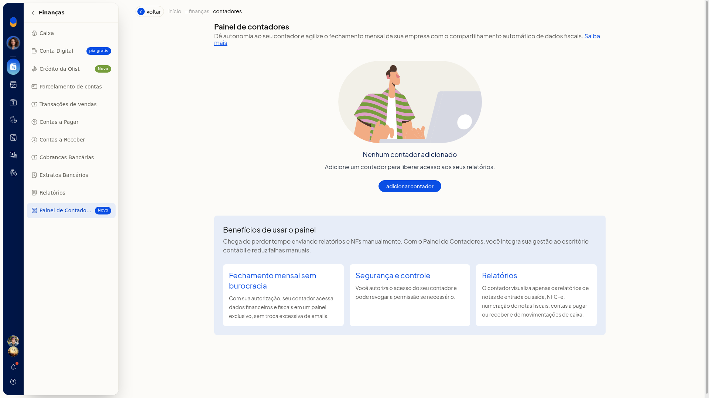
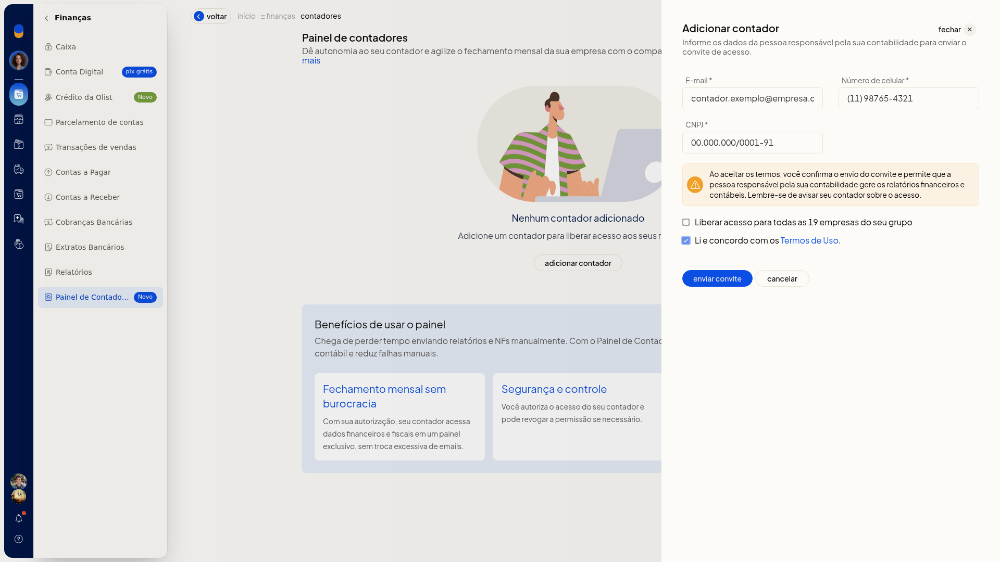
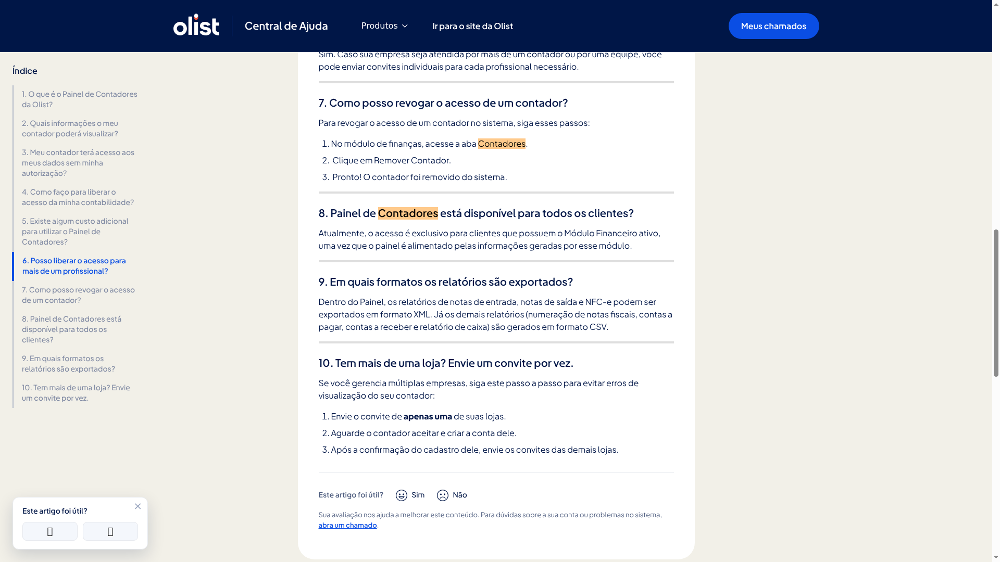

# Contabilidade: acesso do contador, XMLs e Painel de Contadores

O Painel de Contadores, no ERP da Olist, permite que você autorize um contador a consultar, direto no sistema, um conjunto limitado de relatórios da empresa para o fechamento mensal. Você não precisa enviar notas e relatórios manualmente.

O acesso fica em **Finanças > Painel de Contadores**. Você convida o responsável pela contabilidade ou aceita uma solicitação feita por ele. Depois de autorizado, o contador exporta notas de entrada, notas de saída e NFC-e em XML e os demais relatórios permitidos em CSV. O acesso só existe depois do convite ou da autorização e pode ser removido depois.

## Pré-requisitos
- Ter o módulo Financeiro ativo. O painel é exclusivo para clientes com esse módulo, porque é alimentado por ele.
- Ter o email, o número de celular e o CNPJ da pessoa responsável pela contabilidade.
- Concordar com os **Termos de Uso** antes de enviar o convite. O link **Termos de Uso** fica no formulário.

## Importante
- O contador não vê os relatórios sem convite enviado pelo ERP ou autorização feita na plataforma.
- O acesso fica restrito a notas fiscais de entrada e saída, NFC-e, numeração de notas fiscais, contas a pagar, contas a receber e movimentações de caixa.
- Notas de entrada, notas de saída e NFC-e saem em XML. Numeração de notas, contas a pagar, contas a receber e caixa saem em CSV, no Painel do contador.
- Com várias lojas, envie o convite de apenas uma. Espere o contador aceitar e criar a conta e só então convide as demais.
- Se você remover o acesso do contador, será preciso convidá-lo novamente para liberar o acesso outra vez.

## Instruções
### Pela tela

1. Acesse **Finanças > Painel de Contadores**.

   

2. Se ainda não houver contador, a tela mostra **Nenhum contador adicionado**. Clique em **Adicionar contador**.

   

3. Preencha **E-mail**, **Número de celular** e **CNPJ** da pessoa responsável pela contabilidade. Os três campos são obrigatórios.
4. Marque **Liberar acesso para todas as empresas do seu grupo** somente se o mesmo acesso deve valer para todas. Para uma empresa, deixe desmarcado.
5. Marque **Li e concordo com os Termos de Uso.**

   

6. Clique em **Enviar convite**. A tela informa **Convite enviado. Avise seu contador sobre o acesso.**

### Pela solicitação do contador

1. No painel do contador, ele informa **CNPJ**, **E-mail** e **Telefone**.
2. O contador clica em **Solicitar Acesso**.
3. Acesse **Finanças > Painel de Contadores** e aceite a solicitação. O acesso fica autorizado e a tela confirma **Acesso do contador autorizado com sucesso.** O contador só passa a ver os relatórios depois dessa autorização.

### Exportação de XML e CSV pelo contador

1. Libere o acesso pelo convite da tela ou aceitando a solicitação do contador.
2. O contador entra no Painel já autorizado.
3. No Painel, ele exporta os relatórios de notas de entrada, notas de saída e NFC-e em XML.

   

4. Os demais relatórios liberados — numeração de notas fiscais, contas a pagar, contas a receber e relatório de caixa — são gerados em CSV. O contador obtém os arquivos do fechamento sem você enviar as notas manualmente.

## Resultado
Depois do envio ou da autorização, o contador consulta no Painel apenas os relatórios permitidos. Na sua lista, o acesso pode aparecer como **Convite enviado** ou **Ativo**.

## Informações adicionais
- Não há custo adicional para clientes Olist nem para escritórios de contabilidade.
- Você pode convidar mais de um profissional. Cada um recebe um convite individual.
- Na mesma tela, **Saiba mais** abre a FAQ – Painel de Contadores Olist, com o passo a passo, os relatórios liberados e os formatos de exportação.
- As ações da lista são **Reenviar convite**, **Cancelar convite** e **Remover contador**. As confirmações correspondentes são **Convite reenviado com sucesso.**, **Convite cancelado com sucesso.** e **Acesso removido.**
- Se a solicitação do contador não for aceita, a tela informa **Solicitação recusada.**
