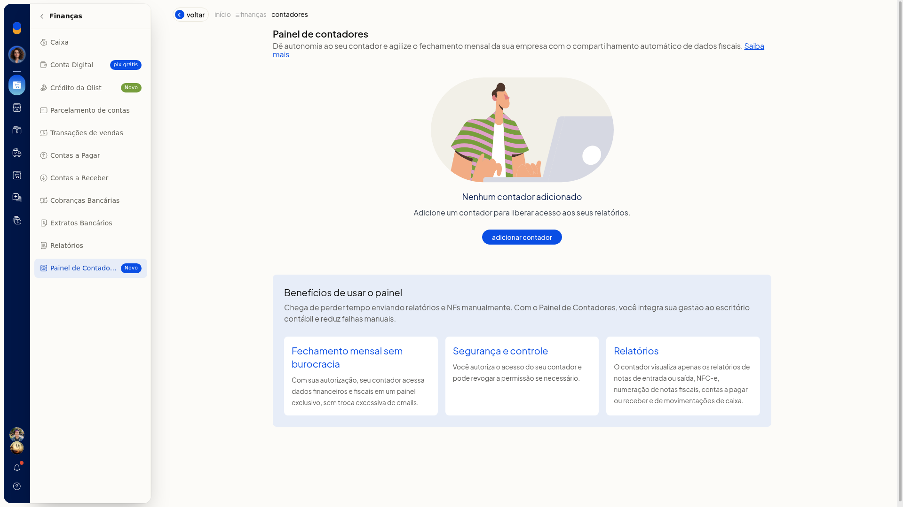
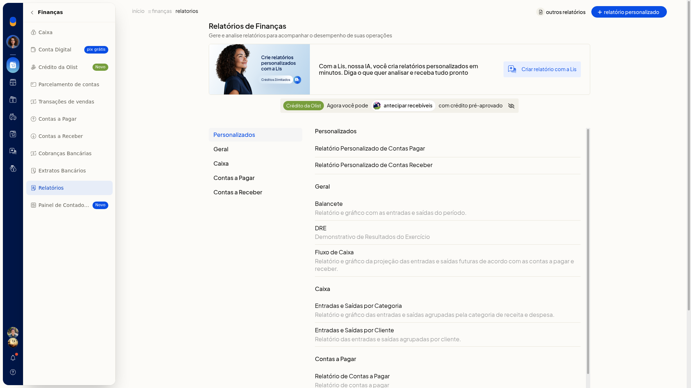
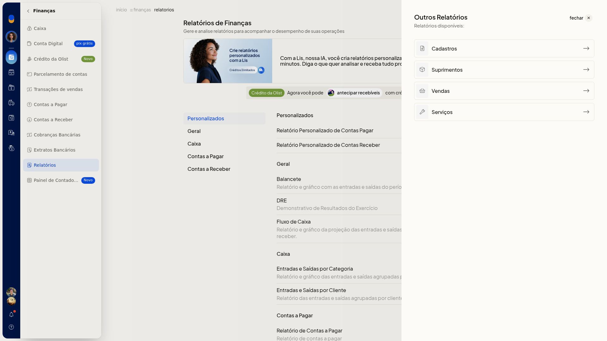

# SPED e Sintegra gerados pelo ERP

No ERP da Olist, os caminhos de **Finanças** indicados para este tema não geram arquivo SPED nem Sintegra. Em **Finanças** não há item com esses nomes.

Em **Finanças > Relatórios**, a lista e o painel **Outros Relatórios** também não levam a SPED nem a Sintegra. **Painel de Contadores** é outra tela: serve para autorizar o contador a exportar notas e relatórios, não para gerar esses arquivos.

## Instruções
1. No menu lateral, clique em **Finanças**.

   

2. Clique em **Relatórios**. A lista mostra relatórios como **Personalizados**, **Balancete**, **DRE**, **Fluxo de Caixa**, entradas e saídas e **Contas a Pagar**. Nenhum título é SPED ou Sintegra.

   

3. Abra **Outros Relatórios**. O painel traz só as categorias **Cadastros**, **Suprimentos**, **Vendas** e **Serviços**.

   

## Resultado
Depois desses caminhos, você permanece nos relatórios de **Finanças** e no painel **Outros Relatórios**. Nenhum dos dois apresenta SPED ou Sintegra para gerar ou baixar.
