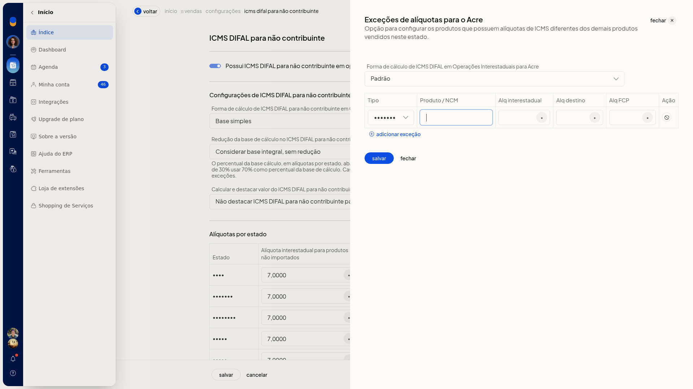
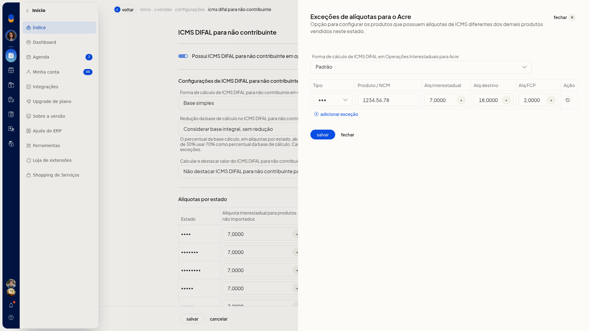
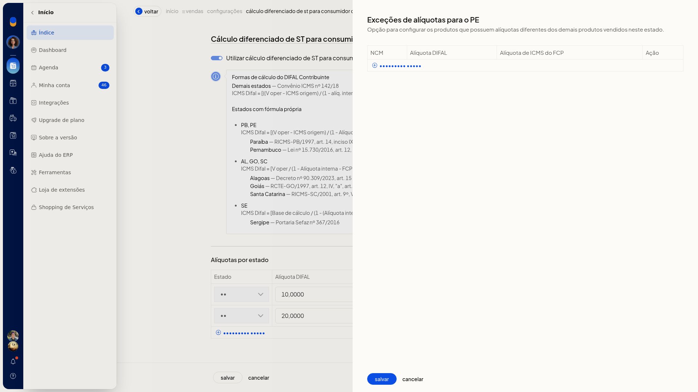
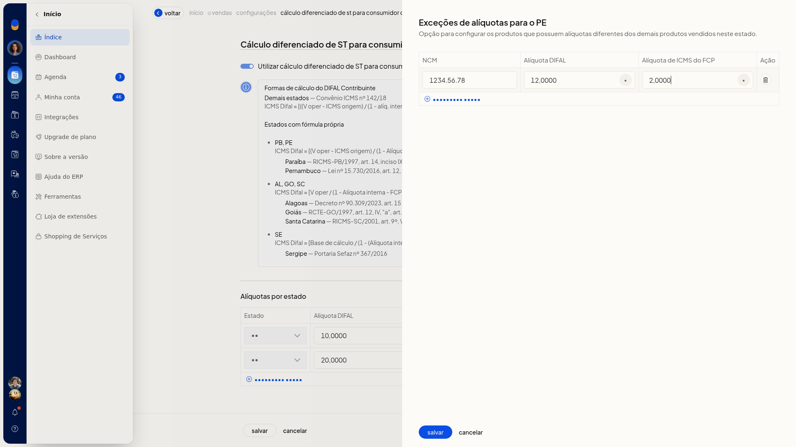

# DIFAL e ST para contribuintes e não contribuintes

## Importante
- No campo de redução da base, o percentual da tabela é a base restante, não o percentual de redução. Uma redução de 30% corresponde a 70% de base.
- No cálculo diferenciado de ST, para os demais estados vale o Convênio ICMS nº 142/18: ICMS Difal = [((V oper - ICMS origem) / (1 - alíq. interna)) × alíq. interna] - ICMS origem. Estados com fórmula própria são indicados na tabela.

## Instruções
### Configurar o ICMS DIFAL para não contribuinte

1. Acesse **Configurações > Configurações ERP**.
2. Abra a aba **Notas Fiscais**.
3. Abra **ICMS DIFAL para não contribuinte**.

   

4. Marque **Possui ICMS DIFAL para não contribuinte em operações interestaduais (EC 87/2015)** se a empresa recolhe esse diferencial.
5. Em **Forma de cálculo**, escolha **Base simples**, **base por dentro (só destino)**, **base por dentro dupla (interestadual + destino)** ou **base por dentro só destino descontando ICMS próprio**.
6. Em **Redução da base**, escolha **Considerar base integral, sem redução** ou a redução pelas alíquotas do estado de destino.
7. Em **Destacar DIFAL de origem**, escolha se o DIFAL de origem deve ser destacado ou não.
8. Confira a tabela **Alíquotas por estado**: alíquota interestadual, alíquota interna de destino sem FCP e FCP.

   

9. Para uma exceção, clique em **Editar** no estado.
10. Em **Forma de cálculo da exceção de alíquota**, escolha **Padrão**, **Base simples** ou uma das bases por dentro.
11. Clique em **Adicionar exceção** e informe **Tipo Produto/NCM**, **Produto/NCM**, **Alq interestadual**, **Alq destino** e **Alq FCP**. Use alíquota com vírgula decimal, no padrão já exibido na tabela. **Alq destino** é a alíquota interna de destino, sem FCP.

   

12. Clique em **Salvar**. A empresa passa a calcular o ICMS DIFAL de não contribuinte nas operações interestaduais com a base, o destaque e as alíquotas definidos, inclusive exceções por produto ou NCM.

### Configurar o cálculo diferenciado de ST para consumidores contribuintes

1. Em **Configurações > Configurações ERP > Notas Fiscais**, abra **Cálculo diferenciado de ST para consumidor contribuintes - DIFAL**.
2. Ative **Utilizar cálculo diferenciado de ST para consumidores contribuintes**.
3. Leia a orientação da tela sobre o Convênio ICMS nº 142/18 e confira na tabela quais estados têm fórmula própria.
4. Informe ou revise a alíquota DIFAL e a alíquota de ICMS do FCP de cada estado. Use **editar** na linha do estado ou **adicionar regra**.

   

5. Na exceção do estado, informe **NCM**, **Alíquota DIFAL** e **Alíquota de ICMS do FCP**, com vírgula decimal.

   

6. Clique em **Salvar**. O cálculo de ST dos consumidores contribuintes passa a usar as alíquotas DIFAL e FCP informadas por estado e as exceções de NCM, em vez da regra geral.

## Resultado
Ao reabrir cada tela, as regras já gravadas de DIFAL e de ST aparecem preenchidas.
