# Guias de pagamento de impostos (GNRE e outras)

## Pré-requisitos
- A empresa precisa ter a GNRE habilitada para abrir as guias de pagamento. Se a opção não aparecer para você, peça acesso ao administrador da conta.
- Para a guia refletir DIFAL ou ST, a regra correspondente precisa estar definida na aba **Notas Fiscais**.
- Para guias de fulfillment, marque **Gerar guias de fulfillment** e indique o canal em **configurar integrações**.
- Para registrar o pagamento de uma guia gerada, escolha uma conta financeira no seletor da guia.

## Importante
- **Convênio padrão** é obrigatório em cada receita usada. Enquanto não for informado, o estado pode aparecer como **Configuração pendente**.
- A geração automática depende de **Enviar NF ao módulo GNRE ao autorizar** e de **Gerar guias automaticamente ao enviar NF ao módulo GNRE**.
- **corrigir** não edita a guia. A orientação é remover a guia, cancelar a nota já emitida, reemitir em **Vendas > Notas Fiscais** e gerar a guia novamente.
- **Marcar como pago e concluir** só fica disponível depois de escolher a conta financeira. Use só quando o pagamento for de fato registrado.
- **gerar novamente**, **Lançar contas** e **remover** alteram os dados da guia.
- Guias com data de pagamento expirada continuam na lista até serem geradas novamente. Use **gerar novamente** da faixa só se quiser atualizar a data de pagamento.
- **Cancelar** descarta o que não foi salvo.

## Instruções
### Configurar a geração das guias

1. Acesse **Configurações > Configurações ERP**.
2. Abra a aba **Notas Fiscais**.

   

3. Abra **Configurações da Guia Nacional de Recolhimento de Tributos Estaduais (GNRE)**.
4. Confira **Categoria padrão contas a pagar**.
5. Marque, conforme a operação: **Enviar NF ao módulo GNRE ao autorizar**, **Gerar guias de fulfillment** e **Gerar guias automaticamente ao enviar NF ao módulo GNRE**.
6. Informe o **Marcador padrão**.

   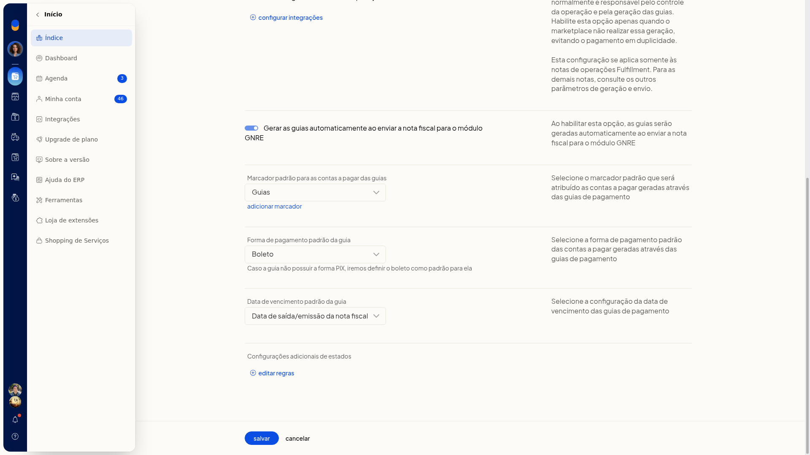

7. Em **Forma de pagamento**, escolha **Boleto** ou **Pix**. Sem Pix, o boleto é o padrão.
8. Em **Vencimento**, escolha **Data de saída/emissão da nota fiscal**, **data de geração da guia** ou **próximo dia útil após a geração**.
9. Clique em **Salvar**. As notas autorizadas podem ser enviadas ao módulo GNRE e as guias podem ser geradas automaticamente, com categoria, marcador, forma de pagamento e vencimento padrão. **Cancelar** descarta as alterações.

### Informar o convênio por estado

1. Na configuração da GNRE, abra **Editar regras**.
2. No painel **Configurações adicionais de estados**, localize o estado. Vários aparecem como **Configuração pendente** até o convênio ser informado.
3. Abra o estado e a receita usada. No Amapá, as abas são **100099 ICMS ST** e **100102 ICMS DIFAL**.

   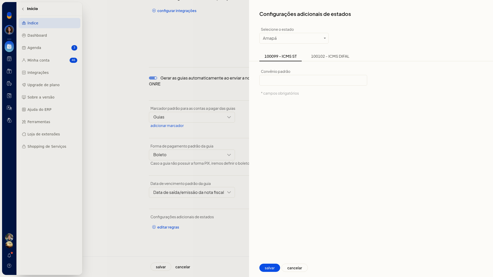

4. Preencha **Convênio padrão** em cada receita usada. O campo é obrigatório.
5. Grave a regra para o estado deixar de depender da configuração pendente. Se não for gravar, clique em **Cancelar**.

   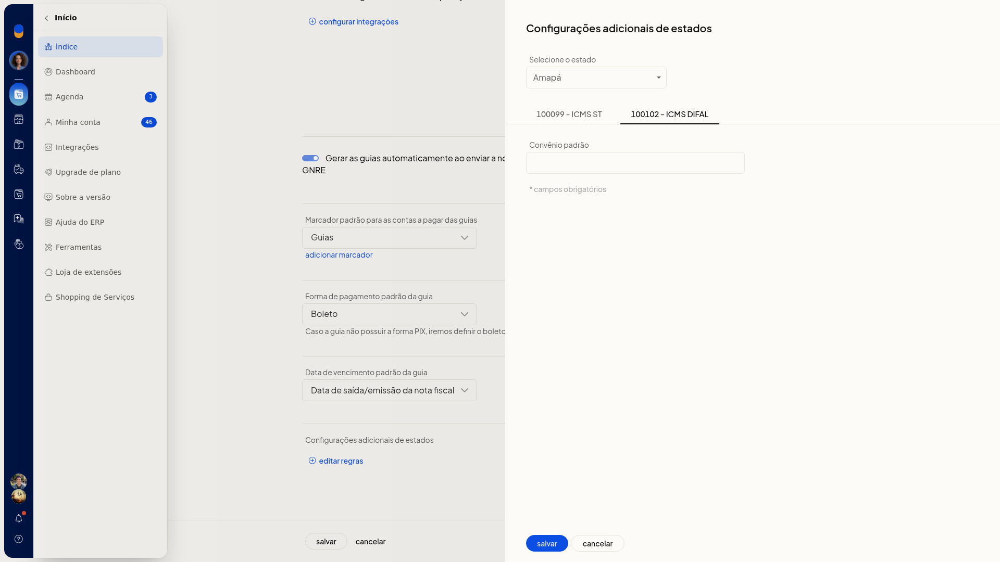

### Indicar canais de fulfillment

1. Na configuração da GNRE, abra **configurar integrações**.
2. A lista mostra os canais já conectados à empresa. Não é preciso ativar a integração nesta consulta.
3. Marque os canais que devem gerar guias de fulfillment.

   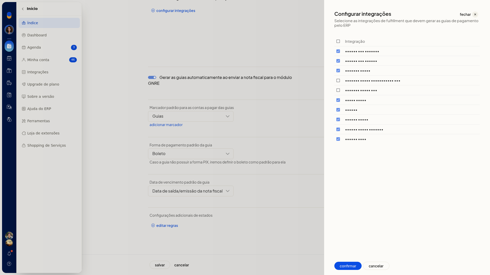

4. Clique em **Confirmar**. Os canais marcados passam a ser considerados na geração de guias de fulfillment, desde que **Gerar guias de fulfillment** esteja habilitada. **Cancelar** fecha sem alterar a seleção.

### Consultar as guias

1. Acesse **Vendas > Notas Fiscais > guias de pagamento**.
2. Em **Pesquise por cliente ou número**, localize a guia. O refinamento oferece número, cliente ou **Não refinar**.
3. Em **por periodo**, filtre pela data de emissão: sem filtro, período, mês, últimos 30 dias ou uma data.
4. Em **todos os estados**, restrinja a UF. Cancele se não quiser aplicar.
5. Em **todas as guias**, escolha **Todas as guias**, **Vencidas**, **A vencer** ou **Pagamento expirado**. Cancele se não quiser aplicar.
6. Troque de aba: **Aguardando**, **Com erro**, **Guias geradas** ou **Guias pagas**. As três últimas exibem contagem.
7. Na aba **Guias geradas**, a lista mostra **N° da nota**, **Receita**, **Data emissão da nota**, **N° de controle**, **Data vencimento**, **Data prev. pagamento**, **CPF/CNPJ/Insc. Est.**, **UF**, **Valor (R$)** e **Integrações**. O rodapé mostra a quantidade e o valor total do imposto.
8. Se houver guias com data de pagamento expirada, a faixa avisa e oferece **gerar novamente**. Use esse botão só para atualizar a data de pagamento.

   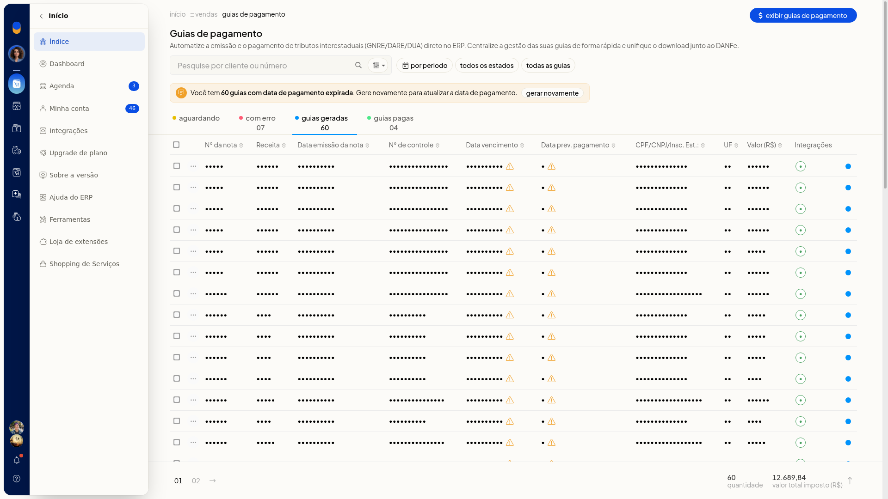

9. Na aba **Com erro**, as colunas são **Nº**, **Data emissão**, **Cliente**, **UF**, **Imposto (R$)** e **Erro**, com a ação **corrigir**.
10. Na aba **Guias pagas**, a lista segue as colunas da guia emitida. O menu da linha oferece **imprimir**, **Download unificado** e **remover**. Você localiza as guias por situação, período, estado e vencimento, e vê quantidade, valor total e, quando houver, o aviso de pagamento expirado.

### Exibir, imprimir ou registrar o pagamento

1. Em **Guias geradas**, abra o menu da linha.
2. As opções são **Exibir guia de pagamento**, **gerar novamente guia de pagamento**, **imprimir** e **remover**.
3. Escolha **Exibir guia de pagamento** para abrir o documento, com código de barras, sem alterar a guia.

   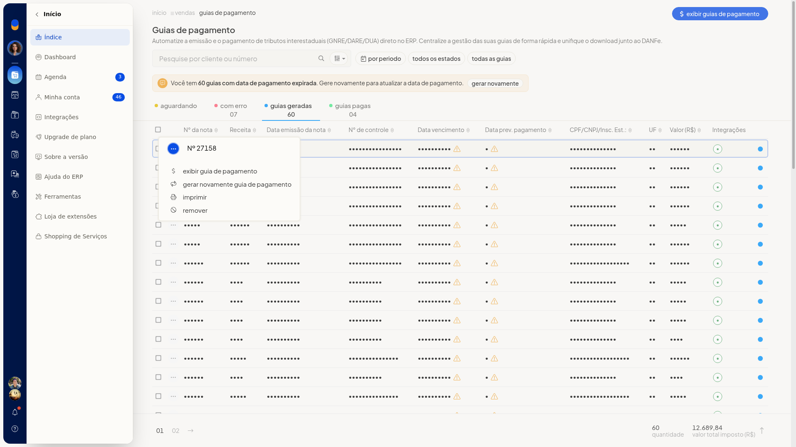

4. Clique em **Imprimir guia** para emitir a impressão. Em **Selecione**, escolha a conta financeira do registro do pagamento, entre caixa, bancos e gateways. **Marcar como pago e concluir** só deve ser usado quando o pagamento for de fato registrado.

   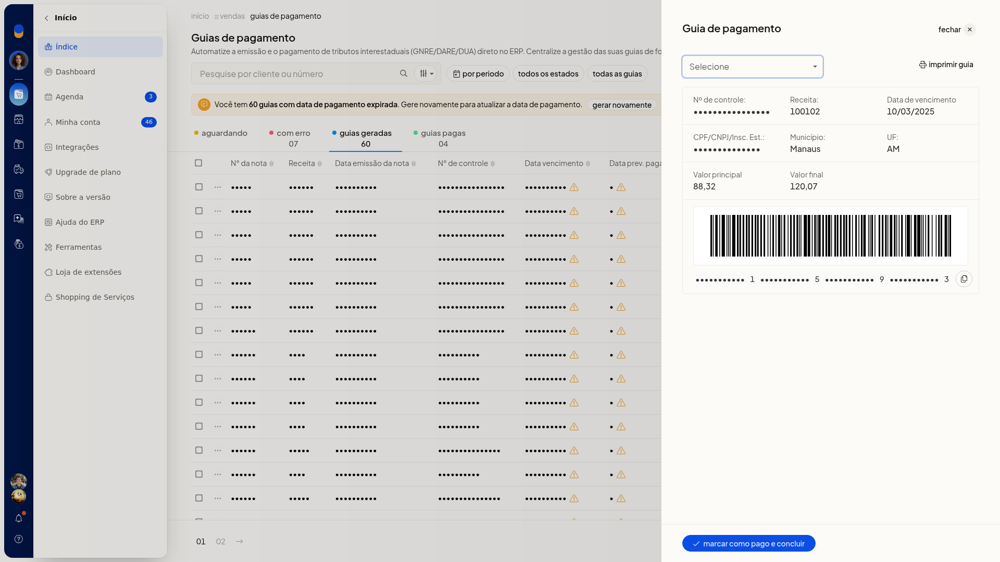

5. Para várias guias, marque as linhas. A barra oferece **Exibir guias de pagamento**, **Lançar contas** e **Mais ações**.

   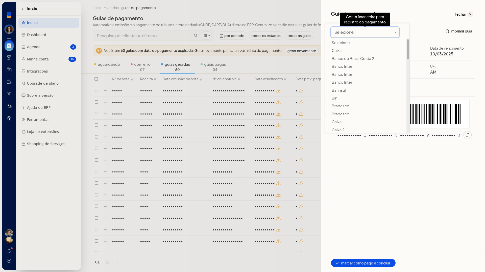

6. Em **Mais ações**, use **Exibir guias de pagamento**, **gerar novamente guias de pagamento**, **Lançar contas** ou **remover**.

   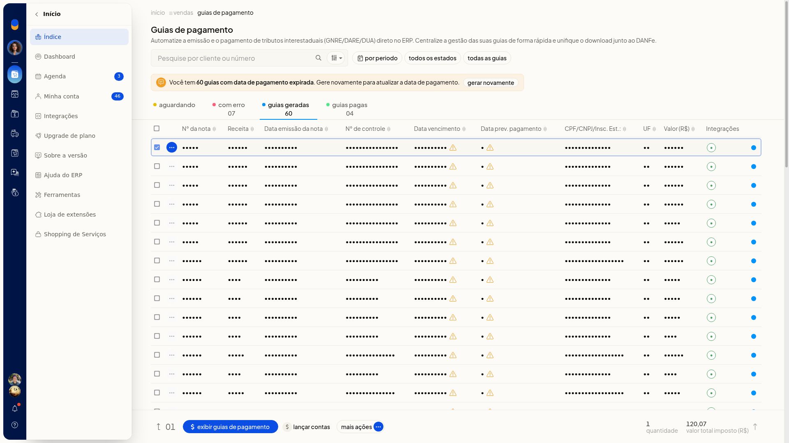

7. Nas guias pagas, a seleção em lote oferece **Lançar contas** e, em **Mais ações**, **Lançar contas** e **Download Unificado**. A guia gerada pode ser consultada e impressa. O pagamento, o lançamento de contas, a nova geração e a remoção ficam no mesmo menu.

   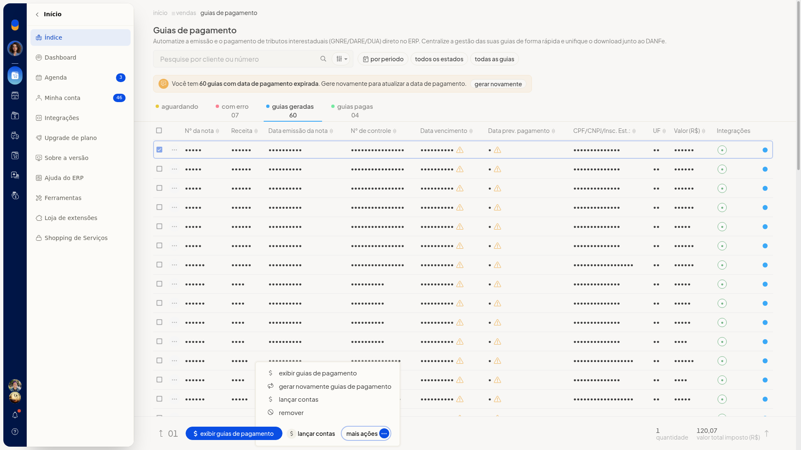

### Tratar uma guia com erro

1. Abra a aba **Com erro**.
2. Leia o texto da coluna **Erro**. Os motivos podem ser CEP ou código de município inválido, ou CNPJ/CPF que não confere com a chave de acesso.
3. Clique em **corrigir**. O painel mostra os dados da guia e orienta a remover a guia, cancelar a nota já emitida, reemitir em **Vendas > Notas Fiscais** e gerar a guia novamente. Não há campos editáveis.
4. O menu da linha também oferece **imprimir** e **remover**.

   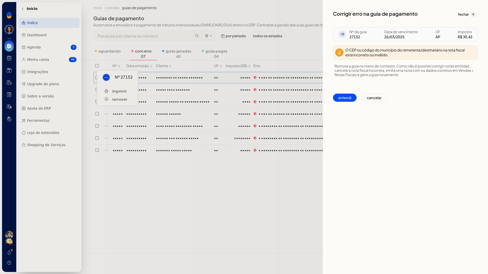

5. Siga a orientação para corrigir a falha: remova a guia, cancele e reemita a nota e gere a guia de novo. **entendi** apenas fecha o aviso e não grava correção na guia. **cancelar** fecha o painel se você não for seguir a orientação.

## Resultado
As guias emitidas aparecem em **Guias geradas**, com receita, vencimento, UF e valor. O rodapé soma a quantidade e o valor total do imposto. As guias já pagas ficam em **Guias pagas**. As falhas ficam em **Com erro**, com o motivo na coluna **Erro**. **Exibir guia de pagamento** abre o documento com código de barras, sem marcar a guia como paga.

## Informações adicionais
- As regras já gravadas da GNRE aparecem preenchidas ao reabrir a tela.
- O filtro de últimos 30 dias pode esvaziar as abas. Limpe os filtros para voltar a listar as guias existentes.
- O download unificado das guias pagas reúne os arquivos junto ao DANFe.
