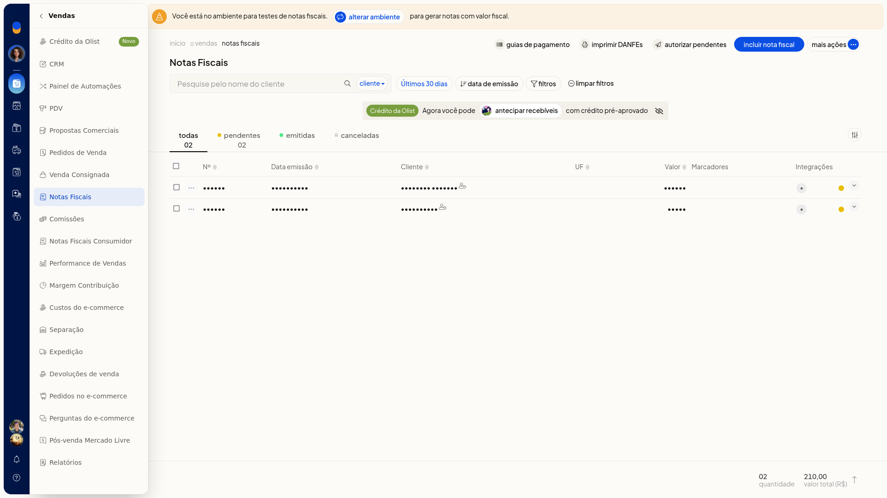
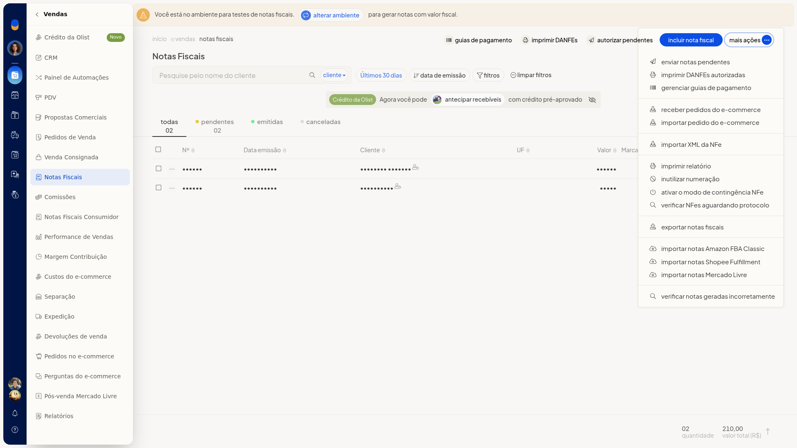
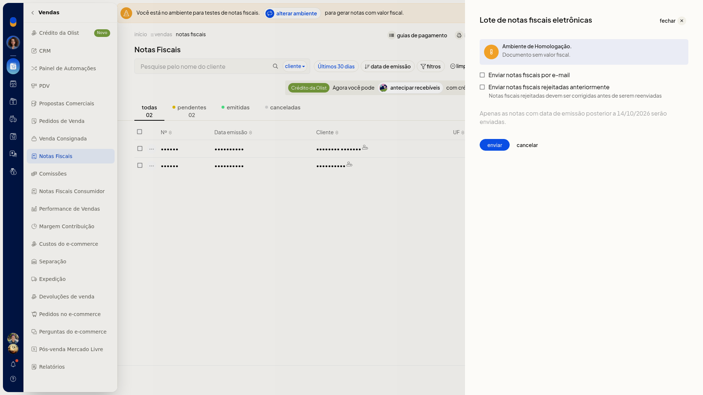
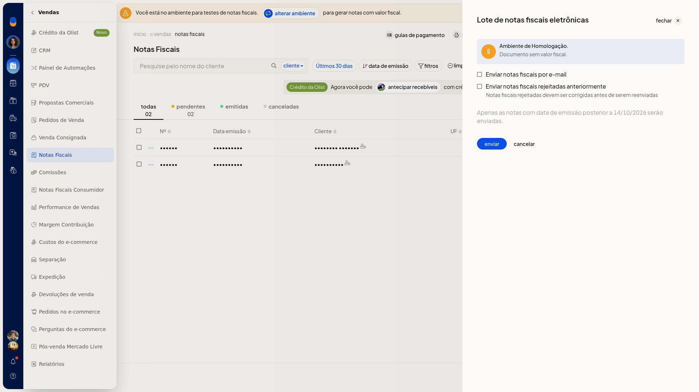
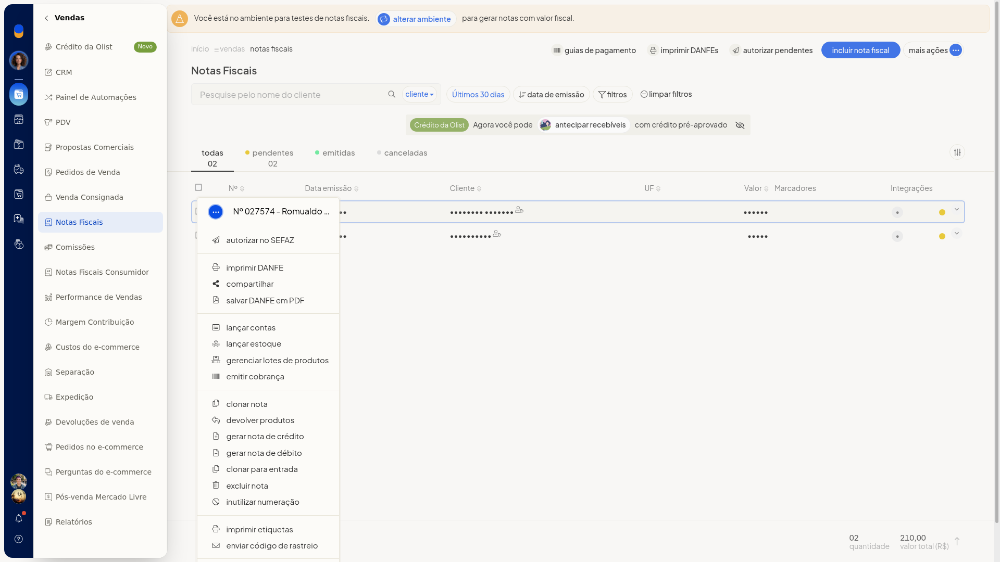
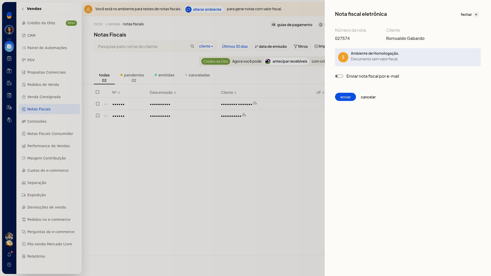

# Autorizar notas na SEFAZ

No ERP da Olist, você envia notas fiscais pendentes para autorização na SEFAZ. Dá para enviar várias notas de uma vez ou uma nota por vez, até a pré-confirmação de envio.

As duas formas ficam em **Vendas > Notas Fiscais**.

## Pré-requisitos
- A lista precisa ter nota pendente.

## Importante
- O painel mostra **Ambiente de Homologação**.
- Só serão enviadas notas emitidas após 14/10/2026.
- No lote, **Enviar notas fiscais por e-mail** e **Enviar notas fiscais rejeitadas anteriormente** abrem desmarcadas.
- Na nota individual, **Enviar nota fiscal por e-mail** abre desmarcada.

## Instruções
### Autorizar notas pendentes em lote

1. Acesse **Vendas > Notas Fiscais**.

   

2. Clique em **Autorizar pendentes** ou abra **Mais ações > Enviar notas pendentes**.

   

3. Aguarde o painel **Lote de notas fiscais eletrônicas** terminar de carregar.
4. Confira **Ambiente de Homologação** e o aviso de data de emissão. Marque **Enviar notas fiscais por e-mail** ou **Enviar notas fiscais rejeitadas anteriormente** só se quiser essas opções.

   

   

5. Clique em **enviar** para seguir com o envio à SEFAZ. Clique em **cancelar** para voltar à lista sem enviar.

### Autorizar uma nota

1. Acesse **Vendas > Notas Fiscais**.
2. Na linha da nota, abra o menu **•••**.

   

3. Clique em **Autorizar no SEFAZ**.
4. Aguarde o painel da nota fiscal eletrônica. Confira o aviso de homologação e marque **Enviar nota fiscal por e-mail** só se quiser essa opção.

   

5. Clique em **enviar** para seguir com o envio à SEFAZ. Clique em **cancelar** para voltar à lista sem enviar.

## Resultado
O painel de lote ou o painel individual fica na pré-confirmação, com **enviar** e **cancelar**. Ao cancelar, a lista volta sem envio à SEFAZ.

## Informações adicionais
- **Autorizar pendentes** e **Enviar notas pendentes** abrem o mesmo painel **Lote de notas fiscais eletrônicas**.
- **Autorizar no SEFAZ** não troca de página: o painel da nota abre na lista.
