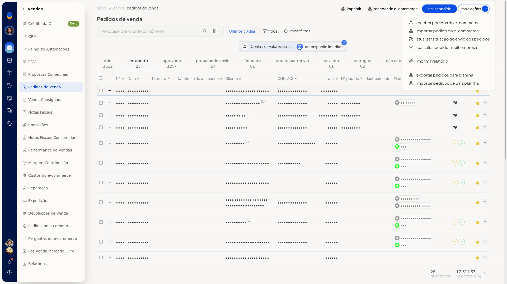
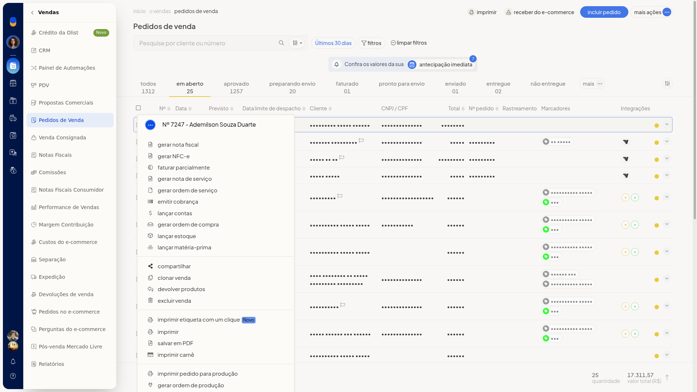
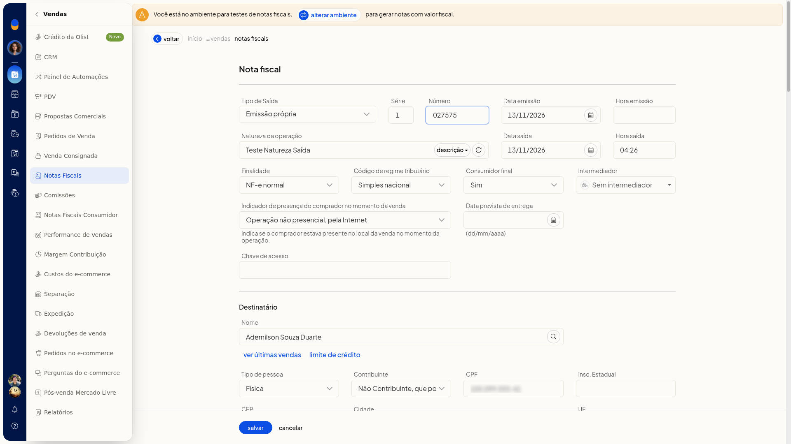
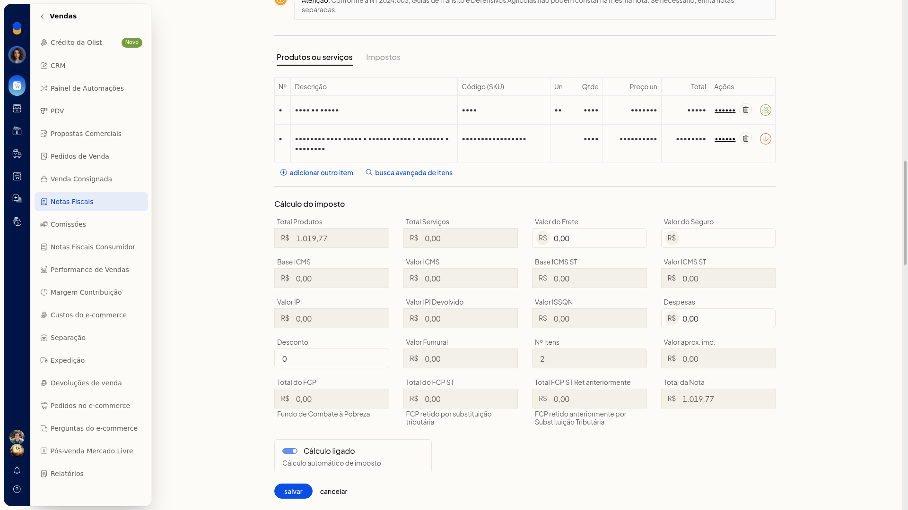
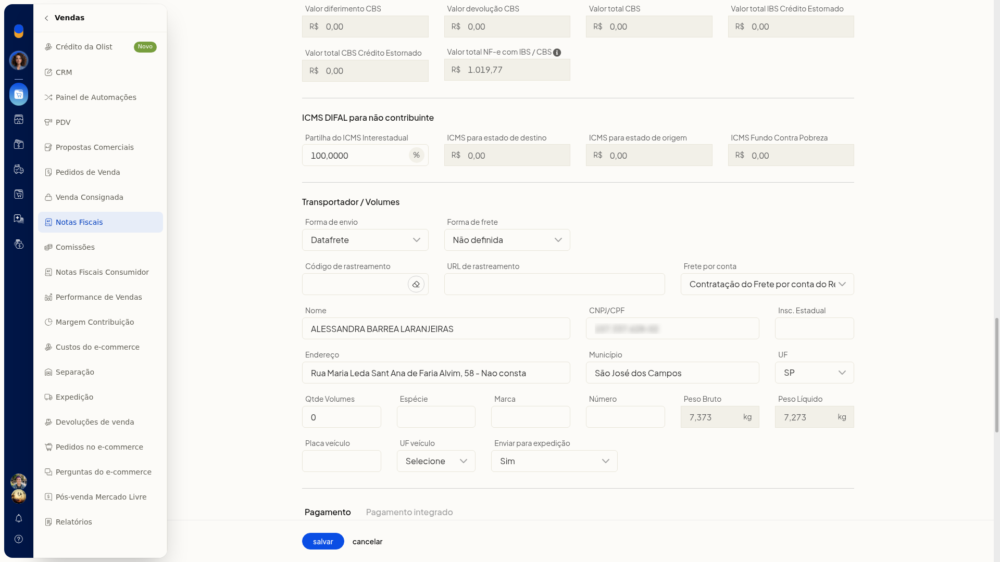
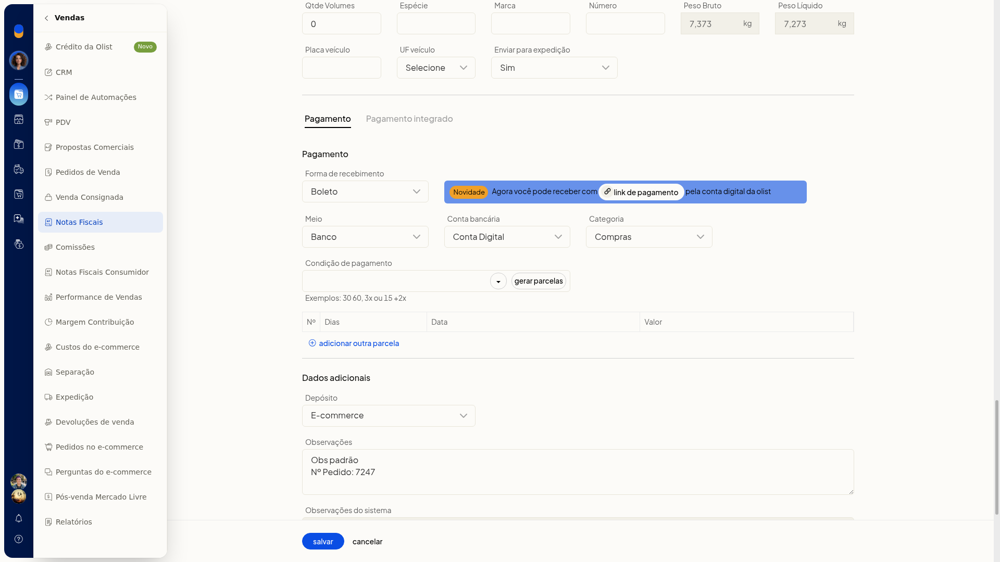

# Gerar nota fiscal a partir do pedido

No ERP da Olist, você gera a nota fiscal a partir de um pedido de venda já registrado. O formulário abre com os dados desse pedido para você revisar o cabeçalho, o destinatário, os itens, o transporte e o pagamento. Nessa abertura, a nota ainda não fica gravada.

## Pré-requisitos
- É preciso já existir um pedido de venda.
- Se a opção não aparecer para você, peça acesso ao administrador da conta.

## Importante
- A geração da nota fica no menu **•••** da linha do pedido. Em **Mais ações** de **Pedidos de Venda** não há **Gerar nota fiscal**; esse menu lista receber, importar e exportar pedidos.

## Instruções
1. Acesse **Vendas > Pedidos de Venda**.
2. Na linha do pedido, abra o menu **•••**. A primeira ação é **Gerar nota fiscal**.

   

   

3. Clique em **Gerar nota fiscal**.

   

4. Revise o cabeçalho, o destinatário, os itens, o transporte e o pagamento. A nota fiscal abre preenchida a partir do pedido, pronta para revisão, sem gravação. **Forma de envio** pode vir como **Datafrete**, **Forma de frete** como **Não definida** e o frete por conta do remetente.

   

   

   

## Resultado
O formulário gerado pelo pedido permanece aberto e editável, sem gravação.

## Informações adicionais
### O mesmo menu mostra outras ações

No menu **•••** do pedido também aparecem **Gerar NFC-e**, **Faturar parcialmente** e **Gerar nota de serviço**.
