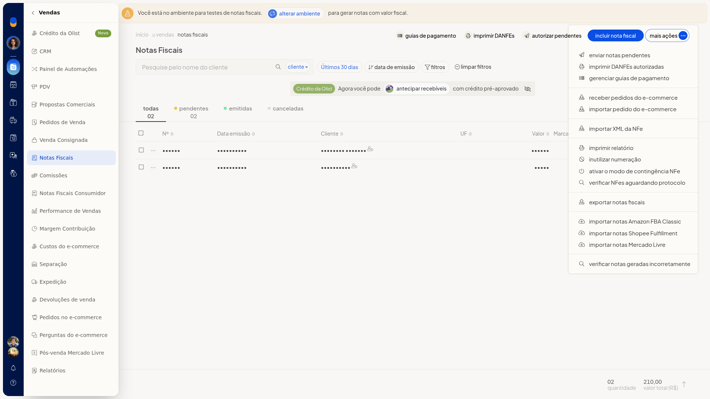
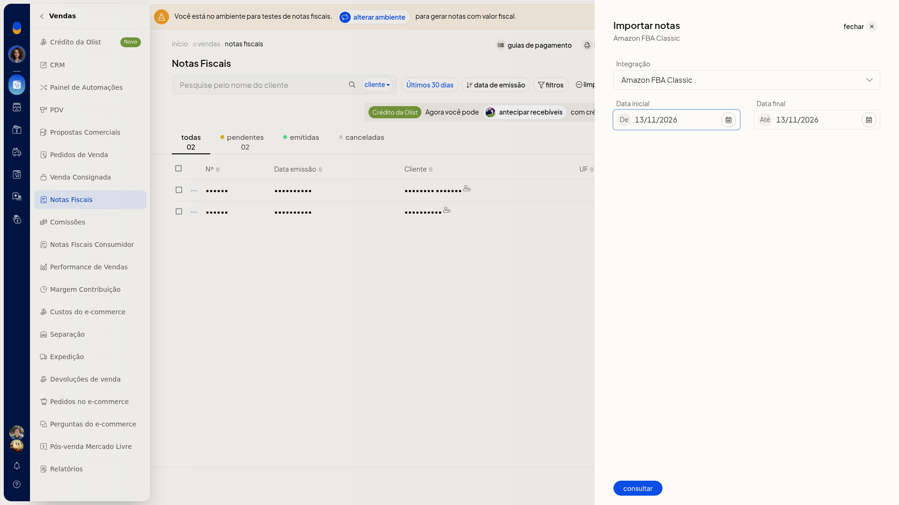

# Importar notas do Amazon FBA Classic

No ERP da Olist, você consulta as notas do Amazon FBA Classic a partir de Notas Fiscais. A consulta usa a integração já conectada e um período.

O painel traz a conta e as datas para você disparar a consulta.

## Pré-requisitos
- A integração do Amazon FBA Classic já precisa estar conectada. Em **Integração**, aparecem somente as contas conectadas.
- Se a opção não aparecer para você, peça acesso ao administrador da conta.

## Instruções
1. Acesse **Vendas > Notas Fiscais**.
2. Abra **Mais ações > Importar notas Amazon FBA Classic**.

   

3. Em **Integração**, confira a opção **Amazon FBA Classic**.
4. Confira **De** e **Até**. Os dois campos abrem com a data do dia. Ajuste o período, se precisar.

   

5. Clique em **consultar** para consultar as notas do período.
