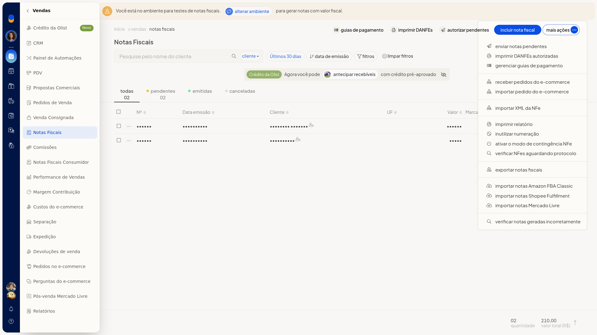
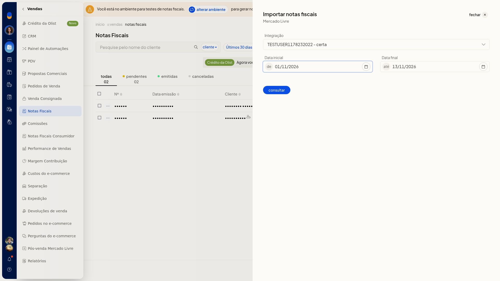

# Importar notas do Mercado Livre

## Pré-requisitos
- A integração do Mercado Livre já precisa estar conectada. Em **Integração** aparecem somente as contas conectadas.

## Instruções
1. Acesse **Vendas > Notas Fiscais**.
2. Abra **Mais ações > Importar notas Mercado Livre**.

   

3. Selecione a conta em **Integração**. O campo não é obrigatório e não permite digitar uma conta nova.
4. Confira **Data inicial** e **Data final**. Os dois campos não são obrigatórios, abrem preenchidos e usam o formato DD/MM/AAAA. O painel também traz o campo **Notas Fiscais**.

   

5. Clique em **consultar** para consultar as notas da conta no período informado. Para voltar à lista sem consultar, feche o painel.

## Informações adicionais
- **Integração** lista somente contas do Mercado Livre já conectadas.
