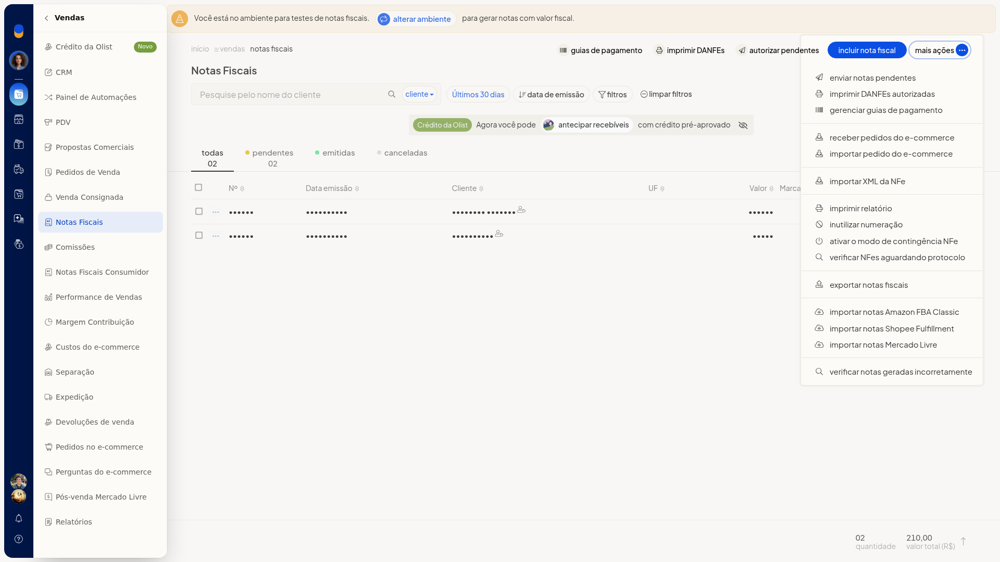
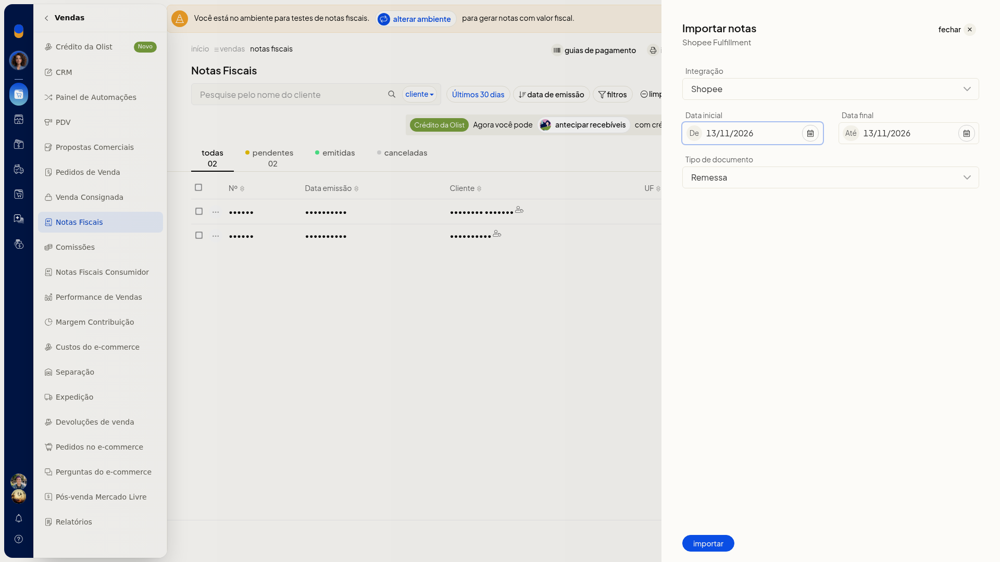

# Importar notas do Shopee Fulfillment

## Pré-requisitos
- A integração Shopee precisa estar conectada. O campo **Integração** lista somente contas já conectadas e não permite digitar uma conta nova.

## Instruções
1. Acesse **Vendas > Notas Fiscais**.
2. Clique em **Mais ações** e depois em **Importar notas Shopee Fulfillment**.

   

3. Em **Integração**, selecione a conta Shopee já conectada. O campo não é obrigatório.
4. Confira **De** e **Até**. Os dois campos abrem com a data do dia.
5. Em **Tipo de documento**, selecione **Remessa**, **Devolução**, **Retorno simbólico**, **Venda** ou **Remessa simbólica**. O campo não é obrigatório e abre em **Remessa**. A importação fica definida pela conta, pelo período e pelo tipo de documento.

   
