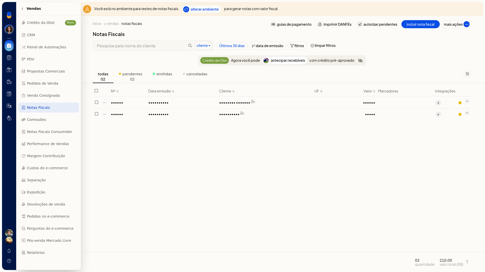
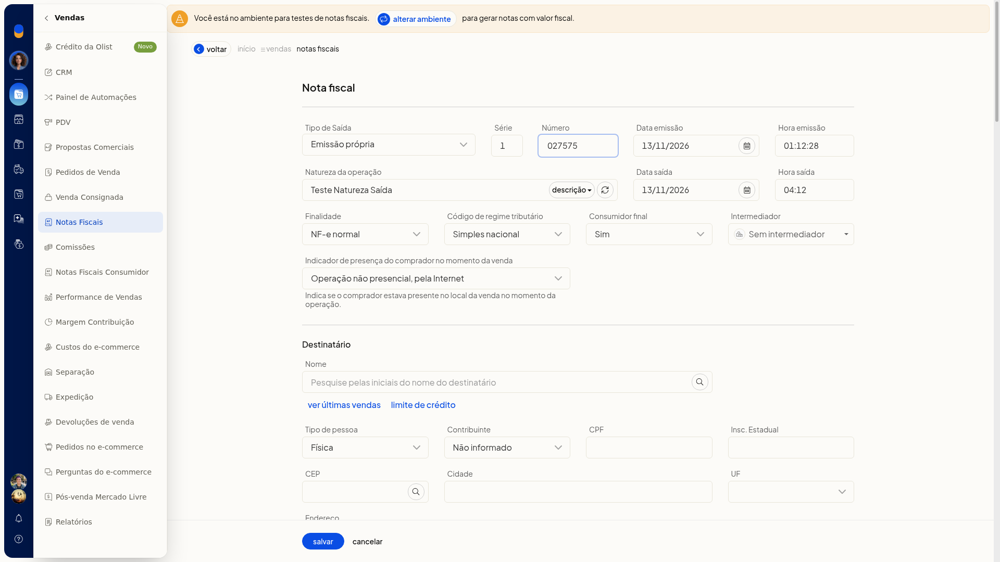
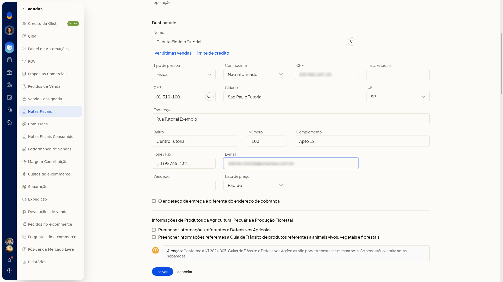
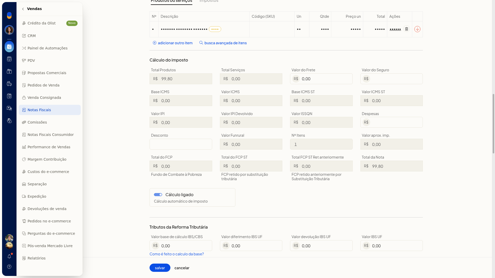
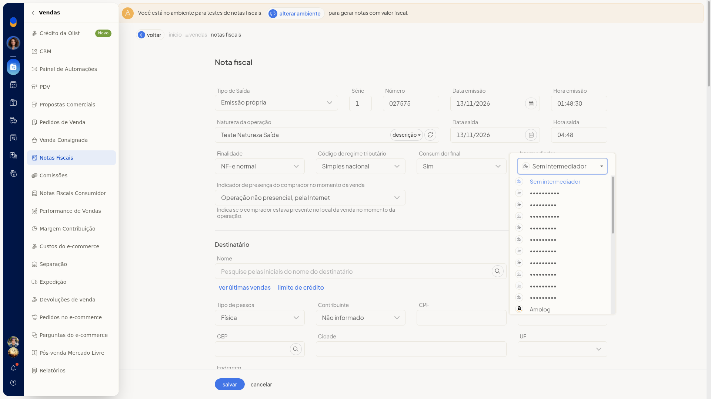
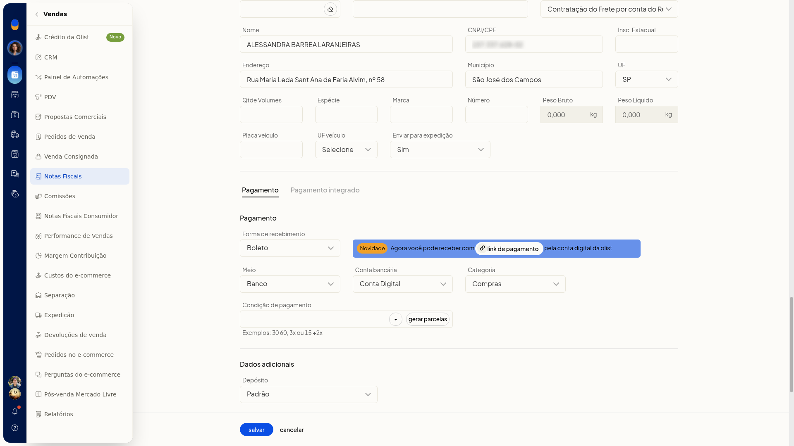
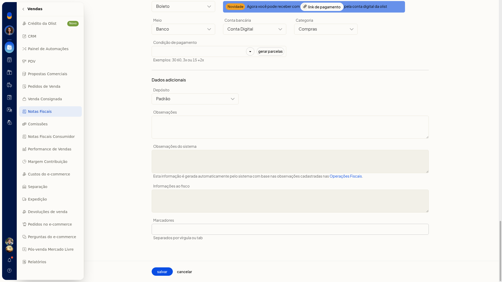

# Incluir nota fiscal manualmente

No ERP da Olist, você inclui uma nota fiscal manualmente quando a venda não parte de um pedido. No formulário, você escolhe o tipo de saída e a finalidade, informa o destinatário e os itens e completa intermediador, transporte e pagamento.

A inclusão fica em **Vendas > Notas Fiscais**.

## Importante
- Defensivos agrícolas e a guia de trânsito de produtos referentes a animais vivos, vegetais e florestais não podem constar na mesma nota.

## Instruções
1. Acesse **Vendas > Notas Fiscais**.
2. Clique em **Incluir nota fiscal**.

   

3. Revise o que já vem selecionado: **Tipo de Saída** em Emissão própria, **Finalidade** em NF-e normal, **Código de regime tributário** em Simples nacional, **Consumidor final** em Sim e **Indicador de presença do comprador no momento da venda** em Operação não presencial, pela Internet.
4. Confira também **Tipo de pessoa** em Física, **Contribuinte** em Não informado e **Lista de preço** em Padrão. **Série**, **Número**, **Data emissão**, **Hora emissão**, **Natureza da operação**, **Data saída** e **Hora saída** já vêm preenchidos. Se alterar uma data, use o formato dd/mm/aaaa. **Cálculo automático de imposto** vem marcado.

   

5. Informe o destinatário em **Nome**, **Tipo de pessoa**, **Contribuinte**, **CPF**, **Insc. Estadual**, **CEP**, **Cidade**, **UF**, **Endereço**, **Bairro**, **Número**, **Complemento**, **Fone / Fax** e **E-mail**.
6. Preencha **Vendedor**, se precisar, e marque **O endereço de entrega é diferente do endereço de cobrança** quando a entrega não for no endereço de cobrança.

   

7. Inclua o item com **Produto**, **UN**, **Qtde** e **Preço un**. Com **Cálculo automático de imposto** marcado, os totais de imposto são calculados na tela.

   

8. Em **Intermediador**, mantenha **Sem intermediador** ou selecione um intermediador já cadastrado. Para cadastrar outro, clique em **Adicionar intermediador**.

   

9. Ajuste o transporte, se precisar, em **Forma de envio**, **Forma de frete**, **Código de rastreamento** e **URL de rastreamento**. **Forma de envio** lista as formas configuradas na conta. A **URL de rastreamento** é gerada ao concluir a expedição.
10. Se for lançar o pagamento, use **gerar parcelas** ou **link de pagamento**. Na seção de dados adicionais, use **Preencher informações referentes a Defensivos Agrícolas** ou **Preencher informações referentes a Guia de Trânsito de produtos referentes a animais vivos, vegetais e florestais** somente quando a nota exigir. A nota fica preenchida na tela, com os totais recalculados, e ainda não é gravada. **Cancelar** volta à lista sem gravar.

   

   

## Informações adicionais
Os campos do formulário de inclusão não são obrigatórios.

### Opções do cabeçalho

- **Tipo de Saída**: Emissão própria, Exportação, Emitida por terceiros e XML de NFe.
- **Finalidade**: NF-e normal, NF-e complementar, NF-e de ajuste, Devolução, Nota de débito, NFe com cupom referenciado, NFe com chave de acesso referenciada e NF-e normal - pagamento antecipado.
- **Código de regime tributário**: Simples nacional, Simples nacional - excesso de sublimite de receita bruta, Regime normal e Microempreendedor Individual (MEI).
- **Consumidor final**: Selecione, Sim e Não.
- **Tipo de pessoa**: Jurídica, Física, Estrangeiro e Estrangeiro no Brasil.
- **Contribuinte**: Não informado; Contribuinte ICMS; Contribuinte isento de Inscrição no cadastro de Contribuintes do ICMS; Não Contribuinte, que pode ou não possuir Inscrição Estadual no Cadastro de Contribuintes do ICMS.
- **Lista de preço**: lista as tabelas cadastradas na conta. A opção exibida por padrão é Padrão.

### Presença do comprador

**Indicador de presença do comprador no momento da venda** indica se o comprador estava presente no local da venda no momento da operação. As opções são:

- Não se aplica (por exemplo, Nota Fiscal complementar ou de ajuste)
- Operação presencial
- Operação não presencial, pela Internet
- Operação não presencial, Teleatendimento
- Operação presencial, fora do estabelecimento
- Operação não presencial, outros
