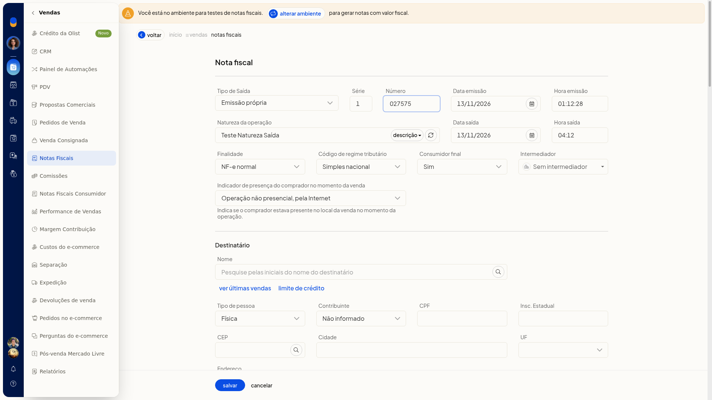
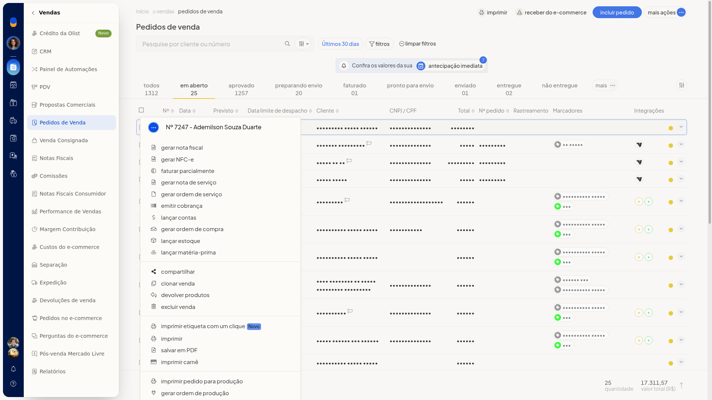
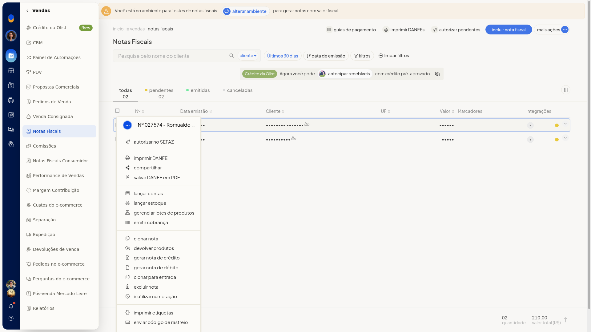

# Tipos de documentos fiscais do ERP

No ERP da Olist, o tipo do documento fiscal é escolhido no formulário da nota, em **Vendas > Notas Fiscais**. Com **Tipo de Saída** e **Finalidade**, você indica a origem da emissão e o objetivo da nota.

## Instruções
1. Acesse **Vendas > Notas Fiscais**.
2. Clique em **Incluir nota fiscal**. O formulário abre com **Tipo de Saída** em **Emissão própria** e **Finalidade** em **NF-e normal**.

   

3. Em **Tipo de Saída**, selecione uma opção:
 - **Emissão própria**
 - **Exportação**
 - **Emitida por terceiros**
 - **XML de NFe**
4. Em **Finalidade**, selecione uma opção. O formulário permanece aberto para você continuar o preenchimento da nota.
 - **NF-e normal**
 - **NF-e complementar**
 - **NF-e de ajuste**
 - **Devolução**
 - **Nota de débito**
 - **NFe com cupom referenciado**
 - **NFe com chave de acesso referenciada**
 - **NF-e normal - pagamento antecipado**

## Informações adicionais
### Outros documentos no pedido e na nota

No menu **•••** do pedido de venda, além de **Gerar nota fiscal**, aparecem **Gerar NFC-e** e **Gerar nota de serviço**.

No menu **•••** da nota, aparecem **Gerar nota de crédito** e **Gerar nota de débito**.

