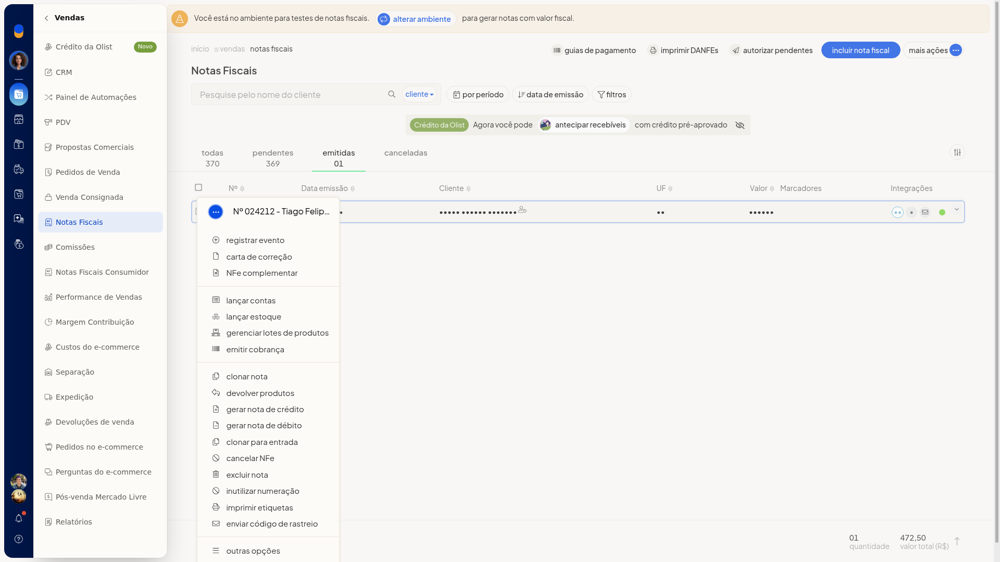
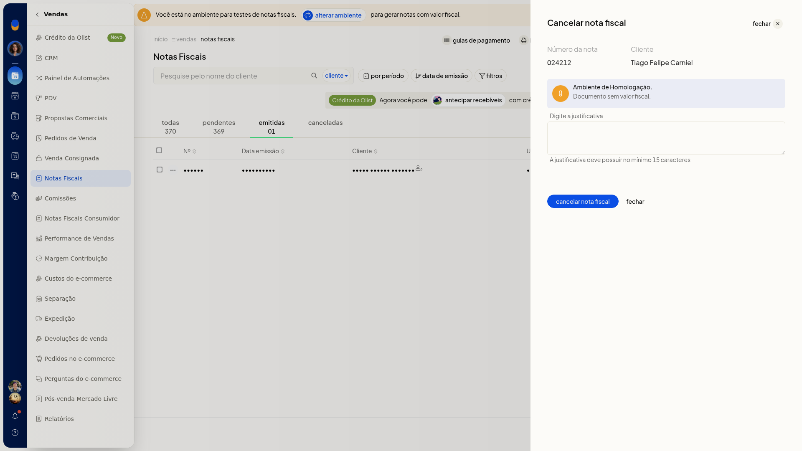
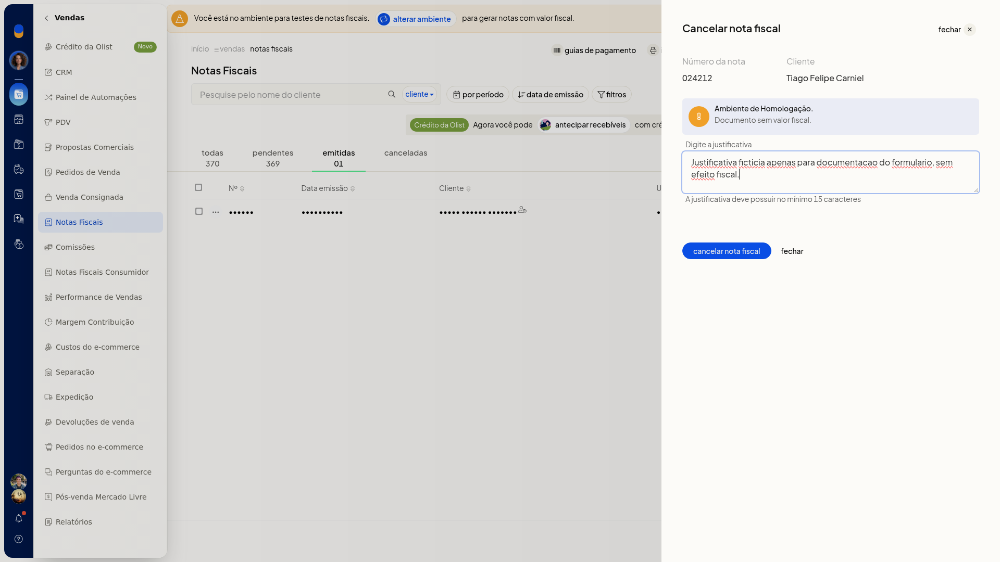

# Cancelar nota fiscal

## Importante
- **Cancelar NFe** aparece no menu da nota emitida. Na nota pendente, essa opção não aparece.
- A justificativa precisa ter no mínimo 15 caracteres.

## Instruções
1. Acesse **Vendas > Notas Fiscais**.
2. Localize a nota emitida. Use a aba **Emitidas** para separar essas notas das pendentes.
3. Na linha da nota, abra o menu de ações.

   

4. Clique em **Cancelar NFe**.

   

5. Digite a justificativa com no mínimo 15 caracteres.

   
