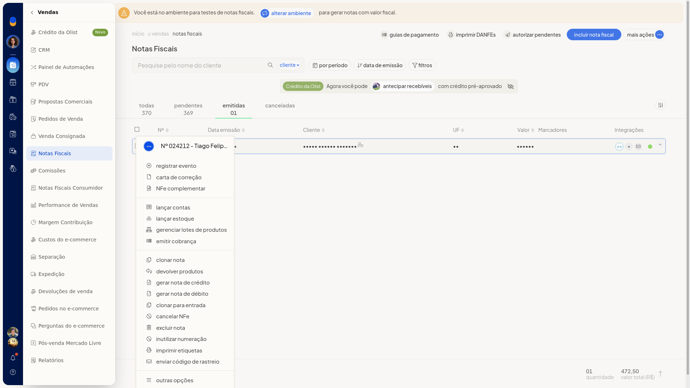
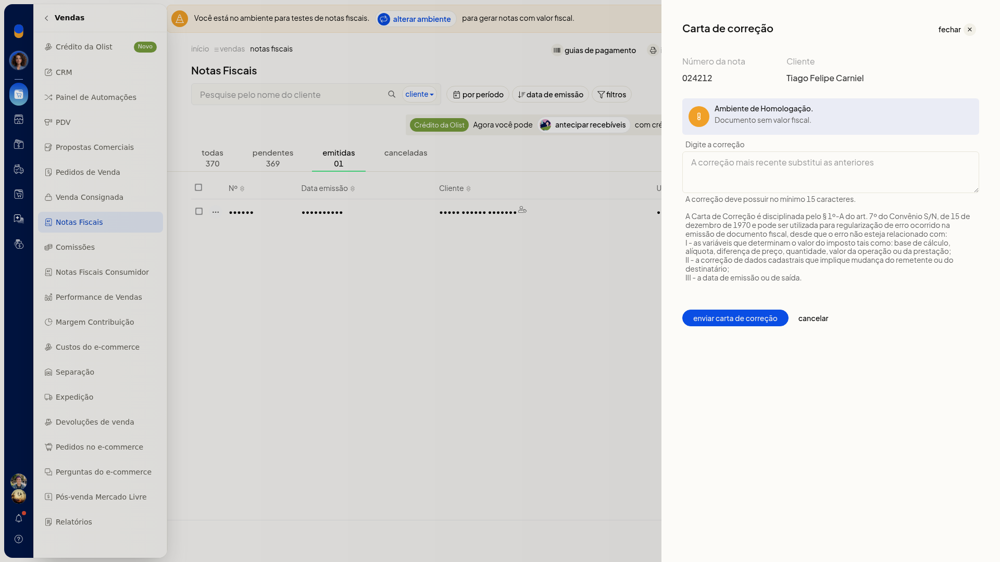
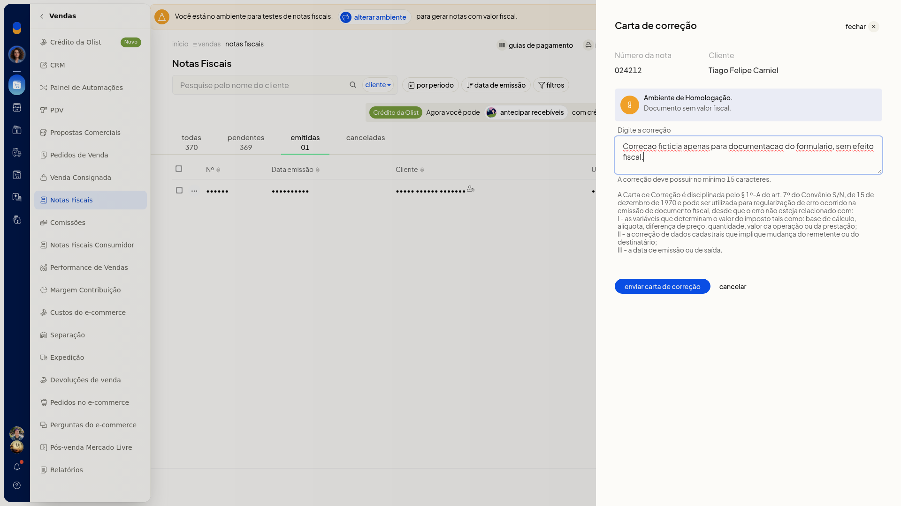

# Carta de correção (CC-e)

## Importante
- **Carta de correção** aparece no menu da nota emitida. Na nota pendente, a opção não aparece.
- O texto da correção precisa ter no mínimo 15 caracteres.
- A correção mais recente substitui a anterior.

## Instruções
1. Acesse **Vendas > Notas Fiscais**.
2. Na linha da nota emitida, abra o menu de ações e escolha **Carta de correção**.

   

3. Informe o texto da correção, com no mínimo 15 caracteres.

   

4. Clique em **Cancelar** para sair sem enviar a carta. O evento não é registrado.

   
