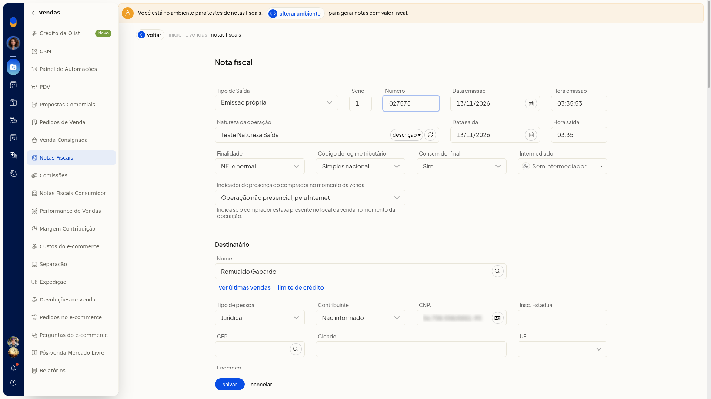

# Clonar notas e enviar dados fiscais

No ERP da Olist, **Clonar nota** abre uma nova inclusão já preenchida com os dados da nota de origem. Você revisa esses dados no formulário e pode descartar a cópia sem gravá-la.

## Instruções
1. Acesse **Vendas > Notas Fiscais**.
2. Abra o menu de ações da linha da nota.
3. Clique em **Clonar nota**. O formulário de inclusão abre já preenchido com os dados da nota de origem.

   

4. Clique em **Cancelar**. A cópia não é gravada e você volta à lista.

## Informações adicionais
### Outras ações no menu da linha

No mesmo menu da linha também aparecem **Clonar para entrada**, **Devolver produtos** e **Gerar nota de crédito/débito**.
