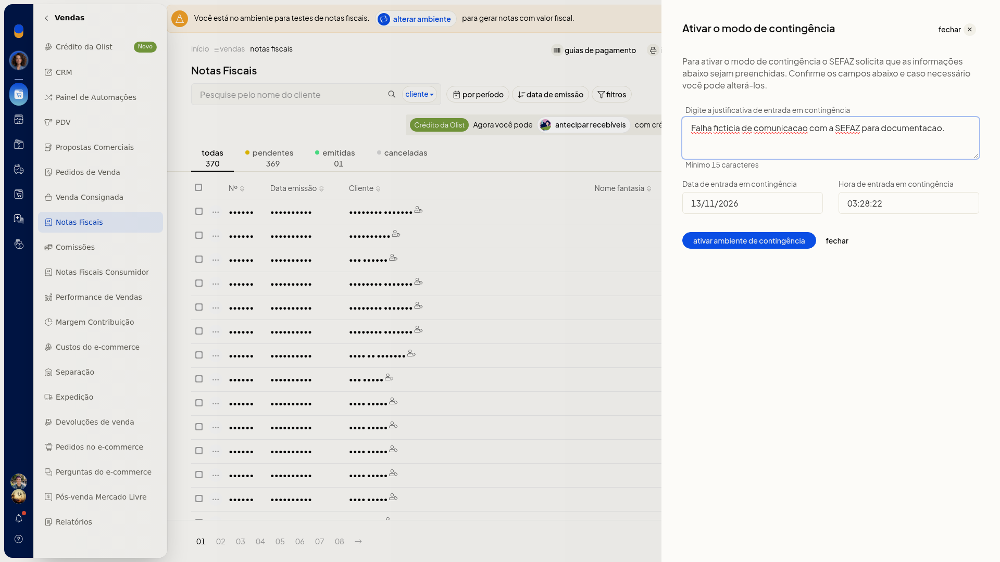

# Emissão em contingência

Em **Vendas > Notas Fiscais**, você abre o modo de contingência da NFe e informa a justificativa antes de ativar o ambiente.

## Importante
- A justificativa precisa ter no mínimo 15 caracteres.
- A data e a hora já vêm preenchidas.

## Instruções
1. Acesse **Vendas > Notas Fiscais**.
2. Abra **Mais ações** e escolha **Ativar o modo de contingência NFe**.

   

3. Preencha a justificativa.

   

4. Clique em **ativar ambiente de contingência**. Para sair sem ativar, clique em **fechar**.
