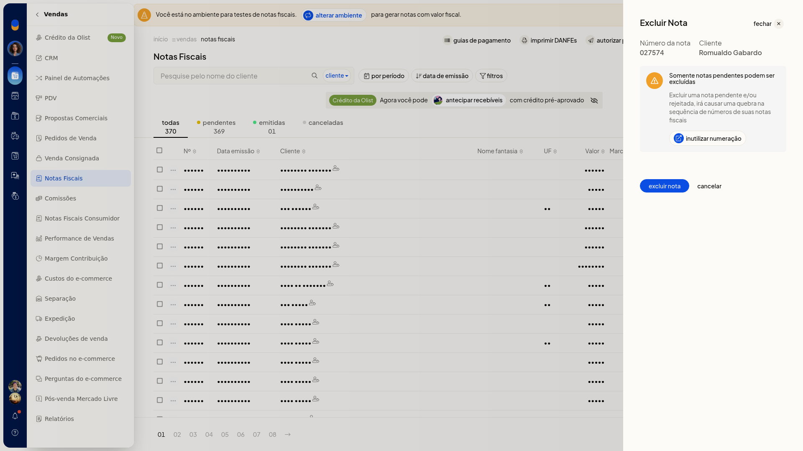

# Excluir notas fiscais

## Importante
- Só notas pendentes podem ser excluídas.
- Excluir nota pendente ou rejeitada quebra a numeração.
- O diálogo traz um link para inutilizar numeração.

## Instruções
1. Acesse **Vendas > Notas Fiscais**.
2. Na linha da nota pendente, abra o menu de ações e clique em **Excluir nota**.

   

3. Clique em **excluir nota** para confirmar. Para manter a nota, clique em **cancelar**.
