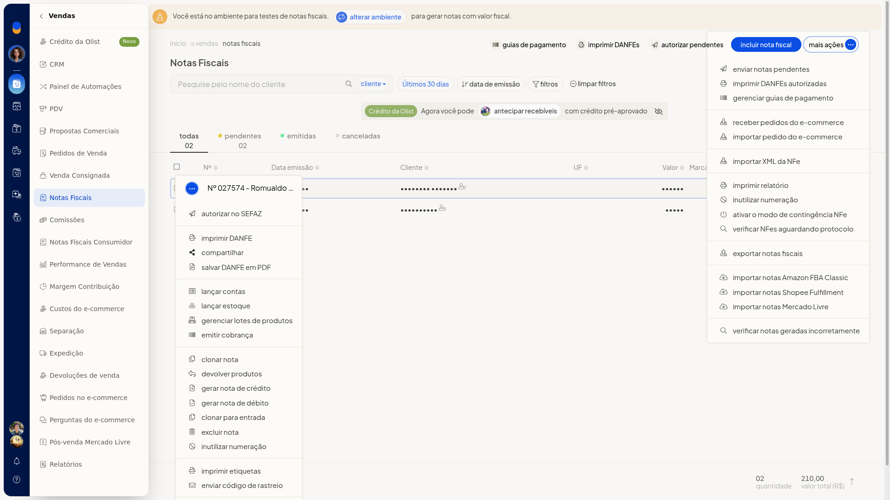
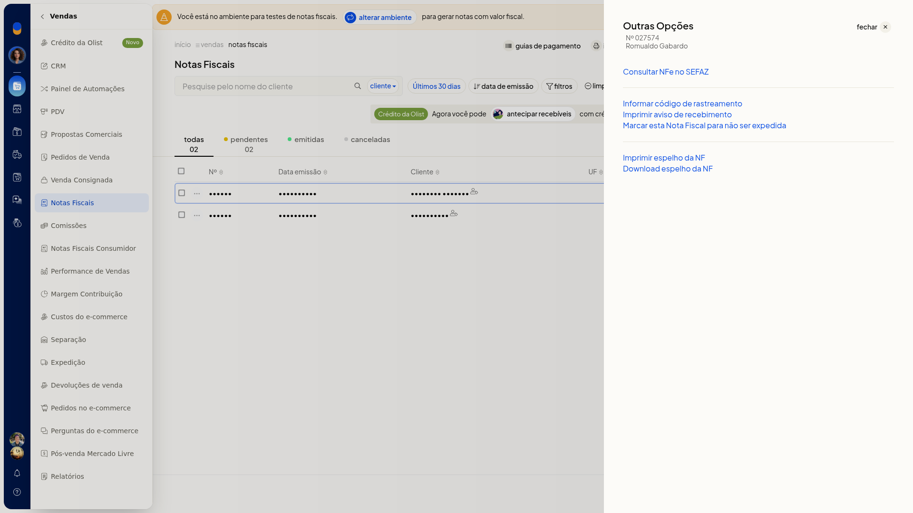
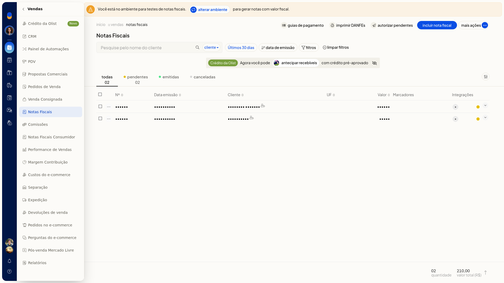
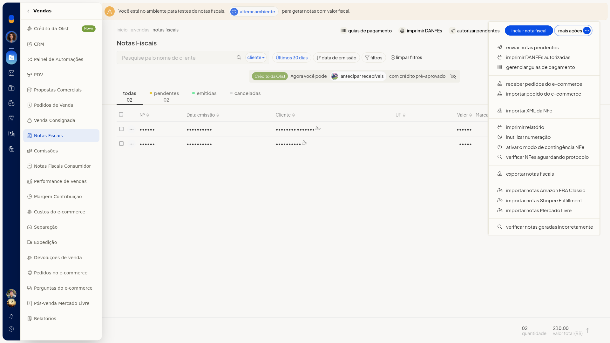
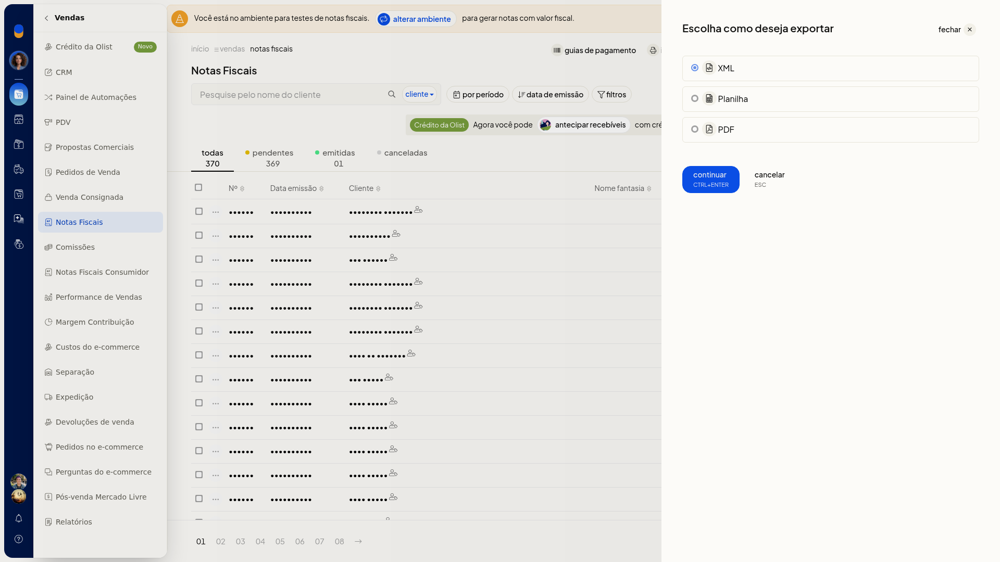
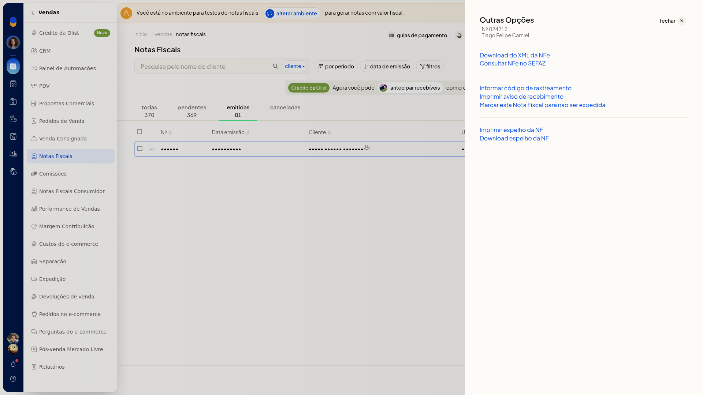

# Exportar e baixar XML

## Importante
- **Download do XML da NFe** aparece em **Outras opções** da nota emitida. Na nota pendente, essa opção não aparece.

## Instruções
### Exportar pela lista

1. Acesse **Vendas > Notas Fiscais**.

   

2. Abra **Mais ações** e escolha **Exportar notas fiscais**.

   

3. No diálogo, selecione **XML**. Os outros formatos do diálogo são **Planilha** e **PDF**.

   

### Baixar o XML de uma nota emitida

1. Acesse **Vendas > Notas Fiscais**.
2. Na linha da nota emitida, abra o menu de ações e entre em **Outras opções**.

   

3. Clique em **Download do XML da NFe** para baixar o XML dessa nota.
