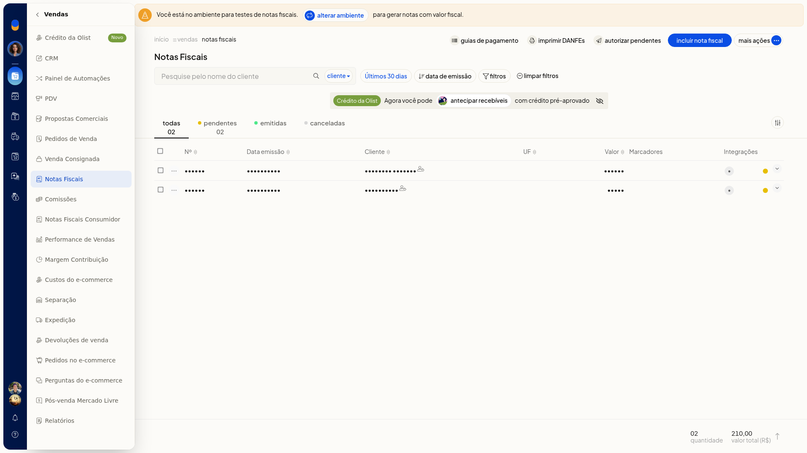
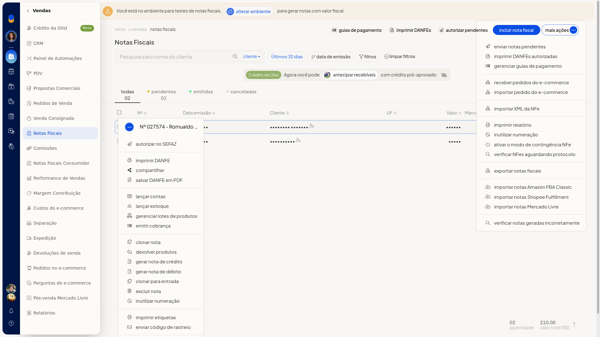
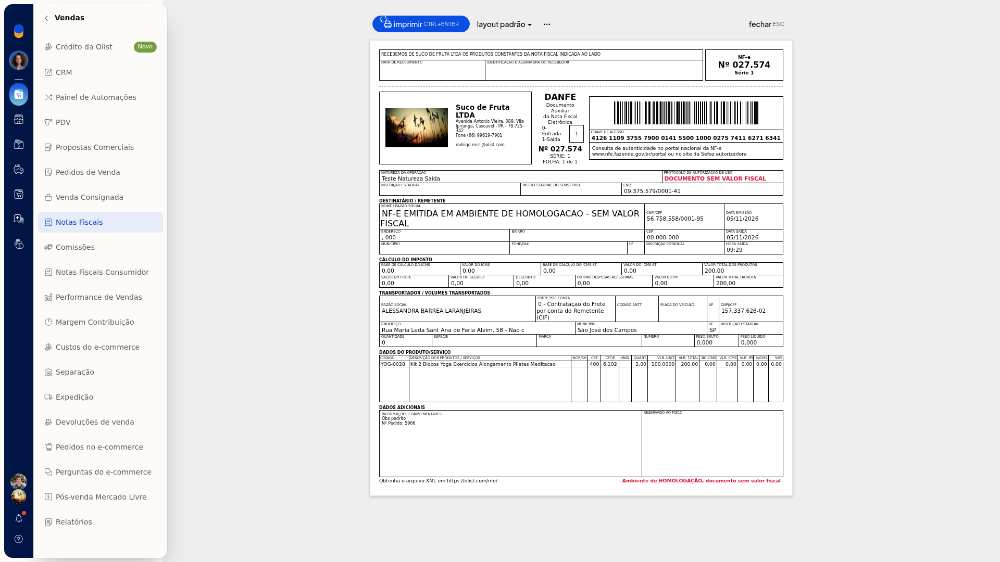
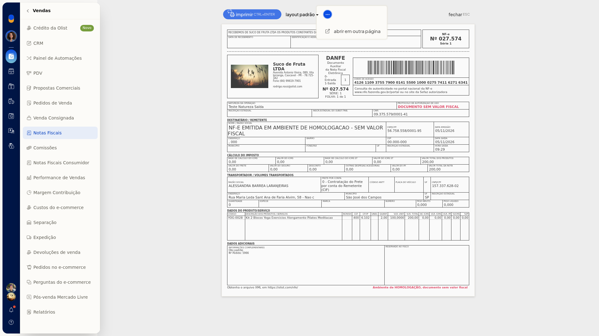
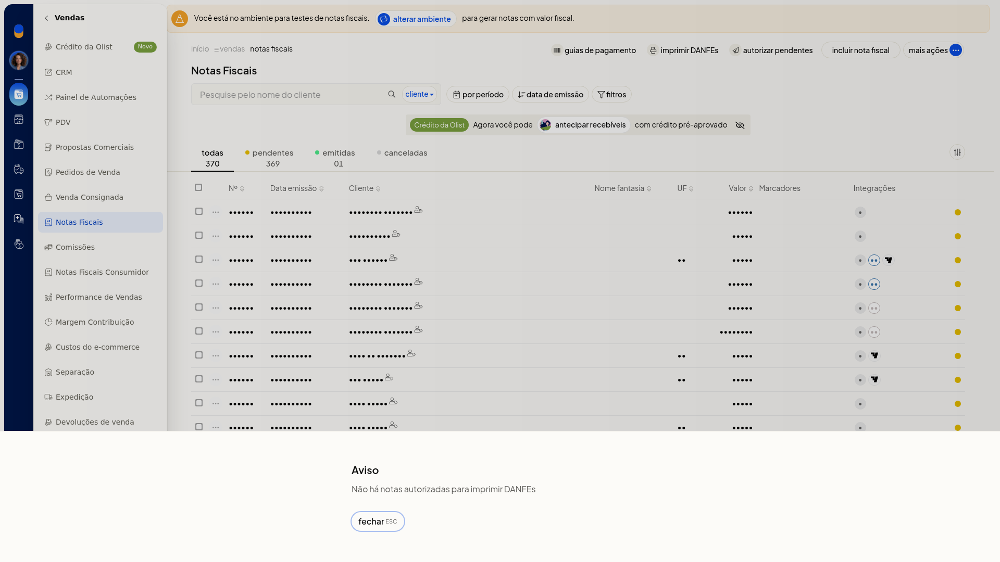

# Imprimir DANFE

No ERP da Olist, você imprime a DANFE de uma nota em **Vendas > Notas Fiscais**, troca o layout e abre o documento em outra página. A impressão em lote avisa quando não há nota autorizada.

## Importante
- A impressão em lote só segue quando existem DANFEs autorizadas. Sem nota autorizada, a tela mostra **Não há notas autorizadas para imprimir DANFEs** e nenhuma DANFE é impressa.

## Instruções
### Pela nota

1. Acesse **Vendas > Notas Fiscais**.

   

2. Na linha da nota, abra o menu de ações.

   

3. Clique em **Imprimir DANFE**.
4. No preview, selecione o layout **Padrão**, **Simplificado** ou **etiqueta**.

   

   

5. Para abrir a DANFE em outra página, clique em **Mais ações** e depois em **Abrir em outra página**.

   

6. Clique em **Imprimir** para imprimir a DANFE. Para sair sem imprimir, clique em **Fechar**.

### Em lote

1. Acesse **Vendas > Notas Fiscais**.
2. Clique em **Imprimir DANFEs**.
3. Ou abra **Mais ações** e clique em **Imprimir DANFEs autorizadas**.

   

4. Se não houver nota autorizada, a tela mostra **Não há notas autorizadas para imprimir DANFEs**. Feche o aviso para permanecer na lista, sem imprimir DANFE.

   

## Resultado
O preview da DANFE abre com **Imprimir**, o seletor de layout e **Fechar**. Na impressão em lote sem nota autorizada, você permanece na lista.

## Informações adicionais
- O menu de ações da linha também oferece **Salvar DANFE em PDF**.
