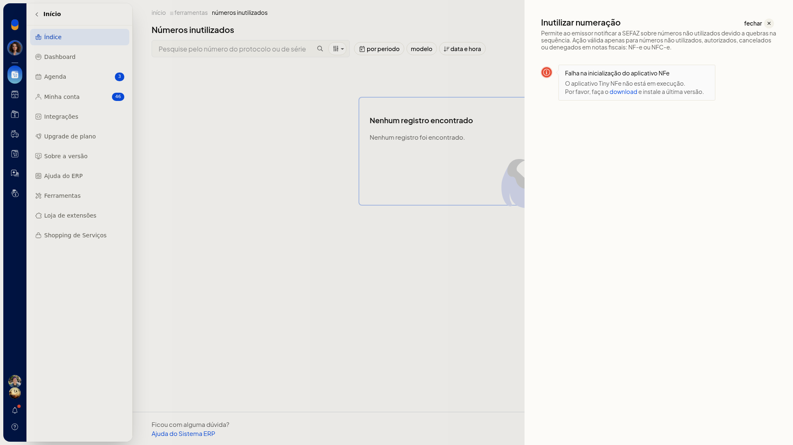
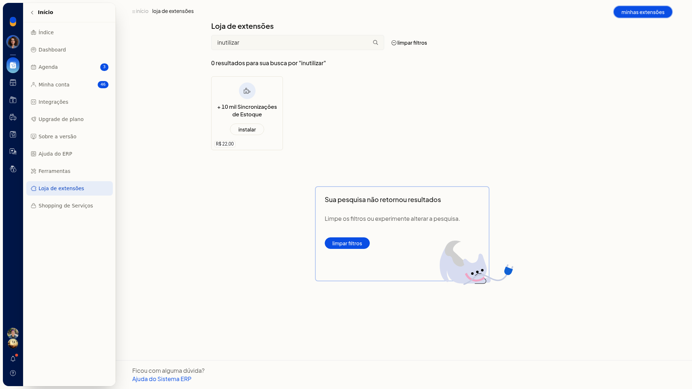
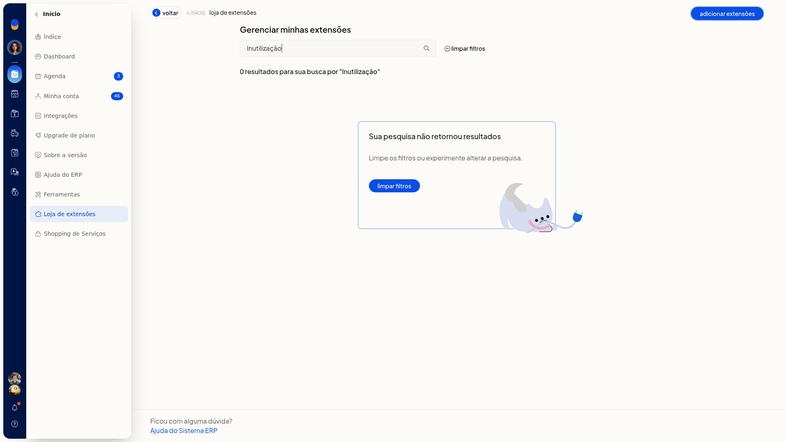
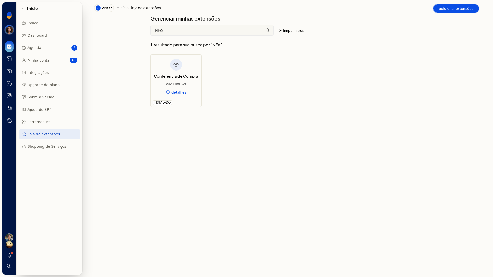

# Inutilizar numeração

## Importante
- Se a tela informar que o **Tiny NFe** não está em execução, não há formulário para preencher. Use o link de download indicado na tela e deixe o serviço em execução antes de inutilizar.
- Um aviso lateral da tela trata da SEFAZ.

## Instruções
1. Acesse **Vendas > Notas Fiscais**.
2. Abra **Mais ações** e selecione **Inutilizar numeração**. Você também pode abrir o menu da linha da nota pendente ou emitida e escolher **Inutilizar numeração**.

   

3. Consulte a lista de números inutilizados. Ela pode abrir com a mensagem **Nenhum registro encontrado**. Na mesma tela estão os botões **Relatório de numeração**, **inutilizar numeração** e **Mais ações**.

   

4. Use os filtros de protocolo/série, período, modelo e data e hora para localizar os registros. Com o **Tiny NFe** em execução, o formulário de inutilização fica disponível nessa tela.

## Resultado
Você permanece na consulta de numerações inutilizadas, com o botão **inutilizar numeração**. Enquanto o **Tiny NFe** não estiver em execução, a inutilização não é enviada.

## Informações adicionais
### A inutilização não é instalada pela loja

A busca por Inutilização de NFe ou por inutilizar em **Início > Loja de extensões** não retorna resultado. Em **Minhas extensões**, a busca por Inutilização também não retorna item. O caminho é a própria tela de notas fiscais.

### Excluir nota pendente pode quebrar a numeração

No diálogo de exclusão de nota pendente, a tela informa que só notas pendentes podem ser excluídas e que excluir nota pendente ou rejeitada quebra a numeração. O mesmo diálogo traz link para inutilizar numeração.
