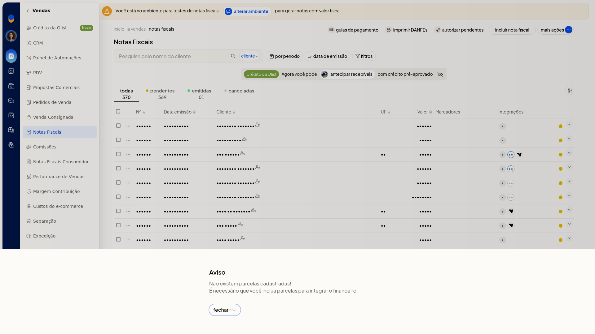
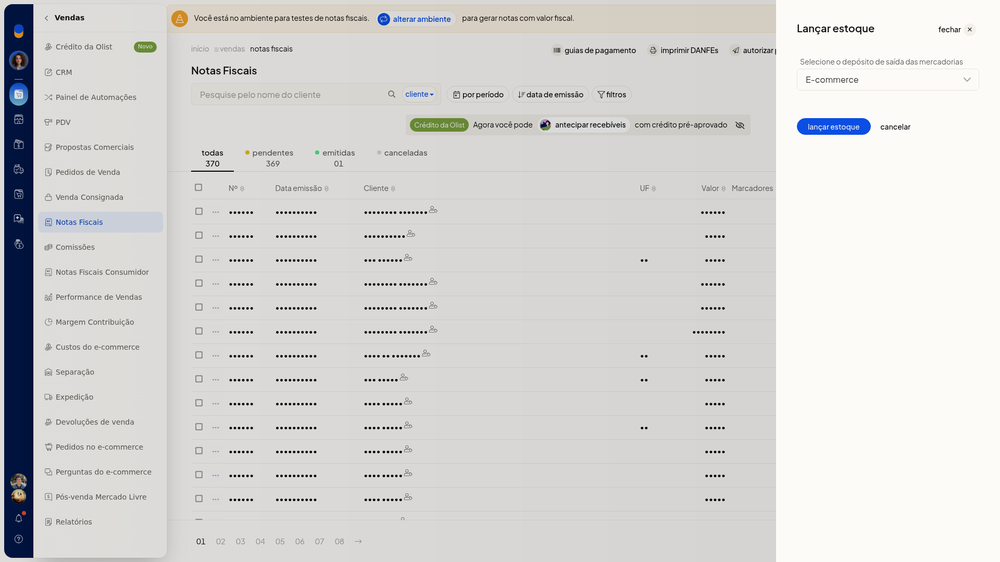

# Lançar contas e estoque pela nota

## Importante
- Para lançar contas, a nota precisa ter parcelas. Sem parcelas, a tela mostra **Não existem parcelas cadastradas** e informa que o financeiro não pode ser integrado.

## Instruções
### Lançar contas

1. Acesse **Vendas > Notas Fiscais**.
2. No menu de ações da linha da nota, clique em **Lançar contas**.
3. Se não houver parcelas, leia o aviso **Não existem parcelas cadastradas** e feche-o. Nenhuma conta é lançada e você permanece na lista.

   

### Lançar estoque

1. Acesse **Vendas > Notas Fiscais**.
2. No menu de ações da linha da nota, clique em **Lançar estoque**.
3. Selecione o depósito de saída entre os depósitos já cadastrados.

   

4. Clique em **lançar estoque** para seguir com o lançamento, ou em **cancelar** para voltar sem movimentar o estoque.
