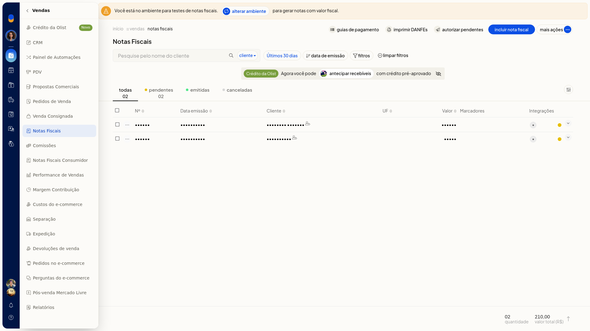
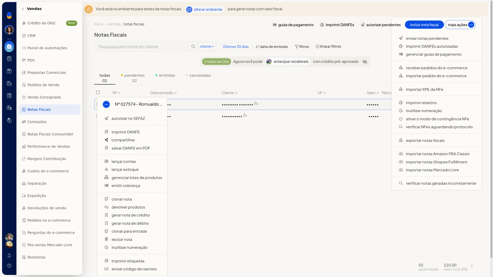
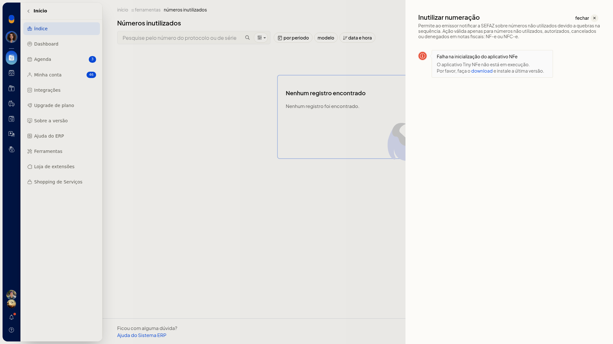
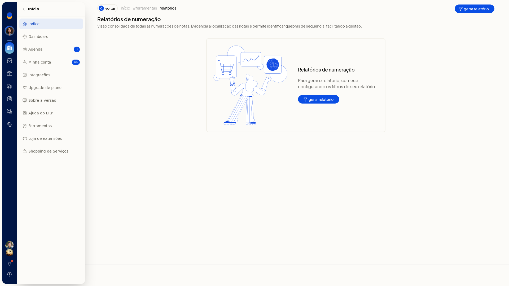
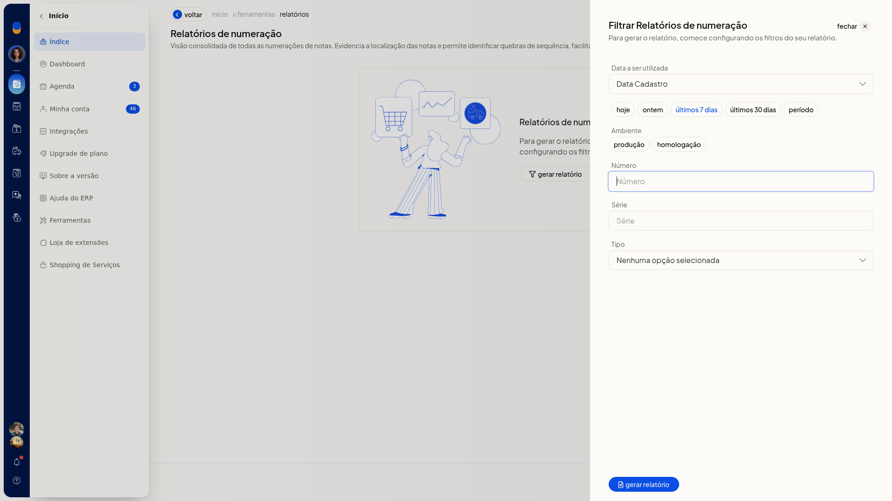
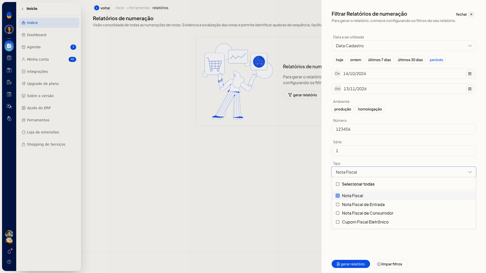

# Lista de notas fiscais e relatório de numeração

## Importante
- Se a tela de inutilização informar que o **Tiny NFe** não está em execução, o formulário para inutilizar número não fica disponível. O botão **Relatório de numeração** permanece nessa tela.

## Instruções
### Consultar a lista de notas fiscais

1. Acesse **Vendas > Notas Fiscais**.

   

2. Clique na aba **Todas**, **Pendentes**, **Emitidas** ou **Canceladas** para separar as notas pela situação.
3. Filtre pelo cliente e pela data de emissão. O período inclui **Últimos 30 dias**. Para voltar à lista sem filtro, clique em **limpar filtros**.
4. Na linha da nota, abra o menu de ações para escolher a operação daquela nota.

   

5. No topo da lista, use **Imprimir DANFEs**, **Autorizar pendentes**, **Incluir nota fiscal** ou **Mais ações**.
6. Abra **Mais ações** para ver as operações da lista: **Enviar notas pendentes**, **Imprimir DANFEs autorizadas**, gerenciar guias de pagamento, **Receber/Importar pedido do e-commerce**, **Importar XML da NFe**, **Imprimir relatório**, **Inutilizar numeração**, **Ativar o modo de contingência NFe**, **Verificar NFes Aguardando protocolo**, **Exportar notas fiscais**, **Importar notas Amazon FBA Classic**, **Shopee Fulfillment**, **Mercado Livre** e **Verificar notas geradas incorretamente**. Você localiza a nota e escolhe a operação na lista ou na linha.

   

### Gerar o relatório de numeração

1. Acesse **Vendas > Notas Fiscais**.
2. Abra **Mais ações** e clique em **Inutilizar numeração**. A mesma opção também está no menu da linha, na nota pendente e na nota emitida.

   

3. Clique em **Relatório de numeração**. Se não houver registro, a tela mostra **Nenhum registro encontrado**.

   

4. Clique em **gerar relatório**. O filtro abre, ainda sem arquivo.

   

5. Escolha o critério de data (**Data Cadastro** ou **Data Emissão**), o período, o **Ambiente**, o **Número**, a **Série** e o **Tipo**. Nenhum desses campos é obrigatório. Em **Ambiente**, as opções são produção e homologação. Em **Tipo**, as opções são **Selecionar todas**, **Nota Fiscal**, **Nota Fiscal de Entrada**, **Nota Fiscal de Consumidor** e **Cupom Fiscal Eletrônico**. O filtro fica pronto para gerar o relatório.

   

## Resultado
A lista fica em **Vendas > Notas Fiscais**, separada pelas abas **Todas**, **Pendentes**, **Emitidas** e **Canceladas**. O relatório de numeração abre o filtro com os critérios que você escolheu.

## Informações adicionais
### O menu da linha muda conforme a situação da nota

- Na nota pendente, o menu não traz **Cancelar NFe**, **Carta de correção** nem **Download do XML da NFe**.
- Na nota emitida, o menu traz **Carta de correção** e **Cancelar NFe**. Em **Outras opções**, aparece **Download do XML da NFe**.
